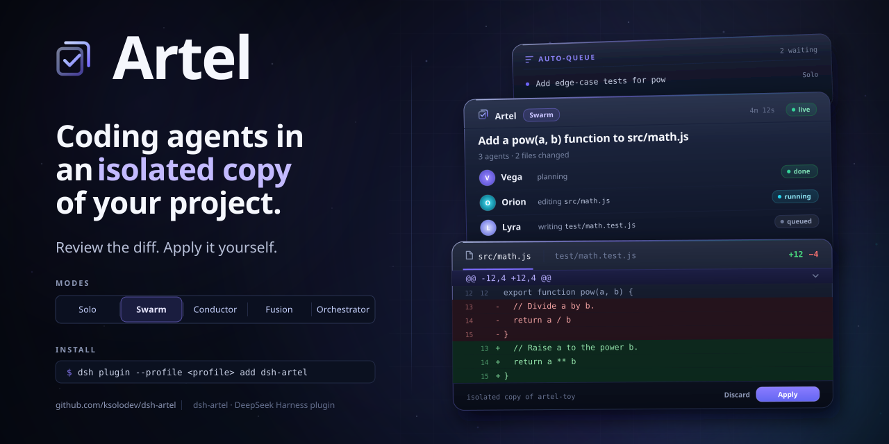
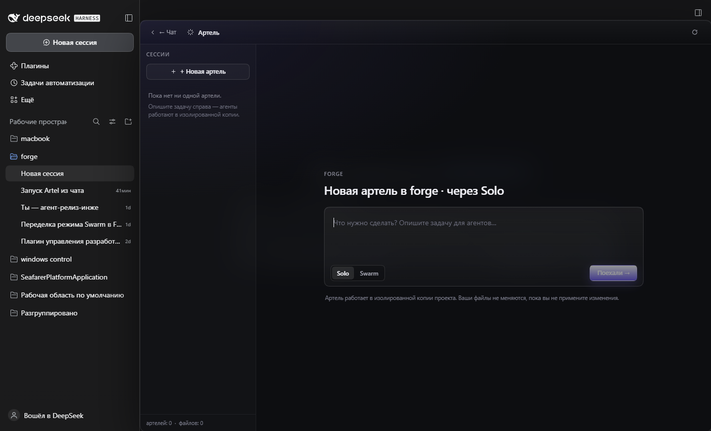
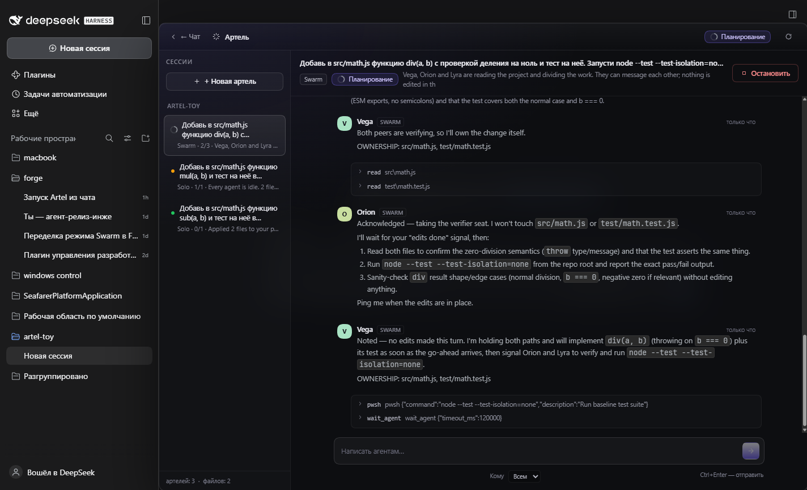
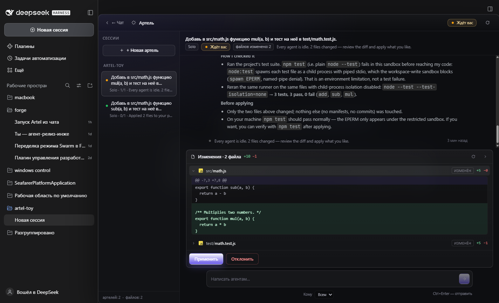

# dsh-artel

[](https://www.npmjs.com/package/dsh-artel)
[](https://github.com/ksolodev/dsh-artel/actions/workflows/ci.yml)
[](LICENSE)



Run a development task in an isolated copy of your project, watch the work as it happens, review the
diff line by line, then apply it yourself.

Artel is a DeepSeek Harness plugin. It adds a labelled **Artel** chip — the brand mark and the name on
the violet brand surface — to the chat composer tool row, next to **+**; a row narrower than 460px keeps
only the mark. Clicking it covers the current chat with a panel: the session rail of Artel runs on the
left, and either the new-run form or the live run on the right. The chat session's working directory is
the project; Artel never touches it until you apply.



## Install

Artel is a DSH bundle: it installs with the standard plugin CLI and needs no build step.

**From npm**

```sh
dsh plugin --profile <profile> add dsh-artel
```

**From the release tarball** — download `dsh-artel.tgz` from the
[latest release](https://github.com/ksolodev/dsh-artel/releases/latest), then:

```sh
dsh plugin --profile <profile> add C:/path/to/dsh-artel.tgz
```

**From a checkout** — point the plugin CLI at the directory:

```sh
dsh plugin --profile <profile> add C:/path/to/dsh-artel
```

A directory install is recorded as a `link:` dependency, so edits in the checkout are live after a
host reload. In the desktop app you can also use **Settings → Plugins → Install from file** and pick
the `.tgz` or the checkout folder.

After installing, restart DeepSeek Harness (or reload the page, which recomposes the client boot
graph), open a chat session that has a project directory, and click the **Artel** chip in the composer
tool row.
The plugin's host half talks to the client over a loopback-only HTTP API, so the plugin and the host
must run on the same machine.

## How it works

1. **Copy** — Artel copies the project into a fresh directory under your DSH home. `node_modules` is
   linked, not copied, so the agents can still run the project's checks. The real project is not
   touched. Orchestrator mode makes one copy per part instead of one copy for the run.
2. **Agents** — one agent works in the copy in **Solo**; `swarmAgentCount` agents (three by default) share
   one copy and one agent tree in **Swarm**, so they can message each other with
   `send_message`/`list_agents`. The first Swarm turn is planning only: the agents divide the files and
   announce who owns what. **Conductor** puts a lead on top of the same team: one conductor Session with
   the workers as its subagent children; the workers propose the shares, the conductor approves them,
   answers the team without you and accepts the finished copy. **Fusion** asks three models the same
   question in parallel and does not let them see each other: each panel model answers independently in
   read-only mode, a judge model merges the answers into one decision, and a single implementer model
   then does the work. **Orchestrator** takes a goal too big for one agent: a planner splits it into
   independent parts with a written "done when" condition for each, every part is worked in its own copy
   and checked by a reviewer against those conditions, a part that fails goes back to work, and only the
   accepted parts are assembled into one copy — with a merger deciding the files that more than one part
   changed. The agents run unattended: Artel gives them the approval policy `never` and
   inherits the sandbox mode of the chat session (Fusion panels and judges are pinned to `read-only`), so
   a run never stalls on an approval prompt.
3. **Diff** — when every agent goes idle, Artel stops the run and fills the **Changes** card on the run
   page: every changed file with added and removed line counts and a line-by-line diff. In Orchestrator
   mode this happens after every part is accepted and the assembly is finished.
4. **Apply** — you press **Apply** and confirm. It writes every changed file into the project. Before
   writing, Artel checks each file against the state it had when the run started; a file you edited
   during the run is reported and the whole apply is refused, so nothing is half-written. **Discard**
   deletes the copy and changes nothing. After an apply, a project that declares a DSH bundle or its own
   install steps keeps an **Install** block on the card: those are separate explicit clicks that add the
   project to the DSH profile or run the project's installer, and they never happen on their own.

## Five ways to run a task

**Solo** — one agent does the whole task in its own copy of the project. It reads the code, edits the
copy, and runs whatever checks it needs. Use it when the task is small and well understood: fix a
bug, add a screen, change some text.

Write the task the way you would write it to a colleague: what should come out, and where in the
project it lives. The agent finds and reads the files itself.

**Swarm** — `swarmAgentCount` agents (three by default) share one copy and one conversation tree. Their
first turn is a planning turn: they make no edits, they divide the files among themselves and say out
loud who owns what, so that nobody edits the same file. They can also message each other directly: the
team has `send_message`/`list_agents`, so a question, a heads-up or a promise to take an area reaches the
other agents as a real turn, and every such message appears in the shared feed. After the planning
turn they work in parallel, read each other's edits on disk, and Artel flags any file that two agents
touch. Checks run once, against the whole copy.

Use Swarm when the work splits into pieces that do not meet in the same files.

**Conductor** — one conductor and `swarmAgentCount` workers share one copy, like Swarm, but the team has
a lead who answers for the result. It opens with a planning turn: the workers propose a narrow area
each, the conductor approves the layout or reassigns it, and nothing is edited until the shares are
handed out. While the team works, a worker's question goes to the conductor and comes back without
waiting for you, and a worker that stops is replaced: the conductor moves its files to another worker.
When every worker is idle, the conductor reviews the whole copy — it reads the changes, runs the
project's checks and compares the result with the task. If the goal is not closed, it sends the work
back to the named workers, at most twice. Accepted work waits for you like in the other modes: the
**Changes** card shows the diff, and only your **Apply** writes it into your project.

Use Conductor when the shares are easy to mix up and the whole result must be verified before it
reaches you. It needs the subagent stack in the DSH profile; there is no independent-session fallback.

**Fusion** — three models answer the same question independently. The panel gets the task in the same
moment and each model answers in its own read-only conversation: no edits, no messages between the
models, no sight of each other's answers. A separate judge model then reads all three answers and merges
them into one decision — where they agreed, where they disagreed, what only one of them noticed — and a
single implementer model receives that merged decision and does the work. The run page shows five route
pickers (three panel slots, the judge, the implementer), each with its own model and effort; the panel
and the judge are pinned to the read-only sandbox, so the discussion cannot touch a file. Nothing is
written to your project until you press **Apply**.

Use Fusion when the choice is the task itself: which approach to take, how something is better done, a
design question where one model's blind spot is another model's catch. It needs no subagent stack — the
five agents are ordinary sessions.

**Orchestrator** — you describe the goal, the planner splits it. A single planner reads the project and
answers with a plan: `orchestratorParts` independent parts (three by default, at most four), each with a
title, a goal, a "DONE" condition and the files it expects to touch. The plan appears in the feed before
any work, so you see the split first. Then every part gets its own copy of the project and its own agent;
the planner stays read-only, the part agents inherit the sandbox mode of the chat session. As soon as a
part agent finishes, a separate reviewer reads that part's copy and compares it with the written
conditions: the part is either accepted, or sent back to work with the reviewer's problems (at most
twice, then it is accepted with the remarks on record). A part that fails its reviewer never reaches
you. When every part is accepted, the accepted changes are written into one assembled copy; files that
more than one part edited are bundled for a merger agent, which resolves them and is then checked by
Artel itself — an unresolved merge is never applied. From there the run behaves like the other modes:
the **Changes** card shows the assembled diff, and only your **Apply** writes it into your project.

Use Orchestrator when the goal is a direction, not a ten-minute task — a feature that touches several
areas that can move in parallel, where you want each part verified before it reaches you and the whole
result assembled with one button. It needs no subagent stack: the planner, the part agents, the
reviewers and the merger are ordinary sessions.

**Models** — the new-run form picks the provider, model and reasoning effort from the routes the DSH
profile actually advertises, and every agent of the run starts on that route. In Fusion the form has one
route per slot: the panel is pre-seeded with distinct catalog rows and the judge and implementer start
on the profile default. On the run page each agent has its own two pickers, so a member can plan on a
cheap model and edit with a strong one: changing a row reroutes that one agent from its next step (the
running step keeps its route), and a route the Host cannot reach leaves the agent on the profile default
with a warning in the feed.

## Auto-queue — the night shift

Every chat session has a queue. Stack tasks in the **Waiting** column with **Add**: each one is an ordinary
Artel run with its own mode and model — Solo, Swarm, Conductor or Fusion — but it waits its turn instead of
starting at once. The Orchestrator is shown in that picker disabled, with the reason: a queued task starts
from the last saved version, and the Orchestrator cannot start from a saved version yet. The queue belongs
to the session, so another chat has its own; a chat message sent while the queue is running becomes the first
task instead of interrupting the agent.

Flip **Auto-queue** and the stack becomes an unattended night shift. Before the first task the pre-flight
asks you to decide about earlier versions that were never saved or parked, shows the check command and the
task limit, and then the queue takes one task after another. The check command is the project's own: Artel
suggests it from the manifests (**Guessed from the project**) and you can set another one or choose
**Without a check**; the limit is twenty tasks per run by default.

A queue task runs under the night-shift rules, which are repeated to the agent on every turn: fresh worker
per task, nobody will answer, so it makes the smallest reasonable assumption and writes it down instead of
asking. The first question of a task is answered automatically with «decide yourself and record the
assumption»; the second one parks the task. The agent never sends anything outward — no push, pull request,
publish, deploy, tracker comment or message outside the machine — never raises a preview and never starts a
long-running dev server, stays inside its copy, runs the project's checks and finishes with a short summary
of what it changed, checked and assumed.

A finished task must pass the check before it becomes a version (with the check off, it is saved on the
agent's word and marked as such). A failed check sends the output back to
the same worker for a fix, at most twice; a task that still fails is parked. Versions are ordinary Artel
versions: the next task starts from the last successful one, so the queue builds on itself, while the diff
base stays the real project, so applying a later version still shows the whole difference and you review
and apply it exactly like a manual run.

**Parked** is where tasks go when they cannot pass unattended: the check still fails after two fixes, the
diff contains a secret or junk, the agent tries to publish outward, or the agent reports that it is blocked.
A parked task gets a `vf/parked-…`
label, keeps its partial copy and can be returned to the queue to continue from it; the queue itself goes
on with the next task. A subscription limit only pauses the queue and it resumes after the reset; a lost
login ends it.

**Stop** interrupts the agent and parks the partial work, **Finish after the current task** lets the
current task pass its check and then stops, and switching **Auto-queue** off stops taking new tasks. The
queue also ends by itself when it is empty, when the task limit is reached, after three parks in a row,
when the login is lost, or when the disk is nearly full. The **Auto-queue results** card then lists the
saved versions, the parked tasks and the reason the queue stopped.

## Factory — the ticket pipeline

The **Factory** is a ticket board per project, maintained by agents. A board is created for a project and
switched on with **Enable** — only a board that passes **Check readiness** can be enabled — and from then on
it takes tickets and moves them through the pipeline on its own. The board shows seven columns —
**Incoming**, **Triage**, **Working**, **Checks**, **Ready for PR**, **Waiting for you**, **Done** — while
the pipeline behind them has nine stages: `incoming`, `triage`, `working`, `tests`, `check`, `review`,
`ready`, `waiting`, `done` (Checks collapses tests, the app check and review).

A ticket starts in **Incoming**. **Triage** is a read-only agent: it reads the project and the ticket,
answers with a spec, acceptance criteria and a route, and may ask questions — those send the ticket to
**Waiting for you**. The route is the cheapest sufficient one out of the routes the board allows (`solo`,
`swarm`, `fusion`, `orchestrator`); the Factory may only cheapen the route triage chose, never upgrade it.
**Working** is an ordinary Artel run of that mode under the night-shift rules; an orchestrator route stops
after the plan and waits for **Approve the plan**. The first question of the working run is answered
automatically, a second one sends the ticket to **Waiting for you**.

**Tests** runs the board's test command (or its check command, then the project's suggested one; without a
usable command the stage is skipped with a note) and sends a failure back to work
with the output. **App check** runs the preview and looks at the result in a read-only copy — only for UI
tickets, only when the template wants it, a preview command and Playwright are configured. **Review** has
one or two reviewers reading the ticket's diff against its criteria. Any failed tests, app check or review
becomes a repair round back in **Working**, up to the template's limit; when the rounds are out the ticket
waits for you with the findings. A ticket that passes review moves to **Ready for PR**.

Templates: **Normal** — tests, app check and review, up to two repair rounds; **Fast** — no app check, one
repair round, for small tickets; **Strict** — two reviewers and up to three repair rounds. **Waiting for
you** collects everything that needs a person: triage questions, an orchestrator plan waiting for approval,
exhausted repair rounds, an interrupted ticket, a run with nothing to work on and tickets you postponed.
Every step is written to the board and ticket journal.

Tickets come from the **Incoming** field (title, description, files and screenshots), from GitHub issues —
`#12`, `owner/repo#12` or the issue URL, imported through an installed and signed-in `gh` and never twice — or from trackers (GitHub,
GitLab, Jira and Linear are polled every five minutes, with optional comment back); every board belongs to
one project. Readiness blocks on three things: a git repository, at least one commit in it (the
Factory diffs against it) and an engine logged in. A test command (or a suggested one), a preview command
and Playwright are reported but do not block; without a usable test command the tests stage is skipped with
a note.

In **Ready for PR** a ticket offers three actions. **Pull Request** requires a clean working tree and a
remote: it creates `factory/ticket-<number>`, applies the ticket's run to the real project, commits,
pushes and calls `gh pr create` with a body built from the spec, criteria, checks, assumptions and review
notes; the link is commented back when the tracker asks for it. **Merge** applies the ticket's cumulative
diff to the project without a branch or a push. **Return with a comment** sends the ticket back to work
with the comment as a repair turn. **Open the session** attaches to the ticket's session for a manual
takeover. A board can be paused: while it is paused no new tickets are taken and started ones finish. The
Factory itself never sends anything outward: push, pull request and comments happen only when you press the
button.

Settings per board: models per role (triage, work, tests, review), allowed routes, tickets at once and per
day, workers per ticket, API-engine and low-subscription allowances, test/check/preview commands, the
«append tests when the change touches none» quirk and the tracker list.

## Review and apply

While a run is active, the run page shows the live feed of every agent: full replies with the avatar,
name, role and time, grouped tool calls, and separate rows for status, plans, your messages,
agent-to-agent messages, edit collisions and errors. You can write to the agents at any time without
waiting for them to finish (Ctrl+Enter sends); address everyone or one specific agent.

The page answers "what is happening right now" without opening a chat: the header names what the run
waits for (**Waiting for your answer**, **Waiting for plan approval**, **Waiting for Nova**, **The
agents are working**, **Assembling the result**) and for how long, the **Right now** strip lists every
agent with its last step, the time on the current turn and the fill of its context window, and a tag
sums the tokens the run has spent. A tool call row with arguments or output is a button: it expands
onto both, and **Collapse all** closes every open row.



When every agent is idle, Artel stops and waits for you:

- **Changes** lists every changed file with added and removed line counts. Open a file to see the diff.
- **Apply** asks for confirmation and writes every changed file into your project. A file that you
  edited during the run is never overwritten: Artel reports it and refuses the whole apply, so you can
  discard and run again.
- **Discard** asks for confirmation, deletes the copy and changes nothing.



An applied project can be something DSH itself has to pick up — a bundle or a plugin with its own
installer. For those, the changes card keeps a second block open after **Apply**, and nothing in it
happens by itself:

- **Install into DSH** appears when the project is a DSH bundle: its `package.json` declares
  `dsh.bundle.patch` and the patch file exists (or the project has a `cordis.patch.yml` at its root).
  One click asks the Host plugin manager to add the *project folder* to the active DSH profile as a
  local `link:` dependency. The card then says whether DSH loaded the bundle or a restart is needed.
  A profile without the plugin manager gets the manual steps instead of the button.
- **Install steps** are the commands the project itself declares in `artel.install.json`
  (`{"steps": [{"title": "Install the runtime", "command": "python install/install.py"}]}`), or the
  conventional installer script the project ships (`install/install.py`, `scripts/install.mjs`, …)
  when it has no manifest. Each step is a row with its exact command and a **Run** button, one run per
  click; the card shows the exit code, a timeout if it ran too long, and the captured output.

The copy lives outside the project, under your DSH home directory. It is deleted as soon as you apply
or discard the run, so reviewed copies do not pile up on disk.

## Open it

1. Open a chat session that has a project directory.
2. Click the **Artel** button in the chat composer tool row (next to **+**). While a run in the session
   is active, the button shows a dot.
3. Pick Solo, Swarm, Conductor, Fusion or Orchestrator, write the task, press **Go →** (or Ctrl+Enter). **Chat** (with a back chevron) or Esc returns to the
   chat; the chat itself is not replaced.

The panel belongs to the chat session: the **Sessions** rail lists every run of the session, grouped by
project, with the active one highlighted, and **New session** returns to the form. Each agent works in
the copy as its working directory. The first agent of a Swarm or Conductor run is an ordinary DSH
session — in a Conductor run that is the conductor — and the other agents are its subagents, live in the
same agent tree, and are not listed in the sidebar as separate chats. Solo agents, all five Fusion
agents and every Orchestrator agent are ordinary sessions as well: the planner is titled
`Artel · Orchestrator · <agent> — <task>`, a part agent gets `Artel · Part N — <title> · <agent> — <task>`,
its reviewer `Artel · Review · Part N — <title> · <agent> — <task>` and the merger `Artel · Merge · <agent> —
<task>` (Fusion adds `Fusion · <role>`). Archive or delete those sessions when you no longer need them.

## Upgrading from `dsh-forge`

The plugin was renamed to Artel (the npm name `dsh-forge` belongs to an unrelated placeholder package).
On its first start the Host moves the previous data root from `<DSH home>/forge/<profile>` to
`<DSH home>/artel/<profile>`, so existing run records, feeds and copies stay available. The plugin id
changed with the name: an open Forge page does not restore Artel, so restart DeepSeek Harness and open
Artel once from the chat composer.

## Requirements

- DSH `^0.2.2-rc.1` with a Host that provides the session controller (the desktop app or `dsh web`).
- Node `^22.19.0 || >=24` — the same runtime the Host uses.
- No Git, no extra binaries and no global install: copies, diffs and applying are done by the plugin.

## Configuration

All values are optional; set them in the bundle's plugin configuration.

| Key | Default | Meaning |
| --- | --- | --- |
| `swarmAgentCount` | `3` | Workers per Swarm or Conductor run (2–8). A Conductor run adds the conductor on top, so it starts `1 + swarmAgentCount` agents. |
| `orchestratorParts` | `3` | Parts per Orchestrator run (2–4). A plan with more parts is folded into the last one. |
| `maxRunsPerSession` | `10` | Finished runs kept per session; the oldest are dropped with their copies. Runs waiting for you stay. |
| `keepCopiesHours` | `72` | Retention window for run copies, in hours (0 disables). The current startup sweep removes copies of applied and discarded runs regardless of age. |
| `diffContext` | `3` | Context lines around each diff hunk (0–12). |
| `idleGraceMs` | `1200` | How long Artel waits for a possible agent-to-agent message before it calls the run idle (0–10000). |
| `excludeGlobs` | `[]` | Extra paths never copied, diffed, or applied. |
| `copyRoot` | `<DSH home>/artel/<profile>/copies` | Where run copies are created. |
| `stateDir` | `<DSH home>/artel/<profile>/state` | Run index and feeds; the auto-queue and Factory stores also live here. |

A Conductor run starts one conductor plus `swarmAgentCount` workers and needs the subagent stack in the
DSH profile. A profile without it refuses a Conductor run with an error; unlike Swarm, there is no
independent-session fallback.

## Limitations

- The project is copied as files, not through Git. Git metadata is not copied, and Artel does not
  require Git to be installed.
- A copy is limited to 512 MB in total and 32 MB per file. A project above the total limit is
  refused with an error instead of a partial copy; files above the per-file limit are left out of
  the copy.
- `node_modules` is linked into the copy instead of copied, so agents can run project checks.
- Artel watches the copy, not your project: it cannot know about edits you make during the run until
  you apply, and then it refuses to overwrite those files.
- Only files are applied. Deleted files are deleted on Apply; renames arrive as one deletion and one
  addition.
- Apply never installs anything and never runs the project's commands. The install block is a separate,
  explicit click: installing a bundle changes the active DSH profile (the project folder becomes a
  `link:` dependency there and DSH may need a restart), and an install step runs the project's own
  command with your account, the project as its working directory, a five-minute limit and bounded
  output. Read the command before you click it.
- Install steps come only from the project (`artel.install.json` or a conventional installer script);
  Artel never invents a command. A bundle install needs a profile that provides the Host plugin
  manager — otherwise the card lists the manual steps and the project path instead of the button.
- Apply is all-or-nothing for the run: either every changed file is written or, if a file conflicts,
  none is. The changes card has no per-file selection.
- Swarm and Conductor agents live in one agent tree: the first agent is the session at the root of that
  tree (the lead of a Swarm run, the conductor of a Conductor run) and the rest are its subagents. That
  is what lets them message each other, and it means the root session must exist for their messages to be
  delivered. Closing that session (or restarting the Host) ends the transport, exactly like the "runs
  stop on restart" rule below. A profile that does not provide the subagent stack falls back to three
  independent sessions for **Swarm**: the run still works, but the agents cannot message each other and
  coordinate only through the ownership line and the files on disk. A Conductor run has no such
  fallback — it is refused.
- In Conductor mode the conductor reviews the whole copy at most twice: a third request for rework is
  turned into an accept with remarks, and the remarks travel with the changes into your hands. Accepting
  a run is not an apply — the changes card shows the diff and only your **Apply** writes the project.
- In Fusion mode the three panel agents and the judge are pinned to the `read-only` sandbox mode: the
  panel is a discussion, not work, and it cannot edit the copy even if a model tries. If a panel model
  stops, the judge merges the answers that are in; if every panel model stops, the run fails before
  anything is edited. A judge that answers nothing is asked once more, then the run fails. A failed
  implementer leaves the run waiting with whatever was already written.
- A Fusion run is five DSH sessions (three panel models, the judge and the implementer), so the session
  sidebar gets five entries per run. They stay inert after their turn; archive them when you are done.
- In Orchestrator mode every part is verified before it counts: the planner, the reviewers and the
  merger are pinned to the `read-only` sandbox mode, and each part agent works in its own copy, so
  parallel parts cannot collide on disk. A part whose reviewer asks for rework goes back at most twice;
  after that it is accepted with the reviewer's remarks on record. A part agent or a reviewer that
  stops fails the whole run — nothing is assembled, so nothing reaches your project — and a planner that
  cannot produce a readable plan is asked once more, then the run fails before anything is edited.
- In Orchestrator mode the assembly step is checked by Artel itself: a file that several parts changed
  must be resolved in the assembled copy by the merger (one retry if it leaves some unresolved) before
  the run waits for you; until then **Apply** is refused with `artel/merge-incomplete`. The assembled
  copy is kept when a merge fails or is stopped, so you can still read the diff, but applying it needs a
  finished merge. Part copies are deleted as soon as the parts are assembled.
- An Orchestrator run is several DSH sessions (the planner, two sessions per part — the agent and its
  reviewer — and the merger), so the session sidebar gets one entry per agent. They stay inert after
  their turn; archive them when you are done.
- While the conductor is deciding the shares, reviewing the copy or handing a share over, Artel refuses
  new messages from you (the feed says the conductor is deciding); from the next stage writing is
  possible again. In Fusion the panel and the judge accept a message only from you and only when they
  are the active stage — the models still never see each other.
- If no one claims a file, Artel hands the unclaimed files that sit next to claimed work to the agents
  that claimed nothing, and marks them in the plan as "nobody claimed it" — so nobody idles through a
  run. If the task is small enough for one agent, the other two end up verifying the copy and say so
  in their summaries instead of inventing work.
- Restarting the plugin or the Host interrupts active runs. Their work stays reviewable and can still
  be applied or discarded, but the agents stop and no longer accept messages.

## Data and privacy

Run records and feeds are plain JSON and JSONL files under `stateDir`. A session's auto-queue and a
project's Factory boards are plain JSON there too (`queue/` and `tickets/`), and ticket attachments are
ordinary files under `attachments/`. Agent conversations are ordinary DSH sessions and stay in your
session store. The plugin's host half talks to the client over
a loopback-only HTTP API; every request is checked for a local socket, a local Host header and a
same-origin origin.

## Development

```sh
node --test test/*.test.js
```

No build step: the host half is plain ESM (`lib/*.js`) and the client half is hand-written
`React.createElement` (`lib/client.js`). CI runs the suite on Ubuntu and Windows with Node 22 and 24.

- [ARCHITECTURE.md](ARCHITECTURE.md) — host/client design, the run and data model, the route surface.
- [docs/publishing.md](docs/publishing.md) — how a release is packed, published and listed.
- [docs/guide.md](docs/guide.md), [docs/guide.ru.md](docs/guide.ru.md),
  [docs/guide.zh.md](docs/guide.zh.md) — the user guide (en / ru / zh).
- [CHANGELOG.md](CHANGELOG.md) — release notes.

## License

MIT © dsh-artel contributors — see [LICENSE](LICENSE).
