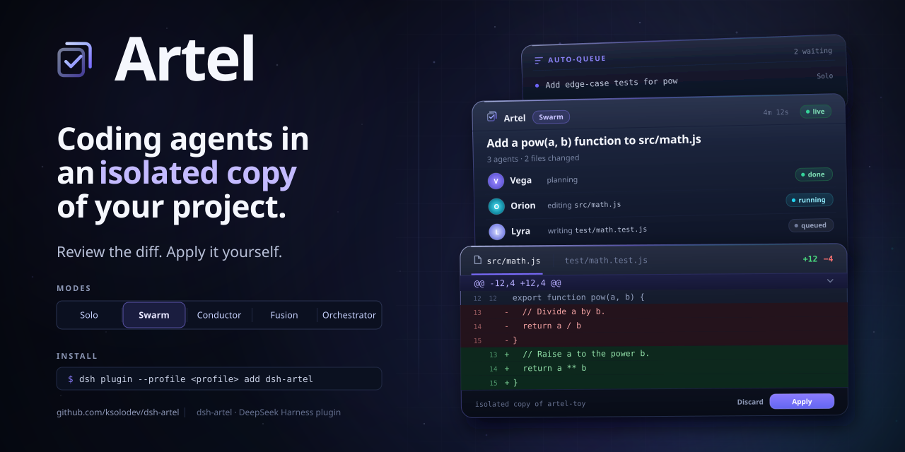
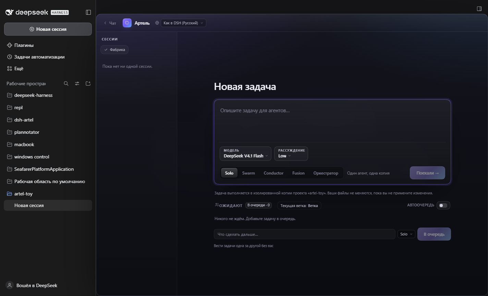
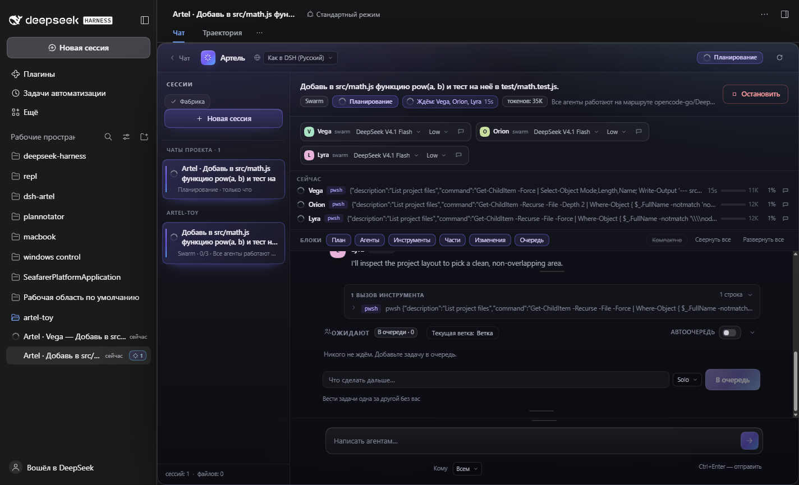
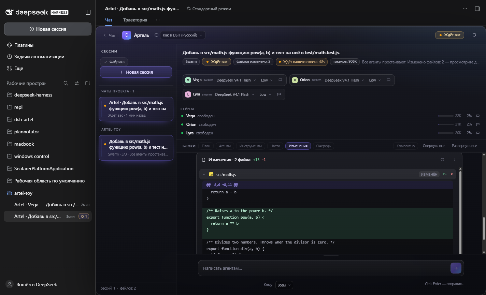

**English** · [Русский](README.ru.md) · [中文](README.zh.md)

# dsh-artel

[](https://www.npmjs.com/package/dsh-artel)
[](https://github.com/ksolodev/dsh-artel/actions/workflows/ci.yml)
[](LICENSE)



Запустите задачу разработки в изолированной копии проекта, наблюдайте за работой по ходу дела,
просмотрите дифф строка за строкой и затем примените его сами.

Artel — плагин DeepSeek Harness. Он добавляет в строку инструментов композера чата подписанный чип
**Артель** — фирменный знак и имя на фиолетовой фирменной поверхности — рядом с **+**; строка уже 460px
оставляет только знак. Щелчок по нему накрывает текущий чат панелью: слева идёт рейл сессий Artel, а
справа — либо форма нового запуска, либо живой запуск. Рабочим каталогом сессии чата служит проект;
Artel никогда не трогает его до применения. Запуск, начатый из панели, получает собственный чат с
заголовком `Artel · <task>` под проектом в боковой панели, поэтому чат, из которого вы начали,
остаётся чистым.



## Установка

Artel — это бандл DSH: он устанавливается стандартным CLI плагинов и не требует шага сборки.

**Из npm**

```sh
dsh plugin --profile <profile> add dsh-artel
```

**Из тарбола релиза** — скачайте `dsh-artel.tgz` из
[последнего релиза](https://github.com/ksolodev/dsh-artel/releases/latest), затем:

```sh
dsh plugin --profile <profile> add C:/path/to/dsh-artel.tgz
```

**Из локальной копии** — укажите CLI плагинов на каталог:

```sh
dsh plugin --profile <profile> add C:/path/to/dsh-artel
```

Установка из каталога записывается как зависимость `link:`, поэтому правки в копии репозитория
становятся живыми после перезагрузки хоста. В десктопном приложении можно также использовать
**Настройки → Плагины → Установить из файла** и выбрать `.tgz` или папку с копией репозитория.

После установки перезапустите DeepSeek Harness (или перезагрузите страницу — это пересоберёт граф
загрузки клиента), откройте сессию чата, у которой есть каталог проекта, и нажмите чип **Артель** в
строке инструментов композера.
Хостовая половина плагина общается с клиентом по HTTP API, доступному только через loopback, поэтому
плагин и хост должны работать на одной машине.

## Как это работает

1. **Чат задачи** — нажатие **Поехали** создаёт для запуска чат с заголовком `Artel · <task>`: он
   присоединяется к группе проекта в боковой панели, доступен только для чтения и содержит страницу
   запуска. Исходный чат не получает ни запуска, ни панели. Каждый чат агента (Solo, команда Swarm,
   кондуктор и его воркеры, Fusion, бригада Orchestrator) попадает в ту же группу проекта, хотя каждый
   агент работает в копии запуска; Artel перекладывает эти чаты при каждом старте, поэтому перезапуск
   сохраняет группировку. Старые запуски не мигрируются.
2. **Копия** — Artel копирует проект в свежий каталог внутри вашего DSH home. `node_modules`
   связывается, а не копируется, поэтому агенты по-прежнему могут запускать проверки проекта.
   Настоящий проект не затрагивается. Режим Orchestrator создаёт по одной копии на часть вместо одной
   копии на весь запуск.
3. **Агенты** — в **Solo** в копии работает один агент; в **Swarm** `swarmAgentCount` агентов (по
   умолчанию три) делят одну копию и одно дерево агентов, поэтому могут писать друг другу через
   `send_message`/`list_agents`. Первый ход Swarm — только планирование: агенты делят файлы и
   объявляют, кому что принадлежит. **Conductor** ставит над той же командой ведущего: одна сессия
   кондуктора с воркерами в качестве её дочерних субагентов; воркеры предлагают доли, кондуктор
   утверждает их, отвечает команде без вас и принимает готовую копию. **Fusion** задаёт один и тот же
   вопрос трём моделям параллельно и не даёт им видеть друг друга: каждая модель панели отвечает
   независимо в режиме только для чтения, судья сводит ответы в одно решение, а затем работу выполняет
   одна модель-исполнитель. **Orchestrator** берёт цель, слишком большую для одного агента: планировщик
   разбивает её на независимые части с письменным условием «done when» для каждой, каждая часть
   выполняется в своей копии и проверяется ревьюером по этим условиям, провалившаяся часть
   возвращается в работу, и только принятые части собираются в одну копию — причём файлы, изменённые
   более чем одной частью, разрешает мерджер. Агенты работают без присмотра: Artel выдаёт им политику
   подтверждений `never` и наследует режим песочницы сессии чата (панели и судьи Fusion жёстко
   закреплены за `read-only`), поэтому запуск никогда не застревает на запросе подтверждения.
4. **Дифф** — когда все агенты простаивают, Artel останавливает запуск и заполняет карточку
   **Изменения** на странице запуска: каждый изменённый файл с числом добавленных и удалённых строк и
   построчным диффом. В режиме Orchestrator это происходит после приёма всех частей и завершения
   сборки.
5. **Применение** — вы нажимаете **Применить** и подтверждаете. Он записывает каждый изменённый файл в
   проект. Перед записью Artel сверяет каждый файл с состоянием, которое тот имел на старте запуска;
   файл, который вы правили во время запуска, будет указан, а всё применение отклонено, так что ничего
   не запишется наполовину. **Отклонить** удаляет копию и ничего не меняет. После применения проект,
   который объявляет бандл DSH или свои шаги установки, сохраняет на карточке блок **Установить в DSH**: это
   отдельные явные нажатия, которые добавляют проект в профиль DSH или запускают установщик проекта,
   и сами по себе они никогда не происходят.

## Пять способов запустить задачу

**Solo** — один агент выполняет всю задачу в собственной копии проекта. Он читает код, правит копию и
запускает нужные проверки. Используйте его, когда задача небольшая и хорошо понятна: исправить
ошибку, добавить экран, изменить текст.

Пишите задачу так, как написали бы её коллеге: что должно получиться и где в проекте это живёт. Файлы
агент найдёт и прочитает сам.

**Swarm** — `swarmAgentCount` агентов (по умолчанию три) делят одну копию и одно дерево разговоров.
Их первый ход — ход планирования: они ничего не правят, а делят файлы между собой и вслух говорят,
кому что принадлежит, чтобы никто не правил один и тот же файл. Они также могут писать друг другу
напрямую: у команды есть `send_message`/`list_agents`, поэтому вопрос, предупреждение или обещание
взять область доходят до других агентов настоящим ходом, и каждое такое сообщение появляется в общей
ленте. После хода планирования они работают параллельно, читают правки друг друга с диска, а Artel
помечает любой файл, которого касаются два агента. Проверки выполняются один раз, по всей копии.

Используйте Swarm, когда работа распадается на куски, не пересекающиеся в одних и тех же файлах.

**Conductor** — один кондуктор и `swarmAgentCount` воркеров делят одну копию, как в Swarm, но у
команды есть ведущий, который отвечает за результат. Всё открывается ходом планирования: воркеры
предлагают каждый свою узкую область, кондуктор утверждает расклад или переназначает его, и ничего не
правится, пока доли не розданы. Пока команда работает, вопрос воркера уходит к кондуктору и
возвращается без ожидания вас, а остановившегося воркера заменяют: кондуктор передаёт его файлы
другому воркеру. Когда все воркеры простаивают, кондуктор проверяет всю копию — читает изменения,
запускает проверки проекта и сравнивает результат с задачей. Если цель не закрыта, он отправляет
работу обратно названным воркерам, не более двух раз. Принятая работа ждёт вас, как и в других
режимах: карточка **Изменения** показывает дифф, и только ваше **Применить** записывает его в ваш проект.

Используйте Conductor, когда доли легко перепутать и весь результат должен быть проверен, прежде чем
дойдёт до вас. Ему нужен стек субагентов в профиле DSH; запасного варианта с независимыми сессиями
нет.

**Fusion** — три модели отвечают на один и тот же вопрос независимо. Панель получает задачу в один и
тот же момент, и каждая модель отвечает в своём разговоре только для чтения: никаких правок, никаких
сообщений между моделями, никакой видимости чужих ответов. Затем отдельная модель-судья читает все три
ответа и сводит их в одно решение — где они сошлись, где разошлись, что заметил только один из них, —
и единая модель-исполнитель получает это сведённое решение и выполняет работу. Страница запуска
показывает пять переключателей маршрутов (три слота панели, судья, исполнитель), у каждого свои модель
и усилие; панель и судья жёстко закреплены за песочницей только для чтения, поэтому обсуждение не
может коснуться файла. В ваш проект ничего не пишется, пока вы не нажмёте **Применить**.

Используйте Fusion, когда выбор и есть задача: какой подход взять, как что-то сделать лучше, вопрос
дизайна, где слепое пятно одной модели — находка другой. Стек субагентов ему не нужен: пять агентов —
обычные сессии.

**Orchestrator** — вы описываете цель, планировщик её разбивает. Один планировщик читает проект и
отвечает планом: `orchestratorParts` независимых частей (по умолчанию три, максимум четыре), у каждой
заголовок, цель, условие «DONE» и файлы, которых она, по ожиданиям, коснётся. План появляется в ленте
до какой-либо работы, так что разбиение вы видите первым. Затем каждая часть получает свою копию
проекта и своего агента; планировщик остаётся только для чтения, агенты частей наследуют режим
песочницы сессии чата. Как только агент части заканчивает, отдельный ревьюер читает копию этой части и
сравнивает её с письменными условиями: часть либо принимается, либо отправляется обратно в работу с
замечаниями ревьюера (не более двух раз, затем она принимается с замечаниями в протоколе). Часть,
провалившая своего ревьюера, до вас не доходит. Когда все части приняты, принятые изменения
записываются в одну собранную копию; файлы, которые правили более одной части, собираются для агента-
мерджера, тот разрешает их, а затем его проверяет сам Artel — неразрешённый мердж никогда не
применяется. Дальше запуск ведёт себя как другие режимы: карточка **Изменения** показывает собранный
дифф, и только ваше **Применить** записывает его в ваш проект.

Используйте Orchestrator, когда цель — это направление, а не десятиминутная задача: функция, которая
затрагивает несколько областей, способных двигаться параллельно, где вы хотите, чтобы каждая часть
была проверена до того, как дойдёт до вас, а весь результат собрался одной кнопкой. Стек субагентов
ему не нужен: планировщик, агенты частей, ревьюеры и мерджер — обычные сессии.

**Модели** — форма нового запуска выбирает провайдера, модель и усилие рассуждения из маршрутов,
которые профиль DSH действительно объявляет, и каждый агент запуска начинает на этом маршруте. В
Fusion у формы по маршруту на слот: панель предварительно заполняется разными строками каталога, а
судья и исполнитель стартуют на значении по умолчанию из профиля. На странице запуска у каждого агента
свои два переключателя, поэтому участник может планировать на дешёвой модели и править сильной: смена
строки перенаправляет этого одного агента со следующего шага (идущий шаг сохраняет свой маршрут), а
маршрут, до которого хост не может добраться, оставляет агента на значении по умолчанию из профиля с
предупреждением в ленте.

## Автоочередь — ночная смена

У каждой сессии чата есть очередь. Складывайте задачи в колонку **Ожидают** кнопкой **В очередь**: каждая —
обычный запуск Artel со своим режимом и моделью — Solo, Swarm, Conductor, Orchestrator или Fusion, — но
она ждёт своей очереди, а не стартует сразу. Orchestrator — такой же режим очереди, как и остальные:
его план принимается автоматически, потому что ночью утверждать его будет некому. Когда в очереди
больше одной ветки, строка добавления также позволяет каждой задаче выбрать свою ветку, а текущая
ветка берётся по умолчанию. Очередь принадлежит сессии, поэтому у другого чата она своя; сообщение
чата, отправленное во время работы очереди, становится первой задачей вместо того, чтобы прерывать
агента.

Включите **Автоочередь**, и стек станет ночной сменой без присмотра. Перед первой задачей
предварительная проверка просит вас решить насчёт более ранних версий, которые так и не были
сохранены или отложены, показывает команду проверки и лимит задач, после чего очередь берёт одну
задачу за другой. Команда проверки — собственная команда проекта: Artel предлагает её по манифестам
(**Подобрана по проекту**), а вы можете задать другую или выбрать **Без проверки**; лимит по
умолчанию — двадцать задач на запуск.

Задача очереди выполняется по правилам ночной смены, которые повторяются агенту на каждом ходу:
свежий воркер на задачу, отвечать никто не будет, поэтому он делает наименьшее разумное допущение и
записывает его вместо того, чтобы спрашивать. На первый вопрос задачи автоматически отвечают «реши сам
и зафиксируй допущение»; второй вопрос паркует задачу. Агент никогда ничего не отправляет наружу — ни
push, ни pull request, ни публикацию, ни развёртывание, ни комментарий в трекере, ни сообщение за
пределы машины — никогда не поднимает превью и не запускает долгоживущий dev-сервер, остаётся внутри
своей копии, запускает проверки проекта и заканчивает коротким резюме о том, что изменил, проверил и
допустил.

Завершённая задача должна пройти проверку, прежде чем стать коммитом на текущей ветке очереди (при
выключенной проверке она сохраняется на слове агента и помечается как таковая). Проваленная проверка
отправляет вывод обратно тому же воркеру на исправление, не более двух раз; задача, которая всё ещё
проваливается, паркуется. У каждой очереди есть собственный git-репозиторий под `stateDir/repos/`,
поэтому собственный `.git` проекта никогда не затрагивается, и проект без git работает так же (бинарник
git обязателен, репозиторий проекта — нет); следующая задача начинается с кончика ветки, и изменение
каждой задачи — это собственный маленький коммит, а не вся ночь целиком. Заголовок очереди показывает
текущую ветку, а **Все ветки** открывает модальное окно веток: граф, коммиты с их диффами и диалоги
применения и слияния. **Применить ветку** применяет всю ветку одним действием; снятие галочки с
коммита пересобирает остальные на текущем применённом состоянии. Незакоммиченные изменения проекта
обнаруживаются перед применением и становятся явным drift-коммитом вместо того, чтобы быть молча
перезаписанными, а ветки сливаются как git-ветки (`--no-ff`, причём агент-фиксер разрешает текстовые
конфликты). Когда сам проект — это git work tree, **Экспортировать в git** импортирует ветку в него
как `refs/heads/artel/<branch-id>` — только ref и его объекты, оставляя work tree и `HEAD` в покое и
отказывая в обновлениях не-fast-forward вместо того, чтобы форсировать их. **Отменить применение**
отменяет последнюю применённую ветку новым коммитом с обратными изменениями, так что история только
растёт; она отказывает проекту с незакоммиченными изменениями или применению, которое уже не
последнее. Модальное окно показывает размер репозитория очереди рядом с **Почистить**, которая
запускает полный `git gc` и сообщает освобождённые байты, а **Доработать с этого результата** начинает
новую ветку от применённого состояния.

**Отложенное** — это место, куда попадают задачи, которые не могут пройти без присмотра: проверка всё ещё
проваливается после двух исправлений, дифф содержит секрет или мусор, агент пытается публиковать
наружу или агент сообщает, что заблокирован. Отложенная задача получает метку `vf/parked-…`, сохраняет
свою частичную копию, и её можно вернуть в очередь, чтобы продолжить с неё; сама очередь идёт дальше
со следующей задачей. Лимит подписки лишь приостанавливает очередь, и она возобновляется после
сброса; потерянный вход в систему её завершает.

**Стоп** прерывает агента и паркует частичную работу, **Закончить после текущей** даёт текущей
задаче пройти проверку и затем останавливает очередь, а выключение **Автоочередь** прекращает приём
новых задач. Очередь также завершается сама, когда она пуста, когда достигнут лимит задач, после трёх
парковок подряд, при потере входа в систему или когда диск почти полон. Затем карточка **Итоги автоочереди** перечисляет сделанные ею коммиты задач, отложенные задачи и причину остановки очереди. Она
сворачивается до своего заголовка, а колонка запуска прокручивается, поэтому на короткой панели
карточка остаётся доступной, а не скрывается под композером.

## Фабрика — конвейер тикетов

**Фабрика** — это тикет-доска на проект, которую ведут агенты. Доска создаётся для проекта и
включается кнопкой **Включить** — включить можно только доску, прошедшую **Проверить** — и с этого
момента она принимает тикеты и сама двигает их по конвейеру. Доска показывает семь колонок —
**Входящие**, **Разбор**, **Работа**, **Проверки**, **Готово к PR**, **Ждёт вас**, **Готово** — а
конвейер за ними состоит из девяти стадий: `incoming`, `triage`, `working`, `tests`, `check`, `review`,
`ready`, `waiting`, `done` (Checks объединяет tests, app check и review).

Тикет начинается в **Входящие**. **Разбор** — агент только для чтения: он читает проект и тикет,
отвечает спецификацией, критериями приёмки и маршрутом и может задавать вопросы — они отправляют тикет
в **Ждёт вас**. Маршрут — самый дешёвый достаточный из маршрутов, которые допускает доска
(`solo`, `swarm`, `fusion`, `orchestrator`); Фабрика может только удешевить выбранный триажем маршрут,
но никогда не повысить его. **Работа** — обычный запуск Artel этого режима по правилам ночной смены;
маршрут orchestrator останавливается после плана и ждёт **Утвердить план**. На первый вопрос рабочего
запуска отвечают автоматически, второй отправляет тикет в **Ждёт вас**.

**Тесты** запускает тестовую команду доски (или её команду проверки, затем предложенную проектом; без
пригодной команды стадия пропускается с пометкой) и отправляет провал обратно в работу вместе с
выводом. **Проверка приложения** поднимает превью и смотрит на результат в копии только для чтения — только для
UI-тикетов, только когда этого хочет шаблон, настроены команда превью и Playwright. **Ревью** — это
один или два ревьюера, читающих дифф тикета против его критериев. Любые проваленные tests, app check
или review становятся раундом исправления обратно в **Работа**, вплоть до лимита шаблона; когда
раунды исчерпаны, тикет ждёт вас с найденными проблемами. Тикет, прошедший review, переходит в **Ready
for PR**.

Шаблоны: **Обычный** — tests, app check и review, до двух раундов исправления; **Быстрый** — без app
check, один раунд исправления, для небольших тикетов; **Строгий** — два ревьюера и до трёх раундов
исправления. **Ждёт вас** собирает всё, что требует человека: вопросы триажа, план orchestrator,
ожидающий утверждения, исчерпанные раунды исправления, прерванный тикет, запуск, которому нечего
делать, и тикеты, которые вы отложили. Каждый шаг записывается в журнал доски и тикета.

Тикеты приходят из поля **Входящие** (заголовок, описание, файлы и скриншоты), из issues GitHub —
`#12`, `owner/repo#12` или URL issue, импортируемых через установленный `gh` с выполненным входом и
никогда дважды — или из трекеров (GitHub, GitLab, Jira и Linear опрашиваются каждые пять минут, с
необязательным комментарием обратно); каждая доска принадлежит одному проекту. Готовность блокируется
четырьмя вещами: git `2.30.0` или новее на машине, git-репозиторий для проекта, хотя бы один коммит в
нём (Фабрика делает дифф относительно него) и движок с выполненным входом; бинарник git и репозиторий
сообщаются как отдельные проверки, поэтому отсутствующий git указывает на ссылку установки, а
не-репозиторий — на `git init`. Тестовая команда (или предложенная), команда превью и Playwright
сообщаются, но не блокируют; без пригодной тестовой команды стадия tests пропускается с пометкой.

В **Готово к PR** тикет предлагает три действия. **Pull Request** требует чистого рабочего дерева и
remote: он создаёт `factory/ticket-<number>`, применяет запуск тикета к настоящему проекту, коммитит,
пушит и вызывает `gh pr create` с телом, собранным из спецификации, критериев, проверок, допущений и
замечаний ревью; ссылка комментируется обратно, когда трекер об этом просит. **Влить** применяет
накопленный дифф тикета к проекту без ветки и пуша. **Вернуть с комментарием** отправляет тикет обратно
в работу с комментарием в качестве хода исправления. **Открыть сессию** подключается к сессии тикета
для ручного перехвата. Доску можно поставить на паузу: пока она на паузе, новые тикеты не берутся, а
запущенные завершаются. Сама Фабрика никогда ничего не отправляет наружу: push, pull request и
комментарии происходят только когда вы нажимаете кнопку.

Настройки на доску: модели на роль (triage, work, tests, review), разрешённые маршруты, тикеты
одновременно и в день, воркеры на тикет, допуски для API-движка и низкой подписки, команды
test/check/preview, причуда «дописывать тесты, если изменение не затрагивает ни одного» и список
трекеров.

## Просмотр и применение

Пока запуск активен, страница запуска показывает живую ленту каждого агента: полные ответы с аватаром,
именем, ролью и временем, сгруппированные вызовы инструментов и отдельные строки для статуса, планов,
ваших сообщений, сообщений агентов друг другу, коллизий правок и ошибок. Вы можете писать агентам в
любой момент, не дожидаясь их завершения (Ctrl+Enter отправляет); адресуйте всем или одному конкретному
агенту.

Страница отвечает на вопрос «что происходит прямо сейчас», не открывая чат: заголовок называет, чего
ждёт запуск (**Ждёт вашего ответа**, **Ждёт утверждения плана**, **Ждём: Nova**, **Агенты работают**, **Сводит результат**) и сколько уже длится ожидание, полоса **Сейчас**
перечисляет каждого агента с его последним шагом, временем на текущем ходу и заполнением его окна
контекста, а тег суммирует токены, потраченные запуском. Строка вызова инструмента с аргументами или
выводом — это кнопка: она раскрывается на то и другое, а **Свернуть все** закрывает каждую открытую
строку. У каждой строки агента также есть кнопка чата, и она же есть у полосы маршрутов под
заголовком: они открывают собственный чат этого агента в группе проекта.

Страница состоит из блоков, и вы управляете ими, не покидая запуск. Карточка плана, ответы агентов,
группы инструментов, карточка **Части**, карточка **Изменения** и полоса **Очередь** — всё сворачивается:
щелчок по заголовку сворачивает его в одну строку («ПЛАН · 24 строки», «Vega · 6 строк»), и состояние
свёрнутости запоминается на сессию чата, даже после перезагрузки. Панель **Блоки** над лентой скрывает
вид блока, сворачивает всё (**Свернуть все**), разворачивает обратно или переключает всю страницу в
**Компактно**; длинный блок обрезается до удобной высоты с помощью **Показать целиком** и ручки на его
нижнем краю для изменения размера, а границу над композером тоже можно перетаскивать. Ничто не
перекрывается: parts, changes и очередь живут в той же прокрутке, что и лента, композер остаётся
закреплённым под ней, а карточка результатов авто-очереди по-прежнему сама прокручивается в поле
зрения, когда смена заканчивается (issue #8).



Когда все агенты простаивают, Artel останавливается и ждёт вас:

- **Изменения** перечисляет каждый изменённый файл с числом добавленных и удалённых строк. Откройте
  файл, чтобы увидеть дифф.
- **Применить** запрашивает подтверждение и записывает каждый изменённый файл в ваш проект. Файл, который
  вы правили во время запуска, никогда не перезаписывается: Artel сообщает о нём и отклоняет всё
  применение, так что вы можете отменить и запустить снова.
- **Отклонить** запрашивает подтверждение, удаляет копию и ничего не меняет.



Применённый проект может быть чем-то, что должен подхватить сам DSH — бандлом или плагином с
собственным установщиком. Для таких случаев карточка изменений держит второй блок открытым после
**Применить**, и ничего в нём не происходит само по себе:

- **Установить в DSH** появляется, когда проект — это бандл DSH: его `package.json` объявляет
  `dsh.bundle.patch` и файл патча существует (или у проекта есть `cordis.patch.yml` в корне). Один
  щелчок просит менеджер плагинов хоста добавить *папку проекта* в активный профиль DSH как локальную
  зависимость `link:`. Затем карточка сообщает, загрузил ли DSH бандл или нужен перезапуск. Профиль без
  менеджера плагинов получает ручные шаги вместо кнопки.
- **Шаги установки** — это команды, которые проект сам объявляет в `artel.install.json`
  (`{"steps": [{"title": "Install the runtime", "command": "python install/install.py"}]}`), или
  обычный скрипт установки, поставляемый проектом (`install/install.py`, `scripts/install.mjs`, …),
  когда манифеста нет. Каждый шаг — строка с его точной командой и кнопкой **Запустить**, один запуск на
  щелчок; карточка показывает код выхода, таймаут, если команда шла слишком долго, и захваченный
  вывод.

Копия живёт вне проекта, внутри каталога вашего DSH home. Она удаляется сразу после того, как вы
примените или отмените запуск, поэтому просмотренные копии не накапливаются на диске.

## Как открыть

1. Откройте сессию чата, у которой есть каталог проекта.
2. Нажмите кнопку **Артель** в строке инструментов композера чата (рядом с **+**). Пока запуск в сессии
   активен, кнопка показывает точку.
3. Выберите Solo, Swarm, Conductor, Fusion или Orchestrator, напишите задачу, нажмите **Поехали →** (или
   Ctrl+Enter). **Чат** (с шевроном назад) или Esc возвращают в чат; сам чат при этом не заменяется.

Панель принадлежит сессии чата: рейл **Сессии** перечисляет каждый запуск сессии, сгруппированный по
проекту, с подсветкой активного, а **Новая сессия** возвращает к форме. Каждый агент работает в копии
как в своём рабочем каталоге. Первый агент запуска Swarm или Conductor — обычная сессия DSH (в запуске
Conductor это кондуктор), а остальные агенты — его субагенты, живут в том же дереве агентов и не
перечисляются в боковой панели как отдельные чаты. Агенты Solo, все пять агентов Fusion и каждый агент
Orchestrator — тоже обычные сессии: планировщик получает заголовок `Artel · Orchestrator · <agent> —
<task>`, агент части — `Artel · Part N — <title> · <agent> — <task>`, его ревьюер — `Artel · Review ·
Part N — <title> · <agent> — <task>`, а мерджер — `Artel · Merge · <agent> — <task>` (Fusion добавляет
`Fusion · <role>`). Архивируйте или удаляйте эти сессии, когда они больше не нужны.

## Язык интерфейса

Панель говорит на английском, русском и китайском. Кнопка языка в шапке панели — глобус рядом с
вкладками **Чат** и **Артель** — предлагает **English**, **Русский** и **中文**, а также **Как в DSH**:
этот режим следует языку самого DeepSeek Harness, и кнопка показывает, какой язык выбран (например,
«Как в DSH (Русский)»). Выбор применяется к открытой панели сразу и хранится для профиля DSH в
`settings.json` под `stateDir`, поэтому все чаты профиля говорят на одном языке. Названия режимов
(Solo, Swarm, Conductor, Fusion, Orchestrator), статусы, пути файлов и всё, что пишут агенты, остаются
как есть; каталоги строк лежат в `locale/*.json` и компилируются в клиент, поэтому новый язык — это
файл каталога, а не код (см. [docs/translating.md](docs/translating.md)). Эта документация выходит на
тех же трёх языках: переключатель в самом верху страницы открывает README и руководство на другом языке.

## Обновление с `dsh-forge`

Плагин был переименован в Artel (имя npm `dsh-forge` принадлежит несвязанному пакету-заглушке). При
первом запуске хост переносит предыдущий корень данных из `<DSH home>/forge/<profile>` в
`<DSH home>/artel/<profile>`, поэтому существующие записи запусков, ленты и копии остаются доступными.
Идентификатор плагина изменился вместе с именем: открытая страница Forge не восстанавливает Artel,
поэтому перезапустите DeepSeek Harness и один раз откройте Artel из композера чата.

`<profile>` — это профиль, в котором Host запустил Artel; он берётся из `profileContext` лаунчера, а не
только из `DSH_PROFILE`, поэтому десктопное приложение и `dsh web` используют один и тот же каталог
профиля. Сборка, запущенная без этой информации, могла писать в `<DSH home>/artel/default`; при первом
запуске этой сборки такой каталог переносится в `<DSH home>/artel/<profile>`, если целевого каталога
ещё нет — существующий каталог профиля никогда не сливается и не перезаписывается.

## Требования

- DSH `^0.2.2-rc.1` с хостом, предоставляющим контроллер сессий (десктопное приложение или `dsh web`).
- Node `^22.19.0 || >=24` — та же среда выполнения, что использует хост.
- Git `2.30.0` или новее на машине. Плагин не поставляет бинарников и ничего не устанавливает, но
  очередь хранит свои версии и ветки в собственных репозиториях, сохранение/экспорт/откат работают
  через git, а Фабрика пушит ветки и открывает pull request с его помощью. Без пригодного git эти
  возможности недоступны: панель предупреждает при открытии, очередь отказывает в действии с
  `artel/git-missing`, а проверка готовности «Фабрики» называет ссылку установки. Для запуска очереди
  проект не обязан быть git-репозиторием, хотя для «Фабрики» он нужен (см. ниже).

## Настройка

Все значения необязательны; задавайте их в конфигурации плагина бандла.

| Ключ | По умолчанию | Значение |
| --- | --- | --- |
| `swarmAgentCount` | `3` | Воркеров на запуск Swarm или Conductor (2–8). Запуск Conductor добавляет сверху кондуктора, поэтому стартует `1 + swarmAgentCount` агентов. |
| `orchestratorParts` | `3` | Частей на запуск Orchestrator (2–4). План с большим числом частей сворачивается в последнюю. |
| `maxRunsPerSession` | `10` | Завершённых запусков, хранимых на сессию; самые старые отбрасываются вместе с их копиями. Запуски, ждущие вас, остаются. |
| `keepCopiesHours` | `72` | Окно хранения копий запусков в часах (0 отключает). Текущая чистка при старте удаляет копии применённых и отменённых запусков независимо от возраста. |
| `diffContext` | `3` | Строк контекста вокруг каждого хунка диффа (0–12). |
| `idleGraceMs` | `1200` | Сколько Artel ждёт возможного сообщения агента агенту, прежде чем считать запуск простаивающим (0–10000). |
| `excludeGlobs` | `[]` | Дополнительные пути, которые никогда не копируются, не диффятся и не применяются. |
| `copyRoot` | `<DSH home>/artel/<profile>/copies` | Где создаются копии запусков. |
| `stateDir` | `<DSH home>/artel/<profile>/state` | Индекс запусков и ленты; здесь же живут хранилища авто-очереди (с репозиториями веток очереди в `repos/`) и доски «Фабрики». |

Запуск Conductor стартует одного кондуктора плюс `swarmAgentCount` воркеров и нуждается в стеке
субагентов в профиле DSH. Профиль без него отказывает в запуске Conductor с ошибкой; в отличие от
Swarm, запасного варианта с независимыми сессиями нет.

## Ограничения

- Проект копируется как файлы, а не через Git: метаданные Git не копируются, а применение пишет файлы.
  Очередь, сохранение/экспорт/откат и Фабрика действительно нуждаются в git `2.30.0` или новее на
  машине (см. «Требования»); только сама копия никогда не касается `.git` проекта.
- Копия ограничена 512 MB в сумме и 32 MB на файл. Проект, превышающий общий лимит, отклоняется с
  ошибкой вместо частичной копии; файлы, превышающие лимит на файл, в копию не попадают.
- `node_modules` связывается в копию, а не копируется, поэтому агенты могут запускать проверки
  проекта.
- Artel следит за копией, а не за вашим проектом: он не может знать о правках, которые вы делаете во
  время запуска, до применения, и тогда отказывается перезаписывать эти файлы.
- Применяются только файлы. Удалённые файлы удаляются при Apply; переименования приходят как одно
  удаление и одно добавление.
- Apply никогда ничего не устанавливает и не запускает команды проекта. Блок установки — отдельный
  явный щелчок: установка бандла меняет активный профиль DSH (папка проекта становится в нём
  зависимостью `link:`, и DSH может потребоваться перезапуск), а шаг установки запускает собственную
  команду проекта с вашей учётной записью, проектом в качестве рабочего каталога, пятиминутным лимитом
  и ограниченным выводом. Прочитайте команду, прежде чем нажимать её.
- Шаги установки берутся только из проекта (`artel.install.json` или обычный скрипт установки); Artel
  никогда не выдумывает команду. Установка бандла требует профиля, предоставляющего менеджер плагинов
  хоста, — иначе карточка перечисляет ручные шаги и путь проекта вместо кнопки.
- Применение для запуска — всё или ничего: либо записывается каждый изменённый файл, либо, если файл
  конфликтует, не записывается ни один. В карточке изменений нет выбора по отдельным файлам.
- Агенты Swarm и Conductor живут в одном дереве агентов: первый агент — это сессия в корне этого
  дерева (ведущий запуска Swarm, кондуктор запуска Conductor), а остальные — его субагенты. Именно это
  позволяет им писать друг другу, и это означает, что корневая сессия должна существовать, чтобы их
  сообщения доставлялись. Закрытие этой сессии (или перезапуск хоста) обрывает транспорт — точно так
  же, как правило «запуски останавливаются при перезапуске» ниже. Профиль, не предоставляющий стек
  субагентов, для **Swarm** откатывается к трём независимым сессиям: запуск всё равно работает, но
  агенты не могут писать друг другу и координируются только через строку владения и файлы на диске. У
  запуска Conductor такого запасного варианта нет — ему отказывают.
- В режиме Conductor кондуктор проверяет всю копию не более двух раз: третий запрос на переработку
  превращается в принятие с замечаниями, и замечания вместе с изменениями доходят до вас. Принятие
  запуска — это не применение: карточка изменений показывает дифф, и только ваше **Применить** пишет
  проект.
- В режиме Fusion три агента панели и судья жёстко закреплены за режимом песочницы `read-only`: панель
  — это обсуждение, а не работа, и она не может править копию, даже если модель попытается. Если
  модель панели останавливается, судья сводит ответы, которые есть; если останавливаются все модели
  панели, запуск проваливается до того, как что-либо отредактировано. Судью, который ничего не
  ответил, спрашивают ещё раз, затем запуск проваливается. Провалившийся исполнитель оставляет запуск
  ждать с тем, что уже было записано.
- Запуск Fusion — это пять сессий DSH (три модели панели, судья и исполнитель), поэтому боковая панель
  сессий получает пять записей на запуск. После своего хода они остаются бездействующими; архивируйте
  их, когда закончите.
- В режиме Orchestrator каждая часть проверяется, прежде чем засчитаться: планировщик, ревьюеры и
  мерджер жёстко закреплены за режимом песочницы `read-only`, а каждый агент части работает в своей
  копии, поэтому параллельные части не могут столкнуться на диске. Часть, ревьюер которой просит
  переработку, возвращается не более двух раз; после этого она принимается с замечаниями ревьюера в
  протоколе. Остановившийся агент части или ревьюер проваливает весь запуск — ничего не собирается,
  поэтому до вашего проекта ничего не доходит, — а планировщика, который не может выдать читаемый
  план, спрашивают ещё раз, затем запуск проваливается до того, как что-либо отредактировано.
- В режиме Orchestrator шаг сборки проверяет сам Artel: файл, который изменили несколько частей, должен
  быть разрешён в собранной копии мерджером (одна повторная попытка, если он оставит что-то
  неразрешённым), прежде чем запуск начнёт ждать вас; до этого **Применить** отклоняется с
  `artel/merge-incomplete`. Собранная копия сохраняется, когда мердж проваливается или
  останавливается, поэтому вы всё ещё можете прочитать дифф, но для применения нужен завершённый
  мердж. Копии частей удаляются сразу после сборки частей.
- Запуск Orchestrator — это несколько сессий DSH (планировщик, две сессии на часть — агент и его
  ревьюер — и мерджер), поэтому боковая панель сессий получает по записи на агента. После своего хода
  они остаются бездействующими; архивируйте их, когда закончите.
- Пока кондуктор решает доли, проверяет копию или передаёт долю, Artel отказывается принимать от вас
  новые сообщения (в ленте сказано, что кондуктор решает); со следующей стадии писать снова можно. В
  Fusion панель и судья принимают сообщение только от вас и только когда они активная стадия — модели
  по-прежнему никогда не видят друг друга.
- Если на файл никто не заявил права, Artel передаёт невостребованные файлы, лежащие рядом с
  востребованной работой, агентам, которые ничего не взяли, и помечает их в плане как «nobody claimed
  it» — так никто не простаивает весь запуск. Если задача достаточно мала для одного агента, двое
  других в итоге проверяют копию и говорят об этом в своих резюме вместо того, чтобы выдумывать себе
  работу.
- Перезапуск плагина или хоста прерывает активные запуски. Их работа остаётся доступной для просмотра,
  и её всё ещё можно применить или отменить, но агенты останавливаются и больше не принимают
  сообщений.

## Данные и конфиденциальность

Записи запусков и ленты — это обычные файлы JSON и JSONL под `stateDir`. Авто-очередь сессии и доски
Фабрика проекта — тоже обычный JSON там же (`queue/` и `tickets/`), а вложения тикетов — обычные файлы
под `attachments/`. Собственные git-репозитории очереди живут под `repos/` рядом с ними, с черновыми
work tree под `worktrees/`. Язык интерфейса профиля хранится в `settings.json` там же. Разговоры агентов — обычные сессии DSH и остаются в вашем хранилище сессий.
Хостовая половина плагина общается с клиентом по HTTP API, доступному только через loopback; каждый
запрос проверяется на локальный сокет, локальный заголовок Host и same-origin origin.

## Разработка

```sh
npm test
```

`npm test` запускает `node --test test/*.test.js` после проверки, что скомпилированный блок локалей в
`lib/client.js` актуален (`node tools/build-locales.mjs --check`). Хостовая половина — чистый ESM
(`lib/*.js`), клиентская написана вручную на `React.createElement` (`lib/client.js`), а видимые
пользователю строки лежат в `locale/*.json` и компилируются в клиент командой
`node tools/build-locales.mjs`. CI прогоняет набор тестов на Windows с Node 22 и 24.

- [ARCHITECTURE.md](ARCHITECTURE.md) — устройство хоста и клиента, модель запуска и данных, поверхность
  маршрутов.
- [docs/publishing.md](docs/publishing.md) — как релиз пакуется, публикуется и попадает в список.
- [docs/translating.md](docs/translating.md) — языки интерфейса, каталоги и добавление языка.
- [docs/guide.md](docs/guide.md), [docs/guide.ru.md](docs/guide.ru.md),
  [docs/guide.zh.md](docs/guide.zh.md) — руководство пользователя (en / ru / zh).
- [CHANGELOG.md](CHANGELOG.md) — заметки о релизах.

## Лицензия

MIT © dsh-artel contributors — см. [LICENSE](LICENSE).
