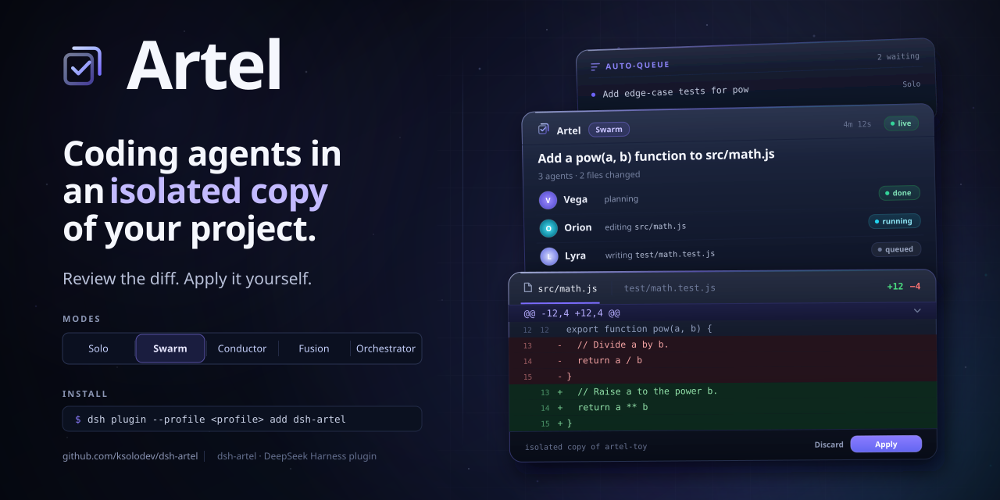
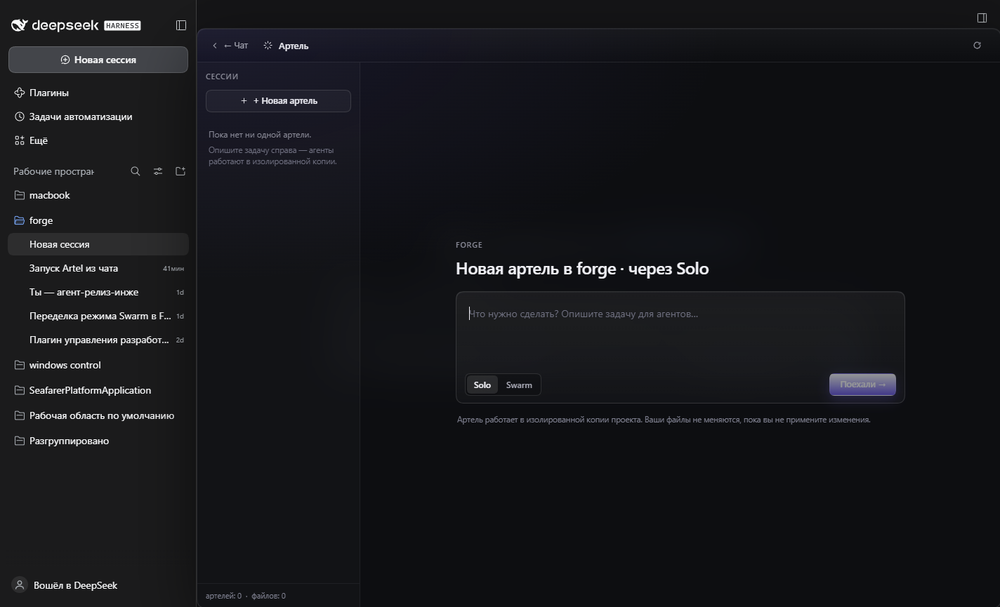
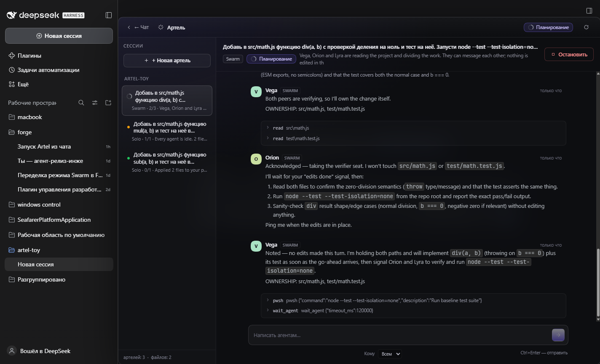
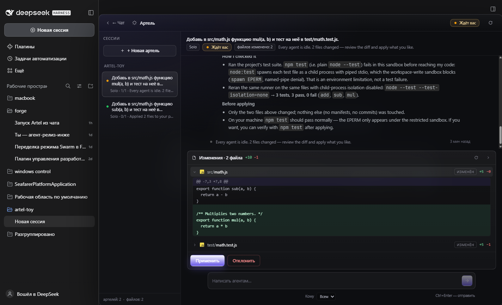

**English** · [Русский](README.ru.md) · [中文](README.zh.md)

# dsh-artel

[](https://www.npmjs.com/package/dsh-artel)
[](https://github.com/ksolodev/dsh-artel/actions/workflows/ci.yml)
[](LICENSE)



在项目的隔离副本中运行一项开发任务，实时观看工作过程，逐行审查差异，然后由你自己应用结果。

Artel 是一个 DeepSeek Harness 插件。它把一个带标签的 **Artel** 芯片——紫色品牌底上的品牌标记和名称——加到聊天输入框的工具行中，紧挨 **+**；宽度小于 460px 的行只保留标记。点击它会用面板覆盖当前聊天：左侧是 Artel 运行的会话栏，右侧是新任务表单或实时运行。聊天会话的工作目录就是项目；在你应用之前，Artel 绝不触碰它。从面板启动的运行会获得自己的聊天，标题为 `Artel · <task>`，位于侧边栏中该项目之下，因此你发起运行的聊天保持干净。



## 安装

Artel 是一个 DSH 插件包：它通过标准插件 CLI 安装，不需要构建步骤。

**从 npm**

```sh
dsh plugin --profile <profile> add dsh-artel
```

**从发布压缩包**——从[最新发布](https://github.com/ksolodev/dsh-artel/releases/latest)下载 `dsh-artel.tgz`，然后：

```sh
dsh plugin --profile <profile> add C:/path/to/dsh-artel.tgz
```

**从检出目录**——让插件 CLI 指向该目录：

```sh
dsh plugin --profile <profile> add C:/path/to/dsh-artel
```

目录安装会记录为 `link:` 依赖，因此检出目录中的修改在宿主重新加载后即时生效。在桌面应用中，你也可以使用 **设置 → 插件 → 从文件安装**，选择 `.tgz` 或检出文件夹。

安装后，重启 DeepSeek Harness（或重新加载页面，这会重新组合客户端启动图），打开一个带有项目目录的聊天会话，然后点击输入框工具行中的 **Artel** 芯片。
插件的服务端部分通过仅限回环的 HTTP API 与客户端通信，因此插件和宿主必须运行在同一台机器上。

## 工作方式

1. **任务聊天**——按下 **开始** 会为这次运行创建一个标题为 `Artel · <task>` 的聊天：它加入侧边栏中的项目分组，是只读的，并承载运行页面。源聊天不保留运行，也不保留面板。每个智能体聊天（Solo、Swarm 团队、指挥及其执行者、Fusion、Orchestrator 团队）都归入同一个项目分组，尽管每个智能体都在运行的副本中工作；Artel 在每次启动时重新归档这些聊天，因此重启后分组仍然保留。旧运行不会被迁移。
2. **副本**——Artel 把项目复制到你的 DSH 主目录下的一个新目录中。`node_modules` 是链接而非复制，因此智能体仍然可以运行项目的检查。真实项目不会被触碰。Orchestrator 模式会为每个部分各建一份副本，而不是为整次运行建一份副本。
3. **智能体**——在 **Solo** 中，一个智能体在副本中工作；在 **Swarm** 中，`swarmAgentCount` 个智能体（默认三个）共用一份副本和一棵智能体树，因此它们可以用 `send_message`/`list_agents` 互相发消息。Swarm 的第一个回合只做规划：智能体划分文件，并宣布谁负责什么。**Conductor** 在同一团队之上加一名负责人：一个指挥会话，执行者作为它的子智能体；执行者提出份额，指挥批准它们，无需你介入就答复团队，并验收完成的副本。**Fusion** 并行向三个模型提出同一个问题，且不让它们看到彼此：每个模型组成员以只读模式独立回答，一个评审模型把答案合并成一个决定，然后由单个执行者模型完成工作。**Orchestrator** 接受一个对单个智能体来说过大的目标：规划者把它拆成相互独立的部分，并为每个部分写明“完成条件”；每个部分在自己的副本中完成，并由检查者对照这些条件验收；未通过的部分退回继续工作，只有通过验收的部分才被汇总成一份副本——多个部分都改动过的文件由合并者决定。智能体无人值守地运行：Artel 给它们审批策略 `never`，并继承聊天会话的沙箱模式（Fusion 的模型组和评审被固定为 `read-only`），因此运行绝不会卡在审批提示上。
4. **差异**——当每个智能体都空闲时，Artel 停止运行，并填充运行页面上的 **变更** 卡片：每个更改过的文件及其新增和删除行数，以及逐行差异。在 Orchestrator 模式下，这会在每个部分都被验收且汇总完成后发生。
5. **应用**——你按下 **应用** 并确认。它会把每个更改过的文件写入项目。写入之前，Artel 会对照运行开始时每个文件的状态进行检查；你在运行期间编辑过的文件会被报告，整个应用会被拒绝，因此不会写入一半。**丢弃** 会删除副本，不做任何更改。应用之后，如果项目声明了 DSH 插件包或自己的安装步骤，卡片上会保留一个 **安装** 区块：这些是单独的显式点击，会把项目加入 DSH 配置或运行项目自带的安装程序，绝不会自行发生。

## 运行任务的五种方式

**Solo**——一个智能体在项目的自己的副本中完成整个任务。它阅读代码、编辑副本，并运行所需的任何检查。当任务较小且已充分理解时使用它：修一个 bug、加一个界面、改一些文字。

像写给同事那样写任务：应该产出什么，以及它在项目中的位置。智能体会自己找到并读取文件。

**Swarm**——`swarmAgentCount` 个智能体（默认三个）共用一份副本和一棵对话树。它们的第一个回合是规划回合：不做任何编辑，只在彼此之间划分文件，并大声说出谁负责什么，以免有人编辑同一个文件。它们也可以直接互相发消息：团队拥有 `send_message`/`list_agents`，因此一个问题、一个提醒或一个接管某区域的承诺会作为真实的回合送达其他智能体，每条这样的消息都会出现在共享动态中。规划回合之后，它们并行工作，在磁盘上读取彼此的编辑，Artel 会标记两个智能体都触碰的文件。检查只运行一次，针对整份副本。

当工作可以拆成不会在同一批文件中相遇的几块时，使用 Swarm。

**Conductor**——一名指挥和 `swarmAgentCount` 名执行者共用一份副本，和 Swarm 一样，但团队有一个为结果负责的负责人。它以规划回合开始：执行者各自提出一个较小的区域，指挥批准或重新分配，在份额分配出去之前不做任何编辑。团队工作时，执行者的问题会交给指挥，并在不等待你的情况下得到答复；停止的执行者会被替换：指挥把它的文件转给另一名执行者。当所有执行者都空闲时，指挥审查整份副本——它读取更改、运行项目的检查，并把结果与任务对照。如果目标没有闭合，它把工作退回给指定的执行者，最多两次。已验收的工作会像其他模式一样等你：**变更** 卡片显示差异，只有你的 **应用** 才会把它写入项目。

当份额容易混淆、整个结果必须在到达你之前得到验证时，使用 Conductor。它需要 DSH 配置中有 subagent 栈；没有退回独立会话的方案。

**Fusion**——三个模型独立回答同一个问题。模型组在同一时刻收到任务，每个模型在自己的只读对话中回答：不编辑、模型之间不发消息、也看不到彼此的回答。随后一个单独的评审模型读取全部三个回答，把它们合并成一个决定——哪些地方一致、哪些地方分歧、只有某一个注意到了什么——再由单个执行者模型接收这个合并后的决定并完成工作。运行页面显示五个路由选择器（三个模型组位置、评审、执行者），每个都有自己的模型和强度；模型组和评审被固定为只读沙箱，因此讨论无法触碰文件。在你按下 **应用** 之前，不会向你的项目写入任何内容。

当选择本身就是任务时使用 Fusion：采用哪种方案、某件事怎样做更好、一个模型盲点正好是另一个模型捕捉到的设计问题。它不需要 subagent 栈——五个智能体都是普通会话。

**Orchestrator**——你描述目标，规划者拆分它。单个规划者阅读项目并给出计划：`orchestratorParts` 个相互独立的部分（默认三个，最多四个），每个都有标题、目标、“DONE”条件和预计会触碰的文件。计划在任何工作开始前出现在动态中，因此你先看到拆分。然后每个部分获得自己的项目副本和自己的智能体；规划者保持只读，部分智能体继承聊天会话的沙箱模式。部分智能体一完成，单独的检查者就读取该部分的副本并与写明的条件对照：该部分要么被验收，要么连同检查者的问题一起退回工作（最多两次，之后带着记录在案的备注被验收）。未通过检查者的部分绝不会到达你这里。当每个部分都被验收后，已验收的更改被写入一份汇总副本；被多个部分编辑过的文件会打包给合并智能体，由它解决，然后由 Artel 本身检查——未解决的合并绝不会被应用。从这里开始，运行的行为与其他模式相同：**变更** 卡片显示汇总后的差异，只有你的 **应用** 才会把它写入项目。

当目标是一个方向而非十分钟的任务时使用 Orchestrator——一个跨多个可并行推进区域的特性，你希望每个部分在到达你之前都得到验证，整个结果用一个按钮汇总。它不需要 subagent 栈：规划者、部分智能体、检查者和合并者都是普通会话。

**模型**——新任务表单从 DSH 配置实际公布的路由中选择提供方、模型和推理强度，运行中的每个智能体都从该路由开始。在 Fusion 中，表单为每个位置提供一条路由：模型组预置为不同的目录行，评审和执行者从配置默认值开始。在运行页面上，每个智能体都有自己的两个选择器，因此成员可以用便宜的模型规划、用强模型编辑：更改某一行会从下一步起重新路由那个智能体（正在运行的步骤保留其路由），Host 无法到达的路由会让智能体留在配置默认值上，并在动态中显示警告。

## 自动队列——夜间班次

每个聊天会话都有一个队列。用 **排队** 把任务堆进 **等待中** 列：每个任务都是一次普通的 Artel 运行，有自己的模式和模型——Solo、Swarm、Conductor、Orchestrator 或 Fusion——但它会等待轮到自己，而不是立即开始。Orchestrator 和其他模式一样是队列模式：它的计划会自动被批准，因为夜里没人会来批准。当队列有多个分支时，添加行还允许每个任务选择自己的分支，默认使用当前分支。队列属于会话，因此另一个聊天有自己的队列；队列运行时发送的聊天消息会成为第一个任务，而不是打断智能体。

打开 **自动队列**，这一摞任务就变成无人值守的夜间班次。第一个任务之前，「启动前」会请你决定如何处理之前从未保存或搁置的版本，显示检查命令和任务上限，然后队列一个接一个地取任务。检查命令是项目自己的：Artel 从清单中推测它（**根据项目推测**），你可以另设一条，或选择 **不做检查**；上限默认为每次运行二十个任务。

队列任务按夜间班次规则运行，这些规则在每个回合都会向智能体重复：每个任务换新的执行者，没有人会回答，因此它做出最小合理假设并记录下来，而不是提问。任务的第一个问题会自动回答「自行决定并记录假设」；第二个问题会让任务搁置。智能体绝不向外发送任何东西——不 push、不创建拉取请求、不发布、不部署、不评论跟踪器，也不向机器外发消息——绝不启动预览，也绝不启动长时间运行的开发服务器，只留在自己的副本中，运行项目的检查，并以简短总结结束：改了什么、检查了什么、做了哪些假设。

完成的任务必须通过检查，才能成为队列当前分支上的一次提交（关闭检查时，按智能体的说法保存并如此标记）。检查失败会把输出送回同一个执行者进行修复，最多两次；仍然失败的任务会被搁置。每个队列在 `stateDir/repos/` 下都有自己的 git 仓库，因此项目自己的 `.git` 绝不会被触碰，非 git 项目也以同样方式工作（需要 git 二进制，但不需要项目的仓库）；下一个任务从分支末端开始，每个任务的更改都是自己的一个小提交，而不是整晚的结果。队列头部显示当前分支，**所有分支** 打开分支窗口：分支图、带差异的提交，以及应用和合并对话框。**应用分支** 一次应用整个分支；取消勾选某个提交会在当前已应用状态上重建其余提交。应用前会检测项目中未提交的更改，它们会变成显式的 drift 提交，而不是被静默覆盖；分支像 git 分支一样合并（`--no-ff`，由一个修复智能体解决文本冲突）。当项目本身是 git 工作树时，**导出到 git** 会把一个分支导入其中，命名为 `refs/heads/artel/<branch-id>`——只导入引用及其对象，不碰工作树和 `HEAD`，并拒绝非快进更新而不是强制推送。**撤销应用** 以带有反向更改的新提交撤销上一次应用的分支，因此历史只会增长；它会拒绝有未提交更改的项目，或已不是最后一次应用的应用。窗口会在 **清理** 旁显示队列仓库的大小，**清理** 执行完整的 `git gc` 并报告释放的字节数，**基于此结果继续** 则从已应用状态新建一个分支。

**搁置** 是任务无法无人值守通过时的去处：两次修复后检查仍然失败、差异中包含密钥或垃圾内容、智能体试图向外发布，或智能体报告自己受阻。被搁置的任务获得 `vf/parked-…` 标签，保留其部分副本，并可以返回队列从那里继续；队列本身继续处理下一个任务。订阅额度只会暂停队列，重置后恢复；登录失效会结束它。

**停止** 会中断智能体并搁置部分工作，**做完当前任务后结束** 会让当前任务通过检查后停止，关闭 **自动队列** 则不再接受新任务。队列也会在以下情况自行结束：为空、达到任务上限、连续三次搁置、登录失效，或磁盘几乎已满。然后 **自动队列结果** 卡片会列出它完成的任务提交、被搁置的任务以及队列停止的原因。它会折叠到标题，运行列可以滚动，因此在矮面板上卡片仍然可达，而不会藏在输入框下面。

## 工厂——工单流水线

**工厂** 是每个项目的工单看板，由智能体维护。为项目创建看板并用 **启用** 打开——只有通过 **检查就绪** 的看板才能启用——此后它接收工单，并自行推动它们通过流水线。看板显示七列——**收件箱**、**分诊**、**执行**、**检查**、**待 PR**、**等你处理**、**完成**——而它们背后的流水线有九个阶段：`incoming`、`triage`、`working`、`tests`、`check`、`review`、`ready`、`waiting`、`done`（**检查** 汇总了测试、应用检查和评审）。

一张工单从 **收件箱** 开始。**分诊** 是一个只读智能体：它阅读项目和工单，给出规格、验收标准和路线，并可能提问——这些问题会把工单送入 **等你处理**。路线是看板允许的路线（`solo`、`swarm`、`fusion`、`orchestrator`）中最便宜的足够路线；工厂只能把分诊选择的路线改便宜，绝不能升级。**执行** 是该模式下的一次普通 Artel 运行，遵循夜间班次规则；orchestrator 路线在计划后停止，等待 **批准计划**。工作运行的第一个问题会自动回答，第二个问题会把工单送入 **等你处理**。

**测试** 运行看板的测试命令（或它的检查命令，然后项目建议的命令；没有可用命令时该阶段会跳过并注明），并把失败连同输出送回工作。**应用检查** 启动预览并在只读副本中查看结果——只针对 UI 工单，只在模板要求、且配置了预览命令和 Playwright 时进行。**评审** 由一到两名评审者对照工单的验收标准阅读其差异。任何失败的测试、应用检查或评审都会变成回到 **执行** 的修复轮次，直到模板的上限；轮次用尽后，工单带着发现等你处理。通过评审的工单进入 **待 PR**。

模板：**常规**——测试、应用检查和评审，最多两轮修复；**快速**——不做应用检查，一轮修复，适合小工单；**严格**——两名评审者，最多三轮修复。**等你处理** 收集所有需要人的东西：分诊问题、等待批准的 orchestrator 计划、用尽的修复轮次、被中断的工单、没有可做内容的运行，以及你推迟的工单。每一步都会写入看板和工单日志。

工单来自 **收件箱** 字段（标题、描述、文件和截图），来自 GitHub issue——`#12`、`owner/repo#12` 或 issue URL，通过已安装并登录的 `gh` 导入，且绝不会重复——或来自跟踪器（GitHub、GitLab、Jira 和 Linear 每五分钟轮询一次，可选地回评）；每个看板属于一个项目。就绪状态取决于四件事：机器上的 git `2.30.0` 或更新、项目有一个 git 仓库、仓库中至少有一次提交（工厂以它为差异基准），以及已登录一个引擎；git 二进制和仓库会作为两项独立检查报告，因此缺少 git 会指向安装链接，而非仓库会指向 `git init`。测试命令（或建议的命令）、预览命令和 Playwright 会被报告，但不阻塞；没有可用的测试命令时，测试阶段会跳过并注明。

在 **待 PR** 中，工单提供三个操作。**Pull Request** 要求工作树干净且有远程仓库：它创建 `factory/ticket-<number>`，把工单的运行应用到真实项目，提交、推送，并用由规格、标准、检查、假设和评审备注构建的正文调用 `gh pr create`；跟踪器要求时会把链接回评。**合并** 把工单的累积差异应用到项目，不建分支也不推送。**带评论交回** 把工单退回工作，评论作为修复回合。**打开会话** 附加到工单的会话，以便手动接管。看板可以暂停：暂停时不接新工单，已开始的会完成。工厂本身绝不向外发送任何东西：push、拉取请求和评论只在你按下按钮时发生。

每个看板的设置：各角色的模型（分诊、执行、测试、评审）、允许的路线、同时和每日处理的工单数、每张工单的执行者数、API 引擎和低订阅额度允许、测试/检查/预览命令、「更改未触及任何测试时追加测试」的特殊行为，以及跟踪器列表。

## 审查与应用

运行活动期间，运行页面显示每个智能体的实时动态：带头像、名称、角色和时间的完整回复，分组的工具调用，以及状态、计划、你的消息、智能体间消息、编辑冲突和错误的独立行。你可以随时向智能体写入，无需等待它们完成（Ctrl+Enter 发送）；可以发给所有人，也可以发给某个特定智能体。

页面无需打开聊天即可回答“现在正在发生什么”：标题栏写明运行在等什么（**等待你的回答**、**等待计划确认**、**等待 Nova**、**智能体正在工作**、**正在汇总结果**）以及等了多久，**当前** 栏列出每个智能体及其最后一步、当前轮次的耗时和上下文窗口的占用，还有一个标签汇总本次运行消耗的 token。带参数或输出的工具调用行是一个按钮：它会展开显示两者，**全部收起** 会关闭所有展开的行。每个智能体行还有一个聊天按钮，标题栏下方的路由栏也一样：它们会在项目分组中打开该智能体自己的聊天。

页面由区块组成，你无需离开运行即可控制它们。计划卡片、智能体回复、工具组、**部分** 卡片、**变更** 卡片和 **队列** 条都可以折叠——点击标题即可折叠成一行（「计划 · 24 行」「奥列格 · 6 行」），折叠状态按聊天会话记忆，重新加载后仍然保留。动态上方的 **区块** 工具栏可以隐藏某类区块、折叠全部（**全部折叠**）、再展开回来，或把整个页面切换为 **紧凑**；长区块会被限制在舒适的高度，用 **显示全部** 和底边的手柄调整大小，输入框上方的边界也可以拖动。任何内容都不会重叠：部分、变更和队列与动态在同一滚动区域中，输入框固定在其下方，自动队列结果卡片仍会在夜班结束时自动滚动到可见位置（issue #8）。



当每个智能体都空闲时，Artel 停止并等待你：

- **变更** 列出每个更改过的文件及其新增和删除行数。打开文件即可查看差异。
- **应用** 请求确认，并把每个更改过的文件写入你的项目。你在运行期间编辑过的文件绝不会被覆盖：Artel 会报告它并拒绝整个应用，因此你可以丢弃后重新运行。
- **丢弃** 请求确认，删除副本且不做任何更改。



已应用的项目可能是 DSH 本身需要接管的东西——一个插件包，或带有自己安装程序的插件。对于这些，变更卡片在 **应用** 之后会保留第二个区块，其中的任何操作都不会自行发生：

- **安装到 DSH** 在项目是 DSH 插件包时出现：其 `package.json` 声明了 `dsh.bundle.patch` 且补丁文件存在（或项目根目录有 `cordis.patch.yml`）。一次点击会请 Host 插件管理器把*项目文件夹*作为本地 `link:` 依赖加入活动的 DSH 配置。卡片随后会说明 DSH 是已加载该插件包，还是需要重启。没有插件管理器的配置会改为显示手动步骤，而不是按钮。
- **安装步骤** 是项目本身在 `artel.install.json` 中声明的命令（`{"steps": [{"title": "Install the runtime", "command": "python install/install.py"}]}`），或项目附带的常规安装脚本（`install/install.py`、`scripts/install.mjs`、……），前提是它没有清单。每一步是一行，包含其确切命令和一个 **运行** 按钮，每次点击运行一次；卡片会显示退出码、运行过久时的超时，以及捕获的输出。

副本位于项目之外，在你的 DSH 主目录下。一旦你应用或丢弃运行，它就会被删除，因此审查过的副本不会在磁盘上堆积。

## 打开方式

1. 打开一个带有项目目录的聊天会话。
2. 点击聊天输入框工具行中的 **Artel** 按钮（紧挨 **+**）。当会话中有运行活动时，按钮会显示一个圆点。
3. 选择 Solo、Swarm、Conductor、Fusion 或 Orchestrator，写下任务，按 **开始 →**（或 Ctrl+Enter）。**聊天**（带返回箭头）或 Esc 返回聊天；聊天本身不会被替换。

面板属于聊天会话：**会话** 栏列出该会话的每次运行，按项目分组，活动运行高亮显示，**新建会话** 返回表单。每个智能体在副本中工作，副本就是它的工作目录。Swarm 或 Conductor 运行的第一个智能体是一个普通 DSH 会话——在 Conductor 运行中就是指挥——其他智能体是它的子智能体，住在同一棵智能体树中，不会作为独立聊天列在侧边栏里。Solo 智能体、Fusion 的全部五个智能体以及每个 Orchestrator 智能体也都是普通会话：规划者的标题为 `Artel · Orchestrator · <agent> — <task>`，部分智能体为 `Artel · Part N — <title> · <agent> — <task>`，其检查者为 `Artel · Review · Part N — <title> · <agent> — <task>`，合并者为 `Artel · Merge · <agent> — <task>`（Fusion 会加上 `Fusion · <role>`）。不再需要这些会话时，请归档或删除它们。

## 从 `dsh-forge` 升级

插件已更名为 Artel（npm 名称 `dsh-forge` 属于一个无关的占位包）。首次启动时，Host 会把之前的数据根从 `<DSH home>/forge/<profile>` 移到 `<DSH home>/artel/<profile>`，因此现有的运行记录、动态和副本仍然可用。插件 id 随名称改变：打开的 Forge 页面不会恢复 Artel，因此请重启 DeepSeek Harness，并从聊天输入框打开一次 Artel。

## 环境要求

- DSH `^0.2.2-rc.1`，其 Host 提供会话控制器（桌面应用或 `dsh web`）。
- Node `^22.19.0 || >=24`——与 Host 使用的运行时相同。
- 机器上安装 Git `2.30.0` 或更新。插件不附带二进制文件，也不安装任何东西，但队列在其自己的仓库中保存版本和分支，保存/导出/回退通过 git 工作，工厂用它推送分支并打开拉取请求。没有可用的 git 时这些功能不可用：面板在打开时警告，队列以 `artel/git-missing` 拒绝操作，工厂的就绪检查会指出安装链接。队列运行不要求项目是 git 仓库，但工厂需要一个（见下文）。

## 配置

所有值都是可选的；在插件包的插件配置中设置。

| 键 | 默认值 | 含义 |
| --- | --- | --- |
| `swarmAgentCount` | `3` | 每次 Swarm 或 Conductor 运行的执行者人数（2–8）。Conductor 运行会在此之上再加一名指挥，因此启动 `1 + swarmAgentCount` 个智能体。 |
| `orchestratorParts` | `3` | 每次 Orchestrator 运行的部分数（2–4）。包含更多部分的计划会折叠进最后一个部分。 |
| `maxRunsPerSession` | `10` | 每个会话保留的已结束运行数；最旧的运行连同其副本一起被丢弃。等待你的运行会保留。 |
| `keepCopiesHours` | `72` | 运行副本的保留时长（小时，0 表示禁用）。当前的启动清扫会删除已应用和已丢弃运行的副本，无论其存在多久。 |
| `diffContext` | `3` | 每个差异块周围的上下文行数（0–12）。 |
| `idleGraceMs` | `1200` | Artel 在判定运行空闲之前，为可能出现的智能体间消息等待多久（0–10000）。 |
| `excludeGlobs` | `[]` | 额外路径，永不复制、比较差异或应用。 |
| `copyRoot` | `<DSH home>/artel/<profile>/copies` | 运行副本的创建位置。 |
| `stateDir` | `<DSH home>/artel/<profile>/state` | 运行索引和动态；自动队列存储（队列的分支仓库位于其下的 `repos/`）和工厂看板也放在这里。 |

一次 Conductor 运行会启动一名指挥加上 `swarmAgentCount` 名执行者，并且需要 DSH 配置中有 subagent 栈。没有它的配置会以错误拒绝 Conductor 运行；与 Swarm 不同，不存在退回独立会话的方案。

## 限制

- 项目按文件复制，而不是通过 Git：不复制 Git 元数据，应用时写入文件。队列、保存/导出/回退和工厂确实需要机器上的 git `2.30.0` 或更新（见环境要求）；只有复制本身绝不触碰项目的 `.git`。
- 副本总大小限制为 512 MB，单文件 32 MB。超过总限制的项目会被拒绝并报错，而不是部分复制；超过单文件限制的文件不会进入副本。
- `node_modules` 以链接方式进入副本，而不是复制，因此智能体可以运行项目检查。
- Artel 监视的是副本，而不是你的项目：在你应用之前，它无法知道你运行期间所做的编辑，届时会拒绝覆盖这些文件。
- 只应用文件。删除的文件在应用时被删除；重命名会表现为一次删除加一次新增。
- 应用从不安装任何东西，也从不运行项目的命令。安装区块是单独的显式点击：安装插件包会更改活动的 DSH 配置（项目文件夹在那里成为 `link:` 依赖，DSH 可能需要重启），安装步骤会以你的账户、项目作为工作目录、五分钟限制和有界输出运行项目自己的命令。点击前请先阅读命令。
- 安装步骤只来自项目（`artel.install.json` 或常规安装脚本）；Artel 绝不凭空发明命令。插件包安装需要提供 Host 插件管理器的配置——否则卡片会列出手动步骤和项目路径，而不是按钮。
- 应用对整次运行是全有或全无：要么每个更改过的文件都被写入，要么如果某个文件冲突，则一个都不写。变更卡片没有逐文件选择。
- Swarm 和 Conductor 的智能体住在同一棵智能体树中：第一个智能体是树根的会话（Swarm 运行的负责人，Conductor 运行的指挥），其余是它的子智能体。这正是它们能互相发消息的原因，也意味着根会话必须存在，消息才能送达。关闭该会话（或重启 Host）会结束传输，完全如下文“重启后运行停止”的规则所述。不提供 subagent 栈的配置会为 **Swarm** 退回三个独立会话：运行仍然可用，但智能体无法互相发消息，只能通过归属行和磁盘上的文件协调。Conductor 运行没有这种退回——它会被拒绝。
- 在 Conductor 模式下，指挥最多审查整份副本两次：第三次返工请求会变成带备注的验收，备注会随更改一起到你手中。验收运行不是应用——变更卡片显示差异，只有你的 **应用** 才会写入项目。
- 在 Fusion 模式下，三个模型组成员和评审被固定为 `read-only` 沙箱模式：模型组是讨论而非工作，即使某个模型尝试，也无法编辑副本。如果某个模型组成员停止，评审会合并已到达的回答；如果所有模型组成员都停止，运行会在任何编辑之前失败。没有任何回答的评审会被再问一次，然后运行失败。执行者失败会让运行带着已经写入的内容继续等待。
- 一次 Fusion 运行是五个 DSH 会话（三个模型组成员、评审和执行者），因此会话侧边栏每次运行会获得五个条目。它们在回合结束后保持不活动；完成后请归档。
- 在 Orchestrator 模式下，每个部分都要经过验证才算数：规划者、检查者和合并者被固定为 `read-only` 沙箱模式，每个部分智能体在自己的副本中工作，因此并行的部分不会在磁盘上碰撞。检查者要求返工的部分最多退回两次；之后它带着记录在案的检查者备注被验收。部分智能体或检查者停止会使整个运行失败——不会汇总任何内容，因此不会有任何东西到达你的项目——而无法给出可读计划的规划者会被再问一次，然后运行会在任何编辑之前失败。
- 在 Orchestrator 模式下，汇总步骤由 Artel 本身检查：多个部分更改过的文件必须由合并者在汇总副本中解决（如果它留下未解决项，会重试一次），然后运行才等待你；在此之前，**应用** 会以 `artel/merge-incomplete` 被拒绝。合并失败或被停止时，汇总副本会保留，因此你仍然可以阅读差异，但应用它需要已完成的合并。部分副本在部分汇总完成后立即删除。
- 一次 Orchestrator 运行是多个 DSH 会话（规划者、每个部分两个会话——智能体及其检查者——以及合并者），因此会话侧边栏每个智能体一个条目。它们在回合结束后保持不活动；完成后请归档。
- 当指挥正在决定份额、审查副本或移交份额时，Artel 会拒绝你的新消息（动态会说明指挥正在决定）；从下一阶段起又可以写入。在 Fusion 中，模型组和评审只接受你的消息，且只在它们是活动阶段时——模型之间仍然永远看不到彼此。
- 如果没有人认领某个文件，Artel 会把紧邻已认领工作的未认领文件交给什么都没认领的智能体，并在计划中把它们标记为“无人认领”——因此没有人会整场运行都闲着。如果任务小到一个智能体就够，另外两个会去验证副本，并在总结中说明，而不是凭空造工作。
- 重启插件或 Host 会中断活动运行。它们的工作仍可审查，也仍然可以应用或丢弃，但智能体会停止，不再接受消息。

## 数据与隐私

运行记录和动态是 `stateDir` 下的普通 JSON 和 JSONL 文件。会话的自动队列和项目的工厂看板也是那里的普通 JSON（`queue/` 和 `tickets/`），工单附件是 `attachments/` 下的普通文件。队列自己的 git 仓库就在旁边的 `repos/` 下，临时工作树在 `worktrees/` 下。智能体对话是普通 DSH 会话，保存在你的会话存储中。插件的服务端部分通过仅限回环的 HTTP API 与客户端通信；每个请求都会检查本地套接字、本地 Host 头和同源 Origin。

## 开发

```sh
node --test test/*.test.js
```

没有构建步骤：服务端部分是普通 ESM（`lib/*.js`），客户端部分是手写的 `React.createElement`（`lib/client.js`）。CI 在 Ubuntu 和 Windows 上用 Node 22 和 24 运行测试套件。

- [ARCHITECTURE.md](ARCHITECTURE.md) —— 服务端/客户端设计、运行与数据模型、路由面。
- [docs/publishing.md](docs/publishing.md) —— 发布如何打包、发布和登记。
- [docs/guide.md](docs/guide.md)、[docs/guide.ru.md](docs/guide.ru.md)、
  [docs/guide.zh.md](docs/guide.zh.md) —— 用户指南（en / ru / zh）。
- [CHANGELOG.md](CHANGELOG.md) —— 发布说明。

## 许可证

MIT © dsh-artel contributors——见 [LICENSE](LICENSE)。
