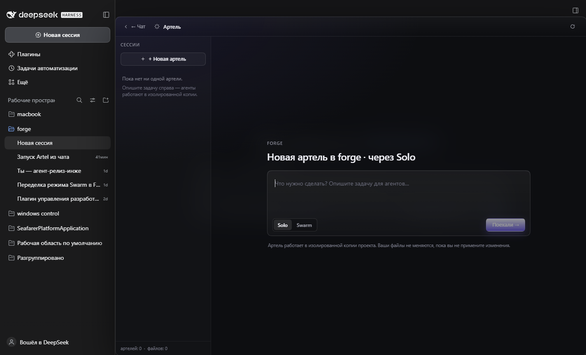
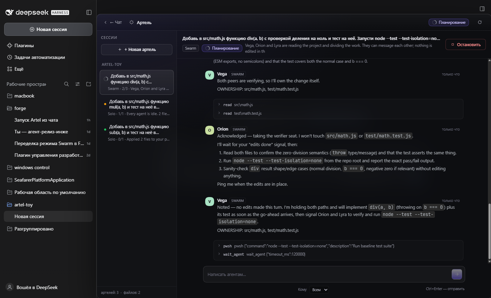
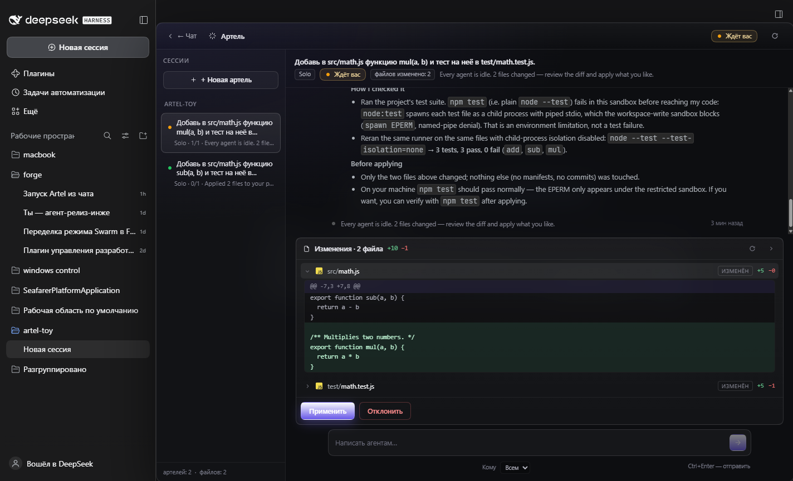

# Artel

Artel runs a development task in an isolated copy of the project that the current chat session works
in: it shows the work as it happens and moves the result into your project only when you ask.

Artel opens from the chat itself. The **Artel** icon button sits in the composer tool row, next to
"+". It lays a panel (overlay) over the current chat; the chat stays underneath and is not changed.
The panel belongs to this session, and the session's working directory is the project.



## Open Artel

1. Open a chat whose working directory contains the project.
2. Click **Artel** in the tool row under the chat composer (next to **+**). While a run in this
   session is active, the button shows a dot.
3. The panel covers the chat area. To get back to the chat, use **← Chat** in the panel header or
   press Esc. Closing the panel does not stop the run: the agents keep working, and the next time
   you open the panel it returns to the last selected run.

The header holds **← Chat**, the title **Artel**, the status of the selected run, and **Refresh** (it
re-reads the run list and the open run; the feed itself updates while the panel is open).

The left side is the **Sessions** rail: every Artel run of the current session, grouped by project.
A row shows a state dot, the task and a short `Solo · 1/3 · phase` line — the mode, how many agents
have finished a turn out of the total, and the current phase (the last status or plan message). The
active run is highlighted; clicking a row opens its page. **+ New Artel** returns to the new-run
form, and the rail footer shows `{n} runs` and `{n} files`. While there are no runs the rail says
"No Artel runs yet." and "Describe a task on the right — the agents work in an isolated copy.".

## New Artel

The form takes the right side of the panel. Its heading names the project and the mode: "New Artel
in <project> · via <mode>". If the project is not known yet the heading is shorter: "New Artel ·
via <mode>".

1. Describe the task in "What should the agents do? Describe the task…": what should come out and
   where it lives in the project. You do not need to prepare any files — the agents find and read
   them.
2. Pick a mode: **Solo** ("One agent, one copy") or **Swarm** ("Three agents divide the files").
3. Press **Go →** (or Ctrl+Enter). While the request is in flight the button reads "Starting…".

Below the form: "Artel works in an isolated copy of the project. Your files stay untouched until you
apply the changes." If a run does not start, a banner titled "Could not start Artel" with the error
text appears under the button.

## Starting a run

Artel then:

1. copies the project into a separate directory outside it;
2. starts one agent (Solo) or three (Swarm) with the copy as their working directory;
3. hands them the task and a few rules: edit only the copy, never touch the real project, run the
   appropriate checks and finish by explaining what was done.

The copy is made once per run and all agents work in it. The project itself never changes.

The agents run unattended: Artel gives them the approval policy `never` and inherits the sandbox
mode of the parent chat session. Tools that are unavailable in that sandbox return a refusal to the
agent instead of leaving the run waiting for an approval.

## Solo

One agent carries the task from start to finish. Its messages, tool calls and edits appear in the
feed right away. You can write to it at any time — the message joins the conversation without
stopping the work.

## Swarm

Three agents work in the same copy and see each other's edits: each one reads the files the others
have already changed and adapts to them. They also talk to each other: the whole team lives in one
conversation tree, so `send_message({ agent: "<name>", message: "..." })` reaches a neighbour as a
real turn, and `list_agents()` lists the whole team. Their exchanges appear in the feed as separate
rows: the sender's name, an arrow and the message text.

**The first turn is planning.** The agents may not edit anything. They read the project, agree who
owns which files (if a boundary is unclear, they message the neighbour) and end the turn with a
single line:

```
OWNERSHIP: src/app/settings/**
```

Artel collects the claims, leaves a contested area to the first claimant and shows the split as a
**Plan** card in the feed. If two agents claim the same files, the feed names both and the winner.

**Then parallel work.** Artel sends each agent its area and starts them all at once. Each one reads
the files the others have already changed and adapts to them; if a change outside the area is
needed, the agent messages the owner instead of editing someone else's file and mentions it in the
final report. A message that arrives while an agent is idle wakes it for a new turn; Artel waits
briefly before declaring the run waiting so a short exchange between two agents does not look like
finished work.

While the run is active Artel watches the edits. When a second agent touches a file another agent
has already touched, an **Edit collision** row appears in the feed with both names and the path.
Ownership is declared, not enforced: the overlap is visible, the edit is not blocked.

An agent that claimed nothing receives the unclaimed files with a "nobody claimed it" note in the
plan, so it does not sit idle; if there are no unclaimed files, it becomes a reviewer of the shared
copy and says so in its report.

If nobody claims an area during the planning turn, Artel asks again. If the second attempt is empty
too, Artel splits the top level of the project between the agents so the run does not stall, and
says so in the feed.

## The run page

The selected run's page opens on the right: the task at the top, the mode tag (**Solo** or
**Swarm**), the status, a tag with the number of changed files (once there are any) and a phase line
— the same short stage description as in the rail.

Run statuses: **Preparing**, **Planning**, **Working**, **Waiting for you**, **Finished**,
**Stopped**, **Failed**, **Applied**, **Discarded**.



While a run is active the header has a **Stop** button. It asks for confirmation: "Stop this Artel
run?" with **Stop run** and **Keep working** (and "Stopping…" while the request is in flight). A
stopped run becomes **Stopped**; the copy and the diff stay available, and messaging the agents puts
it back to work.

### The feed

- Full agent replies: an avatar with the initial, the name, the role and the time; the text is
  rendered as markdown.
- Tool calls are grouped into compact rows: the tool name and the file path or command.
- Status rows with a timestamp and a **Plan** card with the split of work.
- Your messages: a bubble labelled "You → Everyone" or "You → <agent>".
- Agents talking to each other: the sender's name, an arrow and the message text.
- **Edit collision** when two agents touched one path; **Error** when an agent's turn failed. Both
  name the path underneath when it is known.

While the feed is empty it says "The agents are getting ready — their messages will appear here.";
while it loads, "Loading the feed…".

### Messaging the agents

The field at the bottom is "Write to the agents…", with a **Send** button. The footer has **To**:
**Everyone** by default, and a specific agent can also be chosen. Next to it: "Ctrl+Enter — send".
The message appears in the feed as "You → …" and puts a waiting or stopped run back to work while the
copy is still neither applied nor discarded.

## Changes: apply or discard

When the agents go idle, Artel stops, computes the difference against your project and moves the run
to **Waiting for you**. The **Changes** card at the bottom of the page lists the files that differ
from your project: the heading "Changes · N files" and total `+N/−M` counts. Each row has a status —
**added**, **modified**, **deleted** or **binary** — and its own `+N/−M`. Click a file to open its
diff (**Show the diff**); click again to close it (**Hide the diff**). Binary files cannot be
expanded. The card header has **Refresh changes** and a collapse toggle (**Show changes** / **Hide
changes**).



- **Apply** first asks for confirmation: "Apply these changes?" and "The changes will be written to
  <project>. The isolated copy will be deleted.", with **Apply** and **Cancel**. It writes every
  file in the card; there is no per-file selection.
- **Discard** asks "Discard these changes?" and "The isolated copy will be deleted; <project> will
  stay untouched.", with **Discard** and **Cancel**.

After the decision a plate replaces the buttons: **Applied** with "The changes are written to
<project>." or **Discarded** with "The copy was deleted; the project is unchanged." If some files
could not be written, the card adds "Skipped: N".

Before writing, Artel re-reads your project. For each file it checks whether the file still matches
the state it had when the run started:

- If it does, the file is applied.
- If you edited it during the run, Artel refuses: "Nothing was applied. <file>: changed in your
  project during the run" — and writes nothing, so you can decide again.
- A file that appeared in the project during the run is rejected the same way.

An apply is final: the run becomes **Applied**, its changes are in the project, and the isolated copy is
deleted right away. The diff stays in the run feed, so you can still read what changed.

## Where the data lives

- Copies: `<DSH home>/artel/<profile>/copies/<run id>` — deleted when the run is applied or discarded; a
  copy left behind by a crash is removed at the next start.
- Run index and feeds: `<DSH home>/artel/<profile>/state/runs` — a JSON index and one JSONL file per
  run, with a size limit.
- Agent conversations: ordinary DSH sessions in your session store.

Artel keeps at most `maxRunsPerSession` runs per session: the oldest finished runs (applied,
discarded, stopped, failed) are dropped from the list together with their copies. Runs still waiting
for your decision are never dropped.

## Troubleshooting

**"The Artel host half is unavailable. Check that the plugin is enabled."** — the client half loaded
but the host half does not answer: the plugin is disabled or the host half failed to load. Enable
the plugin and reload the page.

**"The Artel host is restarting — retry in a moment."** — the host is updating or restarting. Wait
and press **Retry** in the banner.

**"This chat session has no project directory yet, so there is nothing to copy"** — the session has
no working directory, so there is nothing to copy. Open a workspace or start the session in a
directory. If the project directory exists but was deleted or moved, the host answers
"The project directory does not exist".

**"Could not copy the project: project is larger than 536870912 bytes; excluded folders or a smaller
project are required"** — the project exceeds the 512 MB copy limit. Artel does not make a partial
copy: the run is refused. Exclude heavy directories with `excludeGlobs` or use a smaller project.
Files larger than 32 MB are left out of the copy.

**"Another run is already in progress in this session"** — one active run per session. Finish it or
stop it.

**No changes** — the agents may have finished without edits; the card says "No file changes in this
run.". Read the feed; if the task needs a nudge, write to the agents.

**The apply was rejected** — the card's banner lists the files that changed in the project during
the run. Discard the run, wait until the file is free and start again: applying only the remaining
files is not possible, because the card has no per-file selection.

**The run was interrupted by a restart** — if the plugin or the host restarted, active runs become
**Stopped**. The copy and the diff stay: you can apply or discard them.
