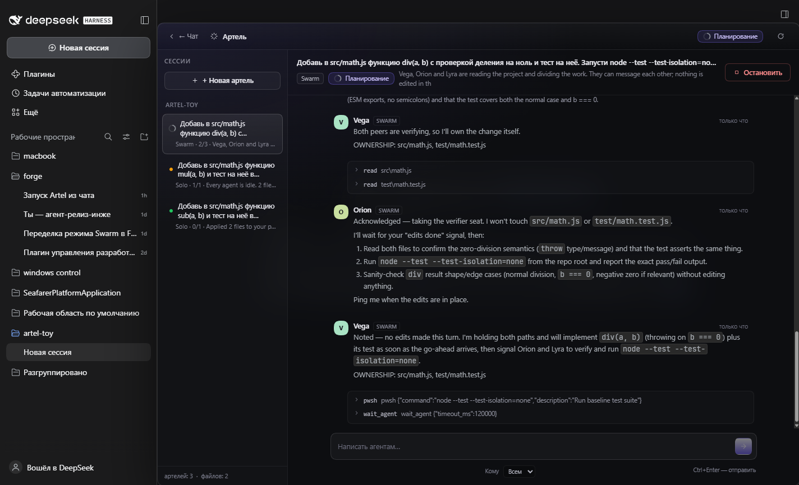
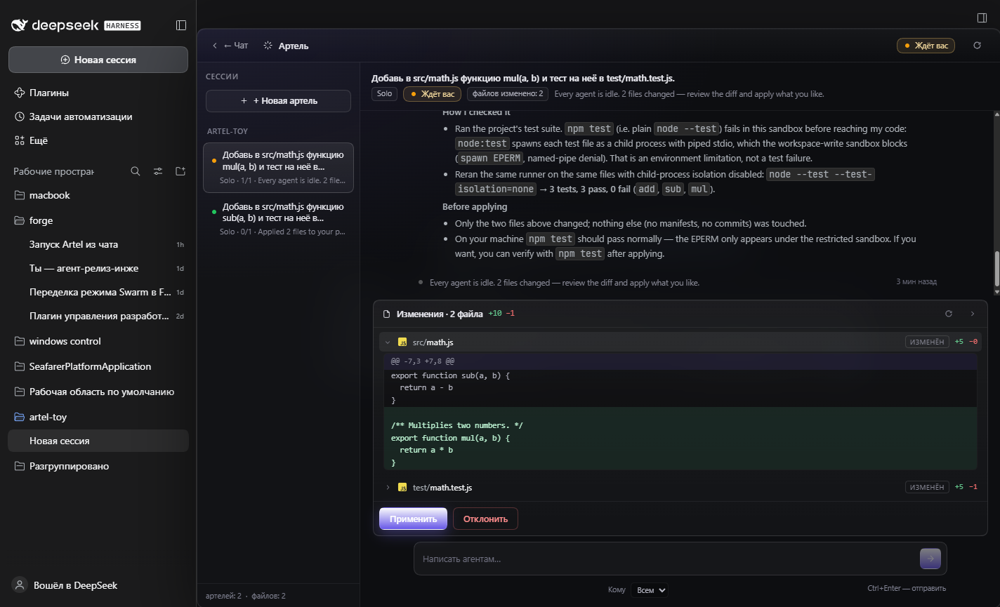

# Artel

Artel выполняет задачу по разработке в изолированной копии проекта, открытого в текущей сессии чата:
показывает работу по ходу дела и переносит результат в ваш проект только по вашей команде.

Артель открывается прямо из чата. Кнопка с иконкой **Артель** стоит в ряду инструментов композера,
рядом с «+». Она накладывает панель (оверлей) на область текущего чата; сам чат остаётся под ней и не
меняется. Панель привязана к этой сессии, а рабочий каталог сессии — это проект.


## Открыть артель

1. Откройте чат, в рабочем каталоге которого лежит проект.
2. Нажмите кнопку **Артель** в ряду инструментов под полем ввода чата (рядом с **+**). Пока в этой
   сессии идёт запуск, на кнопке горит точка.
3. Панель займёт область чата. Вернуться в чат — кнопка **Чат** в её шапке или клавиша Esc.
   Закрытие панели не останавливает запуск: агенты продолжают работать, а при следующем открытии
   панель вернётся к последнему выбранному запуску.

В шапке панели: кнопка **Чат** (со стрелкой назад и словом), название **Артель**, статус выбранного запуска и кнопка **Обновить**
(она перечитывает список артелей и открытый запуск; сама лента обновляется, пока панель открыта).

Слева — рейл **Сессии**. Это все артели текущей сессии, сгруппированные по проекту. В строке артели:
точка состояния, задача и краткая строка `Solo · 1/3 · фаза` — режим, сколько агентов уже закончило
ход из общего числа и текущая фаза (последнее сообщение статуса или плана). Активная артель
подсвечена, клик открывает её страницу. Кнопка **Новая сессия** возвращает к форме со страницы запуска, а
внизу рейла видны счётчики `сессий: N` и `файлов: M`. Пока сессий нет, рейл пишет «Пока нет ни одной
сессии.»; кнопка создания показывается только на странице запуска.

## Новая задача

Форма занимает правую часть панели. Заголовок короткий — «Новая задача»; у выборов
модели и рассуждения открывается меню с разделами провайдеров, галочкой у текущего значения и
полной поддержкой клавиатуры, а напоминание под карточкой называет проект, в
котором будет работать запуск, и говорит про изолированную копию.

1. Опишите задачу в поле «Опишите задачу для агентов…»: что должно получиться и
   где это в проекте. Готовить файлы не нужно — агенты находят и читают их сами.
2. Выберите режим: **Solo** («Один агент, одна копия»), **Swarm** («Три агента делят файлы») или
   **Conductor** («Трое делят файлы, дирижёр принимает работу»).
3. Нажмите **Поехали →** (или Ctrl+Enter). Пока запрос уходит, кнопка показывает «Запускаю…».

Под формой — напоминание: «Задача выполняется в изолированной копии проекта «<проект>». Ваши файлы не меняются, пока
вы не примените изменения.» Если запуск не стартовал, под кнопкой появляется баннер «Не удалось
запустить артель» с текстом ошибки.

## Модель и степень рассуждения

В форме новой артели выбирается и маршрут. **Модель** группирует всех провайдеров, которых объявляет
профиль, и их модели; **Усилие** предлагает степени рассуждения, которые сообщает сама модель, а
**Авто** означает значение адаптера по умолчанию. Artel запускает всех агентов запуска на этом
маршруте. Без выбора агенты работают на модели профиля по умолчанию.

На странице артели под заголовком есть полоса маршрутов: каждый агент со своими списками **модели** и
**усилия**, так что один участник может планировать на дешёвой модели, а править — на сильной. Смена
строки перенаправляет только этого агента, начиная со следующего хода: уже идущий ход сохраняет свой
маршрут. После применения или отклонения запуска полоса доступна только для чтения. Если Host не может
добраться до агента, строка остаётся на модели профиля по умолчанию, а в ленте появляется
предупреждение — запуск не падает.

## Запуск

Дальше Artel:

1. копирует проект в отдельный каталог вне его;
2. запускает одного агента (Solo), трёх (Swarm) или дирижёра с участниками (Conductor) с рабочим
   каталогом, равным копии;
3. передаёт им задачу и короткие правила: работать только в копии, не трогать настоящий проект,
   запускать подходящие проверки и в конце объяснить, что сделано.

Копия создаётся один раз на запуск, и все агенты работают в ней. Сам проект не меняется.

Агенты работают без запросов подтверждения: Artel выдаёт им политику approval `never` и переносит
режим песочницы (sandbox) из родительской сессии чата. Инструменты, недоступные в этой песочнице,
вернут агенту отказ, и запуск не зависнет на ожидании подтверждения.

## Solo

Один агент ведёт задачу от начала до конца. Его сообщения, вызовы инструментов и правки появляются в
ленте сразу. Писать ему можно в любой момент — сообщение попадёт в разговор, не останавливая работу.

## Swarm

Три агента работают в одной копии и видят правки друг друга: каждый читает файлы, которые соседи уже
изменили, и подстраивается под них. Они ещё и переписываются между собой: вся команда живёт в одном
дереве разговоров, поэтому `send_message({ agent: "<имя>", message: "..." })` доходит до соседа
настоящим ходом, а `list_agents()` показывает всю команду. Переписка агентов видна в ленте отдельными
строками: имя отправителя, стрелка и текст сообщения.

**Первый ход — планирование.** Агентам запрещено что-либо править. Они читают проект, договариваются,
кто за какие файлы отвечает (при неясной границе — прямо сообщением соседу), и завершают ход одной
строкой:

```
OWNERSHIP: src/app/settings/**
```

Artel собирает заявки, оставляет за первым претендентом спорный участок и показывает карту разделения
в ленте карточкой **План**. Если двое заявили одни и те же файлы, лента называет обоих и победителя.

**Затем — параллельная работа.** Artel отправляет каждому его участок и запускает их одновременно.
Каждый читает файлы, которые соседи уже изменили, и подстраивается под них; если нужна правка вне
участка, агент пишет владельцу сообщением, а не правит чужой файл, и упоминает это в итоговом отчёте.
Сообщение, пришедшее простаивающему агенту, будит его на новый ход; Artel немного выжидает, прежде чем
объявить запуск ожидающим, чтобы короткая переписка двух агентов не выглядела как завершённая работа.

Пока запуск активен, Artel следит за правками. Когда второй агент трогает файл, который уже трогал
другой, в ленте появляется строка **Конфликт правок** с обоими именами и путём. Владение объявляется,
но не блокирует: пересечение видно, правка не запрещается.

Агенту, который ничего не заявил, Artel отдаёт незанятые файлы с пометкой «nobody claimed it» в
плане, чтобы он не простаивал; если незанятых файлов нет, он становится проверяющим общей копии и
пишет об этом в отчёте.

Если на планирующем ходу никто не объявил участок, Artel спрашивает ещё раз. Если и вторая попытка
пуста, Artel делит верхний уровень проекта между агентами, чтобы запуск не остановился, и сообщает об
этом в ленте.

## Conductor

Дирижёр ведёт команду и отвечает за результат. Это ещё один агент поверх команды Swarm: один дирижёр и
заданное число участников (`swarmAgentCount`, по умолчанию трое), общая копия и общее дерево
разговоров. Запуск проходит пять актов.

**1. Задача попадает команде.** Участники и дирижёр стартуют в копии и читают проект. Каждый участник
предлагает свой узкий участок, а дирижёр завершает планирующий ход своим решением. Правок в этом шаге
нет: предложение видно в ленте карточкой **План** с пометкой, что доли утверждает дирижёр.

**2. Доли розданы.** Дирижёр утверждает раскладку или перераспределяет её — его слово решает спор, и
обсуждение не ходит по кругу. Artel отправляет каждому участнику его участок, а в ленте появляется
итоговая карта: **доли розданы, правок пока нет**. С этого места начинается работа.

**3. Файлы правятся параллельно.** Участники правят свои файлы, дирижёр следит. Застрявший участник
спрашивает дирижёра и получает ответ, не дожидаясь вас. Если участник упал или остановился, дирижёр
передаёт его долю живому участнику — лента называет обоих. **Файлы правятся параллельно, ваш проект
без изменений.**

**4. Доля B на доработке.** Когда все участники простаивают, дирижёр читает изменённые файлы,
запускает проверки проекта и сверяет копию с задачей. Он отвечает **принять** или **доработать**: на
доработку уходят названные доли с замечаниями, остальные пока приняты — **доля B на доработке, доли A
и C приняты**. Раундов доработки не больше двух; третий запрос превращается в приём с замечаниями, и
запуск уходит к вам вместе с ними.

**5. Проверки пройдены — решение за вами.** Принятый запуск переходит в **Ждёт вас**, как и в других
режимах. Карточка **Изменения** показывает общий дифф всей копии, а панель сообщает, что проверки
прошли и дирижёр принял результат. Но в ваш проект пока ничего не попало: **Применить** — по-прежнему
единственная кнопка, которая пишет изменения. **Проверки пройдены, решение за вами.**

Conductor требует subagent-стек в профиле DSH: без него запуск отклоняется с ошибкой «Conductor mode
needs the subagent stack in this profile.» — запасного варианта с независимыми сессиями нет. Пока
дирижёр решает доли, проверяет копию или передаёт долю, Artel отклоняет сообщения с просьбой
дождаться следующего этапа; со следующего этапа писать снова можно.

## Страница артели

Справа открывается страница выбранной артели: сверху задача, тег режима (**Solo**, **Swarm** или
**Conductor**), статус, тег с числом изменённых файлов (появляется, когда файлы уже есть) и строка
фазы — то же краткое описание этапа, что и в рейле.

Статусы запуска: **Подготовка**, **Планирование**, **В работе**, **Ждёт вас**, **Готово**,
**Остановлено**, **Ошибка**, **Применено**, **Выброшено**.



Пока запуск активен, в шапке есть кнопка **Остановить**. Она просит подтверждение: «Остановить
артель?» с кнопками **Остановить** и **Продолжить** (на время запроса — «Останавливаю…»).
Остановленный запуск переходит в **Остановлено**, копия и дифф остаются доступны, а сообщением агентов
можно вернуть в работу.

### Лента

- Полноценные реплики агентов: аватар с инициалом, имя, роль и время; текст выводится как markdown.
- Вызовы инструментов собраны в компактные строки: имя инструмента и путь к файлу или команда.
- Строки статуса с отметкой времени и карточка **План** с картой разделения работы. В режиме
  Conductor карточка **План** также несёт решения дирижёра: розданные доли, раунд доработки и приём.
- Ваши сообщения — пузырь с подписью «Вы → Всем» или «Вы → <агент>».
- Переписка агентов между собой: имя отправителя, стрелка и текст сообщения.
- **Конфликт правок** — если два агента тронули один путь; **Ошибка** — если ход агента завершился
  ошибкой. В обеих строках ниже указан путь, если он известен.

Пока лента пуста, на её месте надпись «Агенты готовятся — первые сообщения появятся здесь.»; во время
загрузки — «Загружаю ленту…».

### Сообщение агентам

Поле внизу страницы — «Написать агентам…», кнопка **Отправить**. В футере — **Кому**: по умолчанию
**Всем**, можно выбрать и конкретного агента. Подсказка рядом: «Ctrl+Enter — отправить».
Сообщение появляется в ленте строкой «Вы → …» и возвращает ожидающий или остановленный запуск в работу,
пока копия ещё не применена и не отклонена. В режиме Conductor сообщение отклоняется, пока дирижёр
решает доли, проверяет копию или передаёт долю; со следующего этапа писать снова можно.

## Изменения: применить или отклонить

Когда агенты простаивают, Artel останавливается, считает разницу с проектом и переводит запуск в
**Ждёт вас**. Карточка **Изменения** внизу страницы показывает файлы, которые отличаются от вашего
проекта: заголовок «Изменения · N файлов» и общие счётчики `+N/−M`. У каждой строки — статус
**добавлен**, **изменён**, **удалён** или **двоичный** и свои `+N/−M`. Нажмите на файл, чтобы раскрыть
его дифф (**Показать дифф**); повторное нажатие скрывает его (**Скрыть дифф**). Двоичные файлы
раскрыть нельзя. В шапке карточки — **Обновить изменения** и свернуть/развернуть карточку (**Показать
изменения** / **Скрыть изменения**).



- **Применить** — сначала спрашивает подтверждение: «Применить изменения?» и «Изменения будут
  записаны в <проект>. Копия будет удалена.», кнопки **Применить** и **Отмена**. Записываются все
  файлы из карточки; выбора отдельных файлов нет.
- **Отклонить** — подтверждение «Отклонить изменения?» и «Изолированная копия будет удалена, а
  <проект> останется без изменений.», кнопки **Отклонить** и **Отмена**.

После решения на месте кнопок появляется плашка **Применено** с подсказкой «Изменения записаны в
<проект>.» или **Отклонено** с подсказкой «Копия удалена; проект не изменён.». Если часть файлов не
удалось записать, карточка добавляет строку «Пропущено: N».

Перед записью Artel заново читает ваш проект. Для каждого файла проверяется, совпадает ли он с
состоянием на момент старта запуска:

- Если совпадает — файл применяется.
- Если вы изменили его во время запуска, Artel отказывает: «Nothing was applied. <файл>: changed in
  your project during the run» — и не записывает ничего, чтобы вы решили заново.
- Файл, появившийся в проекте во время запуска, отклоняется так же.

Применение окончательно: запуск становится **Применено**, его изменения — в проекте, а изолированная копия
сразу удаляется. Диффы остаются в ленте запуска, так что посмотреть изменения можно и потом.

## Где лежат данные

- Копии: `<DSH home>/artel/<profile>/copies/<run id>` — удаляются при **Применить** и **Отклонить**;
  копия, оставшаяся после сбоя, убирается при следующем старте.
- Индекс запусков и ленты: `<DSH home>/artel/<profile>/state/runs` — JSON-индекс и по одному JSONL на
  запуск, с ограничением размера.
- Разговоры агентов: обычные сессии DSH в вашем хранилище сессий.

Artel хранит не больше `maxRunsPerSession` запусков на сессию: самые старые завершённые запуски
(применённые, отклонённые, остановленные, с ошибкой) убираются из списка вместе с копиями. Запуски,
которые ещё ждут вашего решения, не удаляются.

## Если что-то не работает

**«Серверная часть «Артели» недоступна. Проверьте, что плагин включён.»** — клиентская половина
загружена, а серверная не отвечает: плагин выключен или host-половина не загрузилась. Включите плагин и
перезагрузите страницу.

**«Сервер «Артели» перезапускается — повторите чуть позже»** — хост обновляется или перезапускается.
Подождите и нажмите **Повторить** в баннере.

**«This chat session has no project directory yet, so there is nothing to copy»** — у сессии нет
рабочего каталога, копировать нечего. Откройте рабочее пространство или начните сессию в каталоге.
Если каталог проекта существует, но был удалён или перемещён, сервер отвечает
«The project directory does not exist».

**«Could not copy the project: project is larger than 536870912 bytes; excluded folders or a smaller
project are required»** — проект не влез в лимит копии 512 МБ. Частичную копию Artel не делает:
запуск отклоняется. Исключите тяжёлые каталоги через `excludeGlobs` или возьмите проект меньше.
Файлы крупнее 32 МБ в копию не попадают.

**«Another run is already in progress in this session»** — на сессию допускается один активный запуск.
Завершите или остановите его.

**Изменений нет** — агенты могли закончить без правок; карточка пишет «В этой артели нет изменений в
файлах.». Прочитайте ленту; если задаче нужен толчок, напишите агентам.

**Применение отклонено** — в баннере карточки перечислены файлы, изменённые в проекте во время
запуска. Отклоните запуск, дождитесь, пока файл освободится, и запустите заново: применить только
остальные файлы нельзя, потому что в карточке нет выбора по файлам.

**Запуск прерван перезапуском** — если плагин или хост перезапустились, активные запуски становятся
**Остановлено**. Копия и дифф остаются: их можно применить или отклонить.
