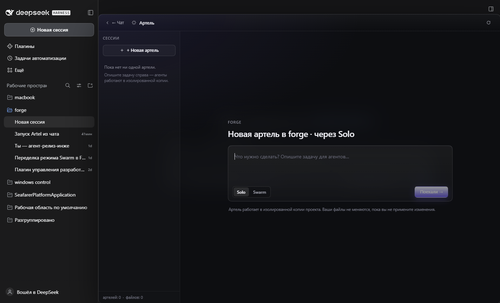

# Artel

Artel выполняет задачу по разработке в изолированной копии проекта, открытого в текущей сессии чата:
показывает работу по ходу дела и переносит результат в ваш проект только по вашей команде.

Артель открывается прямо из чата. Чип **Артель** — метка на фиолетовой плашке и название — стоит в ряду
инструментов композера, рядом с «+» (в узком ряду остаётся только метка). Он накладывает панель (оверлей)
на область текущего чата; сам чат остаётся под ней и не меняется. Панель привязана к этой сессии, а
рабочий каталог сессии — это проект.



## Открыть артель

1. Откройте чат, в рабочем каталоге которого лежит проект.
2. Нажмите чип **Артель** в ряду инструментов под полем ввода чата (рядом с «+»). Пока в этой
   сессии идёт запуск, в углу чипа горит янтарная точка.
3. Панель займёт область чата. Вернуться в чат — кнопка **Чат** в её шапке или клавиша Esc.
   Закрытие панели не останавливает запуск: агенты продолжают работать, а при следующем открытии
   панель вернётся к последнему выбранному запуску.

В шапке панели: кнопка **Чат** (со стрелкой назад и словом), название **Артель**, статус выбранного запуска и кнопка **Обновить**
(она перечитывает список артелей и открытый запуск; сама лента обновляется, пока панель открыта).

Слева — рейл **Сессии**. Это все артели текущей сессии, сгруппированные по проекту. В строке артели:
точка состояния, задача и краткая строка `Solo · 1/3 · фаза` — режим, сколько агентов уже закончило
ход из общего числа и текущая фаза (последнее сообщение статуса или плана). Активная артель
подсвечена, клик открывает её страницу. Кнопка **Новая сессия** возвращает к форме со страницы запуска, а
внизу рейла видны счётчики `сессий: N` и `файлов: M`. Пока сессий нет, рейл пишет «Пока нет ни одной
сессии.»; кнопка создания показывается только на странице запуска.

## Новая задача

Форма занимает правую часть панели. Заголовок короткий — «Новая задача»; у выборов
модели и рассуждения открывается меню с разделами провайдеров, галочкой у текущего значения и
полной поддержкой клавиатуры, а напоминание под карточкой называет проект, в
котором будет работать запуск, и говорит про изолированную копию.

1. Опишите задачу в поле «Опишите задачу для агентов…»: что должно получиться и
   где это в проекте. Готовить файлы не нужно — агенты находят и читают их сами.
2. Выберите режим: **Solo** («Один агент, одна копия»), **Swarm** («Три агента делят файлы»),
   **Conductor** («Трое делят файлы, дирижёр принимает работу»), **Fusion** («Три модели отвечают
   независимо, судья сводит ответы, одна модель делает работу») или **Orchestrator** («Планировщик
   режет большую цель на части, каждая часть получает свою копию и ревьюера»).
3. Нажмите **Поехали →** (или Ctrl+Enter). Пока запрос уходит, кнопка показывает «Запускаю…».

Под формой — напоминание: «Задача выполняется в изолированной копии проекта «<проект>». Ваши файлы не меняются, пока
вы не примените изменения.» Если запуск не стартовал, под кнопкой появляется баннер «Не удалось
запустить артель» с текстом ошибки.

## Модель и степень рассуждения

В форме новой артели выбирается и маршрут. **Модель** группирует всех провайдеров, которых объявляет
профиль, и их модели; **Усилие** предлагает степени рассуждения, которые сообщает сама модель, а
**Авто** означает значение адаптера по умолчанию. Artel запускает всех агентов запуска на этом
маршруте. Без выбора агенты работают на модели профиля по умолчанию.

На странице артели под заголовком есть полоса маршрутов: каждый агент со своими списками **модели** и
**усилия**, так что один участник может планировать на дешёвой модели, а править — на сильной. Смена
строки перенаправляет только этого агента, начиная со следующего хода: уже идущий ход сохраняет свой
маршрут. После применения или отклонения запуска полоса доступна только для чтения. Если Host не может
добраться до агента, строка остаётся на модели профиля по умолчанию, а в ленте появляется
предупреждение — запуск не падает.

В режиме **Fusion** форма заменяет один маршрут пятью слотами — **Панель 1**, **Панель 2**,
**Панель 3**, **Судья** и **Исполнитель**, — у каждого свои списки модели и усилия (список усилий
появляется, если выбранная модель предлагает степени рассуждения). Панель по умолчанию занимает разные
строки каталога, если профиль объявляет несколько моделей; судья и исполнитель стартуют на модели
профиля. Все пять маршрутов можно поменять на странице артели, пока запуск жив и агент ещё не начал
свой ход.

## Запуск

Дальше Artel:

1. копирует проект в отдельный каталог вне его (в режиме Orchestrator копии создаются позже, по одной
   на часть, после того как планировщик разрежет цель);
2. запускает одного агента (Solo), трёх (Swarm), дирижёра с участниками (Conductor), пять агентов
   Fusion — три модели панели, судью и исполнителя — или, в Orchestrator, сначала планировщика, а затем
   агента и ревьюера на каждую часть, с рабочим каталогом, равным их копии;
3. передаёт им задачу и короткие правила: работать только в копии, не трогать настоящий проект,
   запускать подходящие проверки и в конце объяснить, что сделано.

Копия создаётся один раз на запуск, и все агенты работают в ней. Сам проект не меняется.

Агенты работают без запросов подтверждения: Artel выдаёт им политику approval `never` и переносит
режим песочницы (sandbox) из родительской сессии чата. Инструменты, недоступные в этой песочнице,
вернут агенту отказ, и запуск не зависнет на ожидании подтверждения.

## Solo

Один агент ведёт задачу от начала до конца. Его сообщения, вызовы инструментов и правки появляются в
ленте сразу. Писать ему можно в любой момент — сообщение попадёт в разговор, не останавливая работу.

## Swarm

Три агента работают в одной копии и видят правки друг друга: каждый читает файлы, которые соседи уже
изменили, и подстраивается под них. Они ещё и переписываются между собой: вся команда живёт в одном
дереве разговоров, поэтому `send_message({ agent: "<имя>", message: "..." })` доходит до соседа
настоящим ходом, а `list_agents()` показывает всю команду. Переписка агентов видна в ленте отдельными
строками: имя отправителя, стрелка и текст сообщения.

**Первый ход — планирование.** Агентам запрещено что-либо править. Они читают проект, договариваются,
кто за какие файлы отвечает (при неясной границе — прямо сообщением соседу), и завершают ход одной
строкой:

```
OWNERSHIP: src/app/settings/**
```

Artel собирает заявки, оставляет за первым претендентом спорный участок и показывает карту разделения
в ленте карточкой **План**. Если двое заявили одни и те же файлы, лента называет обоих и победителя.

**Затем — параллельная работа.** Artel отправляет каждому его участок и запускает их одновременно.
Каждый читает файлы, которые соседи уже изменили, и подстраивается под них; если нужна правка вне
участка, агент пишет владельцу сообщением, а не правит чужой файл, и упоминает это в итоговом отчёте.
Сообщение, пришедшее простаивающему агенту, будит его на новый ход; Artel немного выжидает, прежде чем
объявить запуск ожидающим, чтобы короткая переписка двух агентов не выглядела как завершённая работа.

Пока запуск активен, Artel следит за правками. Когда второй агент трогает файл, который уже трогал
другой, в ленте появляется строка **Конфликт правок** с обоими именами и путём. Владение объявляется,
но не блокирует: пересечение видно, правка не запрещается.

Агенту, который ничего не заявил, Artel отдаёт незанятые файлы с пометкой «nobody claimed it» в
плане, чтобы он не простаивал; если незанятых файлов нет, он становится проверяющим общей копии и
пишет об этом в отчёте.

Если на планирующем ходу никто не объявил участок, Artel спрашивает ещё раз. Если и вторая попытка
пуста, Artel делит верхний уровень проекта между агентами, чтобы запуск не остановился, и сообщает об
этом в ленте.

## Conductor

Дирижёр ведёт команду и отвечает за результат. Это ещё один агент поверх команды Swarm: один дирижёр и
заданное число участников (`swarmAgentCount`, по умолчанию трое), общая копия и общее дерево
разговоров. Запуск проходит пять актов.

**1. Задача попадает команде.** Участники и дирижёр стартуют в копии и читают проект. Каждый участник
предлагает свой узкий участок, а дирижёр завершает планирующий ход своим решением. Правок в этом шаге
нет: предложение видно в ленте карточкой **План** с пометкой, что доли утверждает дирижёр.

**2. Доли розданы.** Дирижёр утверждает раскладку или перераспределяет её — его слово решает спор, и
обсуждение не ходит по кругу. Artel отправляет каждому участнику его участок, а в ленте появляется
итоговая карта: **доли розданы, правок пока нет**. С этого места начинается работа.

**3. Файлы правятся параллельно.** Участники правят свои файлы, дирижёр следит. Застрявший участник
спрашивает дирижёра и получает ответ, не дожидаясь вас. Если участник упал или остановился, дирижёр
передаёт его долю живому участнику — лента называет обоих. **Файлы правятся параллельно, ваш проект
без изменений.**

**4. Доля B на доработке.** Когда все участники простаивают, дирижёр читает изменённые файлы,
запускает проверки проекта и сверяет копию с задачей. Он отвечает **принять** или **доработать**: на
доработку уходят названные доли с замечаниями, остальные пока приняты — **доля B на доработке, доли A
и C приняты**. Раундов доработки не больше двух; третий запрос превращается в приём с замечаниями, и
запуск уходит к вам вместе с ними.

**5. Проверки пройдены — решение за вами.** Принятый запуск переходит в **Ждёт вас**, как и в других
режимах. Карточка **Изменения** показывает общий дифф всей копии, а панель сообщает, что проверки
прошли и дирижёр принял результат. Но в ваш проект пока ничего не попало: **Применить** — по-прежнему
единственная кнопка, которая пишет изменения. **Проверки пройдены, решение за вами.**

Conductor требует subagent-стек в профиле DSH: без него запуск отклоняется с ошибкой «Conductor mode
needs the subagent stack in this profile.» — запасного варианта с независимыми сессиями нет. Пока
дирижёр решает доли, проверяет копию или передаёт долю, Artel отклоняет сообщения с просьбой
дождаться следующего этапа; со следующего этапа писать снова можно.

## Fusion

Fusion — для вопроса, который стоит перед работой: *какой подход взять и как это лучше сделать*.
Три модели отвечают на одну задачу независимо, судья сводит ответы в одно решение, и одна модель его
исполняет. Запуск проходит три акта; первые два ничего не меняют.

**1. Три ответа, без подглядывания.** Задача одновременно уходит трём моделям панели. Каждая отвечает
в своём разговоре — модели не видят ответы друг друга и не могут друг другу написать, — и каждая
отвечает рекомендацией: подход, компромиссы, риски и как это проверить. Панель работает в песочнице
`read-only`, поэтому модель панели физически не может править файлы: это разговор о том, *как* делать
работу. Правок нет, ваш проект не тронут.

**2. Судья сводит.** Когда все три ответа готовы, отдельная модель-судья читает их и собирает одно
общее решение: где ответы сошлись, где разошлись, что заметил только один из них, и итоговый план.
Никто не побеждает — в дело идут сильные части каждого ответа. Сведённое решение появляется в ленте
карточкой **План**, а строка статуса называет число спорных мест, которые нашёл судья. Если модель
панели остановилась, судья сводит ответы, которые есть; если остановился сам судья или ответил пусто,
Artel спрашивает его ещё раз и только потом завершает запуск ошибкой.

**3. Одна модель исполняет.** Исполнитель получает сведённое решение целиком и обычные правила работы
и правит копию: сначала читает проект, делает минимальную связную правку и запускает проверки проекта.
С этого места запуск ведёт себя как Solo — реплики исполнителя в ленте, ему можно писать, а когда он
простаивает, запуск останавливается.

**Решение за вами.** Когда исполнитель простаивает, запуск переходит в **Ждёт вас**, как и в других
режимах. Карточка **Изменения** показывает дифф копии, и только **Применить** пишет его в ваш проект.
Упавший исполнитель оставляет запуск ожидающим с тем, что уже было написано.

Панель и судья принимают ваши сообщения, только пока активен их этап; во время сведения запуск
остаётся в **Планировании**, и действует правило «дождитесь следующего этапа». Fusion не требует
subagent-стека: все пять агентов — обычные сессии, и каждая из них отдельный чат в списке справа с
заголовком `Artel · Fusion · <роль> — <задача>`.

## Orchestrator

Orchestrator — для цели, которая велика для одного агента: это направление, а не задача на десять
минут. Планировщик режет её на независимые части, каждая часть делается в своей копии проекта, а
ревьюер сверяет её с условиями плана; в одну копию попадают только принятые части, и вы применяете
результат одной кнопкой. Разбиение видно до начала работы.

**1. Планировщик режет цель.** Запуск начинается с одного агента — планировщика, который читает
настоящий проект в режиме только чтения. Он отвечает коротким планом: сводка и `orchestratorParts`
частей (по умолчанию три, максимум четыре), у каждой — название, цель, условие «считается сделанной,
когда» и файлы, которых она, по ожиданию, коснётся. Разбиение появляется в ленте карточкой **План**,
так что части видны до любых правок. Если планировщик не выдал читаемый план, Artel просит ещё раз и
затем завершает запуск ошибкой — ничего не изменено.

**2. Своя копия и два агента на часть.** Для каждой части Artel делает отдельную копию проекта и
запускает в ней двух агентов: агент части делает работу, а ревьюер — в режиме только чтения — читает
её правки и сверяет с записанными условиями. Когда агент части заканчивает, ревьюер либо принимает
часть, либо возвращает её в работу и перечисляет проблемы. Возвращённая часть уходит своему агенту
вместе с этими проблемами; вернуть часть можно не больше двух раз, после этого она принимается с
замечаниями ревьюера. Агенты частей работают параллельно, в отдельных копиях, поэтому не могут
перезаписать друг друга; планировщик и ревьюеры ничего не правят.

**3. Сборка.** Когда все части приняты, Artel записывает принятые изменения в одну собранную копию.
Файлы, которые меняла только одна часть, попадают туда как есть; файлы, которые меняли несколько
частей, — это конфликт, его получает агент-сборщик, который сводит правки на их настоящих местах.
Затем Artel проверяет, что каждый конфликтный файл действительно отличается от исходного, и только
после этого отдаёт работу вам. Сборка, которую не удалось закончить, завершает запуск ошибкой с
записанным состоянием слияния: собранная копия остаётся доступной для диффа, но **Применить**
отклоняется, пока вы не отклоните запуск.

**Решение за вами.** Когда сборка закончена, запуск переходит в **Ждёт вас**: карточка **Изменения**
показывает дифф собранной копии, и только **Применить** пишет его в ваш проект. Карточка **Части** на
странице артели перечисляет части с их статусом (в работе, на проверке, вернулась в работу, принята) и
условиями плана, так что видно, что проверено и о чём просил ревьюер. Копии частей удаляются сразу
после сборки.

Orchestrator не требует subagent-стека: каждый агент — обычная сессия с заголовком по своей части —
`Artel · Orchestrator · <агент> — <задача>` у планировщика, `Artel · Part N — <название> · <агент> —
<задача>` у агента части, `Artel · Review · Part N — <название> · <агент> — <задача>` у ревьюера и
`Artel · Merge · <агент> — <задача>` у сборщика. Пока планировщик режет цель, запуск находится в
**Планировании**, и сообщения отклоняются; дальше действуют обычные правила.

## Автоочередь

У каждого сеанса чата своя очередь; её колонка в панели — **Ожидают**. Напишите следующую задачу в
поле «Что сделать дальше…» и нажмите **В очередь**: задача встанет в очередь вместо запуска, и для неё
можно выбрать свой режим (Solo, Swarm, Conductor или Fusion) и модель. Очередь принадлежит сеансу,
поэтому в другом чате она своя; сообщение в чате, отправленное во время автоочереди, не прерывает
агента — оно встаёт в очередь первой задачей.

Переключите **Автоочередь**, и очередь пойдёт без вас, задача за задачей. Пока переключатель выключен,
задача просто ждёт в колонке **Ожидают**. Перед первой задачей показывается карточка «Перед запуском»:
команда проверки, лимит задач и не сохранённые ранее версии — по каждой вы решаете, сохранить её
версией или отложить. Команду проверки Artel подбирает по манифестам проекта (**Подобрана по
проекту**); её можно заменить вручную или выключить (**Без проверки**); без подходящей команды версия
сохраняется на слово агента и помечается как такая. Лимит («Не больше задач за
запуск», по умолчанию двадцать) ограничивает, сколько задач возьмёт одна ночь.

Задача автоочереди идёт по правилам ночной смены, которые агент получает на каждом ходу: это новый
работник на задачу, спрашивать некого — значит, агент принимает наименьшее разумное допущение и
записывает его, а не спрашивает. На первый вопрос задачи отвечают за него — «решай сам и запиши
допущение»; второй вопрос отправляет задачу в «Отложенное». Наружу агент ничего не отправляет (ни
push, ни пул-реквеста, ни публикации, ни деплоя, ни комментария в трекере, ни сообщения за пределы
машины), не поднимает preview и не запускает долгий dev-сервер, остаётся в своей копии, гоняет проверки
проекта и заканчивает коротким отчётом: что изменил, что проверил, какие допущения принял.

Готовая задача должна пройти проверку, и только тогда она становится версией. Неудачная проверка
возвращается тому же работнику как попытка починки, не больше двух; после этого задача либо проходит и
сохраняется версией, либо откладывается. Версия — обычная версия Artel: следующая задача стартует от
последней успешной, так что очередь наращивает результат, а базой диффа остаётся настоящий проект —
версию вы смотрите и применяете так же, как ручной запуск.

В **Отложенное** попадают задачи, которые не проходят без человека: проверка не прошла после двух
починок, в диффе есть секрет или мусор, агент попытался отправить что-то наружу или сообщил, что
заблокирован. Отложенная задача
получает метку `vf/parked-…`, сохраняет свою частичную копию и может вернуться в очередь и продолжить с
неё; остальные задачи при этом идут дальше. Лимит подписки только приостанавливает очередь, и она
продолжается после сброса; потерянный вход её завершает.

**Стоп** прерывает агента и откладывает частичную работу, **Закончить после текущей** даёт текущей
задаче пройти проверку и останавливает очередь, а выключенный переключатель **Автоочередь** означает,
что новые задачи не берутся. Очередь завершается сама, когда она пуста, когда достигнут лимит задач,
после трёх отложенных подряд, при потере входа или когда на диске почти не осталось места. Тогда
карточка **Итоги автоочереди** показывает сохранённые версии с их проверками, отложенные задачи с
причинами и задачи, которые не взяли. Карточку можно свернуть до заголовка **Итоги автоочереди**, а
когда смена заканчивается, она сама прокручивается в поле зрения: колонка запуска прокручивается, и
короткая панель больше не прячет карточку под композером.

## Фабрика

**Фабрика** превращает проект в конвейер тикетов: доска хранит тикеты одного проекта, а агенты ведут
каждый тикет от **Входящих** до **Готово к PR** без вас; в **Готово** тикет попадает после того, как вы
откроете пул-реквест или вольёте результат. Откройте её кнопкой **Открыть «Фабрику»**, создайте
доску проекта (**Создать доску**) и включите её кнопкой **Включить** — включить доску можно только
после того, как **Проверить** покажет «Готова». **Пауза** перестаёт брать новые тикеты, начатые
заканчиваются, **Продолжить** возвращает доску в работу.

Готовность блокируют три вещи: проект — git-репозиторий, в нём есть хотя бы один коммит (фабрика
считает дифф от него) и хотя бы один движок авторизован. Команда тестов (или подобранная по проекту),
команда preview и Playwright показываются в списке, но не блокируют. Если команда тестов не задана,
берётся команда проверки, затем подобранная по проекту; без подходящей команды этап тестов
пропускается с пометкой.

На доске семь колонок — **Входящие**, **Разбор**, **Работа**, **Проверки**, **Готово к PR**, **Ждёт
вас**, **Готово** — а в конвейере за ними девять этапов: incoming, triage, working, tests, check, review,
ready, waiting и done. **Проверки** объединяют этапы тестов, проверки приложения и ревью.

**Входящие.** Заведите тикет полями **Заголовок**, **Текст** и **Файлы и скриншоты** (**Прикрепить**),
добавьте его кнопкой **Добавить тикет** — или импортируйте GitHub issue через **Из GitHub issue**:
`#12` (из репозитория проекта доски), `owner/repo#12` или ссылка на issue — читается установленным и
авторизованным `gh`, и никогда дважды. Неудачный импорт говорит почему: `gh` не установлен или не
авторизован, репозиторий или issue не найдены. Трекеры (GitHub, GitLab, Jira,
Linear) опрашиваются каждые пять минут, если они добавлены на доску, с необязательным комментарием
обратно; **Проверить трекеры** делает это сразу.

**Разбор.** Агент в режиме только чтения читает проект и тикет и отвечает спецификацией, критериями
приёмки, допущениями и маршрутом. Он предлагает самый дешёвый достаточный маршрут из разрешённых
(Solo, Swarm, Fusion, Orchestrator); фабрика может только удешевить предложенный маршрут, но не
удорожить его. Вопросы уходят в **Ждёт вас**: ответьте кнопкой **Ответить**, и тикет вернётся в разбор.
Спецификация, критерии и маршрут после этого видны на тикете.

**Работа.** Тикет запускает обычный запуск Artel своего маршрута по тем же правилам ночной смены, что и
задача автоочереди: на первый вопрос отвечают за него, а второй отправляет тикет в **Ждёт вас**. На
маршруте Orchestrator запуск останавливается после плана и ждёт кнопку **Утвердить план**.

**Тесты** запускают команду тестов доски и возвращают неудачу в работу вместе с выводом. **Проверка
приложения** поднимает preview и смотрит результат в копии только для чтения — только для UI-тикетов,
только если этого хочет шаблон и заданы команда preview и Playwright. **Ревью** — один или два
ревьюера читают дифф тикета и сверяют его с критериями. Неудачные тесты, проверка приложения или ревью
становятся кругом починки в **Работе** с замечаниями, до предела шаблона; когда круги кончились, тикет
ждёт вас. Прошедший ревью тикет переходит в **Готово к PR**.

Шаблоны: **Обычный** — тесты, проверка приложения и ревью, до двух кругов починки; **Быстрый** — без
проверки приложения и один круг починки, для мелких тикетов; **Строгий** — два ревьюера и до трёх кругов
починки. В **Ждёт вас** собираются вопросы разбора, план Orchestrator, ждущий утверждения, исчерпанные
круги починки, прерванная работа, запуск, которому нечего делать, и тикеты,
отложенные кнопкой **Отложить**; **Ещё круг** и **Принять как есть** решают судьбу исчерпанного
тикета, а **Вернуть фабрике** отправляет изменённый тикет снова в разбор.
У доски и у каждого тикета ведётся журнал.

В **Готово к PR** у тикета три действия. **Pull Request** требует чистого дерева и удалённого
репозитория: создаётся ветка `factory/ticket-<number>`, запуск тикета применяется к настоящему проекту,
коммитится, пушится и вызывает `gh pr create` с телом из спецификации, критериев, проверок, допущений и
замечаний ревью; ссылка комментируется обратно в трекер, если доска об этом просит. **Влить** применяет
накопленный дифф тикета к проекту без ветки и push. **Вернуть с комментарием** отправляет тикет
обратно в работу, а ваш комментарий становится кругом починки. **Открыть сессию** подключается к сессии
тикета для ручного вмешательства. Сама фабрика наружу ничего не отправляет: push, пул-реквест и
комментарии случаются только когда вы нажимаете кнопку.

Настройки доски: модели по ролям (**Разбор**, **Работа**, **Тесты**, **Ревью**), **Разрешённые
маршруты**, **Потолок расхода** (**Тикетов одновременно**, **Тикетов в день**, **Работников на тикет**,
**Разрешить движок «API»**, **Разрешать почти исчерпанные подписки**), **Команды** (**Команда тестов**,
**Команда проверки**, **Команда preview**), причуда «Дописывать тесты, если правки их не трогали» и
**Приём тикетов** (трекеры с типом, меткой, проектом/ссылкой и комментарием обратно).

## Страница артели

Справа открывается страница выбранной артели: сверху задача, тег режима (**Solo**, **Swarm**,
**Conductor**, **Fusion** или **Orchestrator**), статус, тег с числом изменённых файлов (появляется,
когда файлы уже есть) и строка фазы — то же краткое описание этапа, что и в рейле.

Статусы запуска: **Подготовка**, **Планирование**, **В работе**, **Ждёт вас**, **Готово**,
**Остановлено**, **Ошибка**, **Применено**, **Выброшено**.

Пока запуск идёт или ждёт, шапка говорит, чего именно он ждёт — «Ждёт вашего ответа», «Ждёт
утверждения плана», «Ждём: Nova», «Агенты работают», «Сводит результат», — и сколько уже ждёт;
тег рядом суммирует токены, потраченные всем запуском (подсказка — вход, выход и кэш). Под шапкой
полоса **Сейчас** перечисляет агентов: точка состояния, последний шаг — вызов инструмента (`write
src/app.js`) или «пишет ответ», — время текущего хода и заполнение окна контекста в токенах и
процентах, а подсказка на цифре показывает состав (система, инструменты, сообщения). Всё это уже
есть в сводке запуска, которую присылает хост, поэтому лишних запросов нет.


Пока запуск активен, в шапке есть кнопка **Остановить**. Она просит подтверждение: «Остановить
артель?» с кнопками **Остановить** и **Продолжить** (на время запроса — «Останавливаю…»).
Остановленный запуск переходит в **Остановлено**, копия и дифф остаются доступны, а сообщением агентов
можно вернуть в работу.

### Лента

- Полноценные реплики агентов: аватар с инициалом, имя, роль и время; текст выводится как markdown.
- Вызовы инструментов собраны в компактные строки: имя инструмента и путь к файлу или команда. Строка,
  которой есть что показать — аргументы, с которыми агент вызвал инструмент, и вывод (или ошибку),
  который вернул инструмент, — это кнопка: она раскрывается на обоих, а галочка поворачивается вниз;
  **Свернуть все** закрывает все раскрытые строки. Строки, которые повторяют только имя, вроде
  `read README.md`, остаются простыми.
- Строки статуса с отметкой времени и карточка **План** с картой разделения работы. В режиме
  Conductor карточка **План** также несёт решения дирижёра: розданные доли, раунд доработки и приём.
  В режиме Fusion она несёт сведённое решение судьи и число спорных мест. В режиме Orchestrator она
  несёт план планировщика с условиями готовности, вердикт ревьюера по каждой части и карточку сборки;
  карточка **Части** над диффом перечисляет части и их статус.
- Ваши сообщения — пузырь с подписью «Вы → Всем» или «Вы → <агент>».
- Переписка агентов между собой: имя отправителя, стрелка и текст сообщения.
- **Конфликт правок** — если два агента тронули один путь; **Ошибка** — если ход агента завершился
  ошибкой. В обеих строках ниже указан путь, если он известен.

Пока лента пуста, на её месте надпись «Агенты готовятся — первые сообщения появятся здесь.»; во время
загрузки — «Загружаю ленту…».

### Блоки: свернуть, скрыть и растянуть

Страница запуска — это колонка блоков: карточка **План**, реплики агентов, сгруппированные вызовы
инструментов, карточка **Части**, карточка **Изменения** и полоса **Очередь**. Заголовок каждого блока —
кнопка: нажмите, чтобы свернуть блок в одну строку с коротким счётчиком — «ПЛАН · 24 строки»,
«Олег · 6 строк», «Инструментов: 4», — и нажмите ещё раз, чтобы развернуть его. Панель **Блоки** над
лентой держит всю страницу под рукой:

- чип скрывает или возвращает один вид блоков — **План**, **Агенты**, **Инструменты**, **Части**,
  **Изменения**, **Очередь**;
- **Компактно** сворачивает все блоки сразу, а **Свернуть все** / **Развернуть все** делают то же
  одним нажатием;
- свёрнутость, скрытые виды и компактный режим запоминаются для каждой сессии чата в браузере
  (`localStorage`, ключ `dsh-artel:blocks:<id сессии>`), так что после перезагрузки страница остаётся
  такой, какой вы её оставили.

Длинный блок ограничен удобной высотой (по умолчанию 40vh для плана и реплик, 36vh для карточки
изменений, 32vh для полосы очереди), прокручивается внутри этой рамки и предлагает **Показать
целиком** / **Свернуть**; за захват на нижнем краю блока можно потянуть его высоту, а за ручку над
полем ввода — высоту самого поля. Лента, карточка частей, карточка изменений и полоса очереди живут в
одной области прокрутки, поэтому поле ввода их никогда не накрывает и ничего не рисуется поверх
ленты (issue #8).

### Сообщение агентам

Поле внизу страницы — «Написать агентам…», кнопка **Отправить**. В футере — **Кому**: по умолчанию
**Всем**, можно выбрать и конкретного агента. Подсказка рядом: «Ctrl+Enter — отправить».
Сообщение появляется в ленте строкой «Вы → …» и возвращает ожидающий или остановленный запуск в работу,
пока копия ещё не применена и не отклонена. В режиме Conductor сообщение отклоняется, пока дирижёр
решает доли, проверяет копию или передаёт долю; со следующего этапа писать снова можно. В режиме Fusion
писать можно только агентам активного этапа: панели, пока она отвечает, судье, пока он сводит ответы, и
исполнителю, когда работа началась. В режиме Orchestrator сообщения отклоняются, пока планировщик режет
цель («Wait until the planner splits the goal into parts»), и пока не закончена остановленная сборка
(«The merge was stopped. Discard the run and plan it again.»); в остальное время писать можно как обычно.

## Изменения: применить или отклонить

Когда агенты простаивают, Artel останавливается, считает разницу с проектом и переводит запуск в
**Ждёт вас**. Карточка **Изменения** внизу страницы показывает файлы, которые отличаются от вашего
проекта: заголовок «Изменения · N файлов» и общие счётчики `+N/−M`. У каждой строки — статус
**добавлен**, **изменён**, **удалён** или **двоичный** и свои `+N/−M`. Нажмите на файл, чтобы раскрыть
его дифф (**Показать дифф**); повторное нажатие скрывает его (**Скрыть дифф**). Двоичные файлы
раскрыть нельзя. В шапке карточки — **Обновить изменения** и свернуть/развернуть карточку (**Показать
изменения** / **Скрыть изменения**).


- **Применить** — сначала спрашивает подтверждение: «Применить изменения?» и «Изменения будут
  записаны в <проект>. Копия будет удалена.», кнопки **Применить** и **Отмена**. Записываются все
  файлы из карточки; выбора отдельных файлов нет.
- **Отклонить** — подтверждение «Отклонить изменения?» и «Изолированная копия будет удалена, а
  <проект> останется без изменений.», кнопки **Отклонить** и **Отмена**.

После решения на месте кнопок появляется плашка **Применено** с подсказкой «Изменения записаны в
<проект>.» или **Отклонено** с подсказкой «Копия удалена; проект не изменён.». Если часть файлов не
удалось записать, карточка добавляет строку «Пропущено: N».

Перед записью Artel заново читает ваш проект. Для каждого файла проверяется, совпадает ли он с
состоянием на момент старта запуска:

- Если совпадает — файл применяется.
- Если вы изменили его во время запуска, Artel отказывает: «Nothing was applied. <файл>: changed in
  your project during the run» — и не записывает ничего, чтобы вы решили заново.
- Файл, появившийся в проекте во время запуска, отклоняется так же.

В режиме Orchestrator у **Применить** есть ещё одно условие: части должны быть собраны. Если вы
остановили запуск посреди сборки или сборщик не смог свести файл, который меняли несколько частей,
**Применить** отклоняется и карточка пишет, что слияние не закончено: собранная копия остаётся
доступной, но единственный путь дальше — **Отклонить** и запустить заново.

Применение окончательно: запуск становится **Применено**, его изменения — в проекте, а изолированная копия
сразу удаляется. Диффы остаются в ленте запуска, так что посмотреть изменения можно и потом.

### Установка в DSH

Применённый проект может быть тем, что должен подхватить сам DSH. Тогда под плашкой **Применено** в
карточке остаётся блок **Установка**, и в нём ничего не происходит само:

- **Установить в DSH** — проект это бандл DSH (`package.json` объявляет `dsh.bundle.patch`, или в корне
  лежит `cordis.patch.yml`). Кнопка добавляет папку проекта в текущий профиль DSH локальной
  зависимостью `link:`. Карточка пишет «Установлено — перезапустите DSH, чтобы загрузить бандл.»
  Профиль без менеджера плагинов вместо кнопки показывает ручной путь: добавьте папку как плагин
  (DSH → Плагины → Добавить плагин), как сказано в README проекта.
- **Шаги установки** — команды, которые объявил сам проект в `artel.install.json`
  (`{"steps": [{"title": "Установить рантайм", "command": "python install/install.py"}]}`, до восьми),
  или обычный скрипт установки, если манифеста нет (`install/install.py`, `scripts/install.mjs`, …).
  У каждого шага видна точная команда; **Запустить** спрашивает подтверждение и запускает только эту
  команду, с папкой проекта как рабочим каталогом и лимитом в пять минут. Карточка показывает код
  возврата, пометку об остановке по лимиту и вывод (**Показать вывод**).

Результаты шагов сохраняются при обновлении карточки: шаг, чья команда не изменилась, сохраняет
результат, а изменённая команда снова начинается с «Не запускался». Ничего не устанавливается и не
запускается без нажатия, а у проекта без бандла и шагов установки блока установки нет вовсе.

## Где лежат данные

- Копии: `<DSH home>/artel/<profile>/copies/<run id>` — удаляются при **Применить** и **Отклонить**;
  копия, оставшаяся после сбоя, убирается при следующем старте. В режиме Orchestrator до сборки
  хранится по копии на часть (`<run id>-p1`, `<run id>-p2`, …), после сборки остаётся только собранная
  копия `<run id>`.
- Индекс запусков и ленты: `<DSH home>/artel/<profile>/state/runs` — JSON-индекс и по одному JSONL на
  запуск, с ограничением размера.
- Автоочередь и Фабрика: `<DSH home>/artel/<profile>/state/queue/<session>.json` (очередь на каждый
  чат), `.../state/tickets/boards.json` (доски тикетов) и `.../state/attachments/<board>/<ticket>/`
  (файлы тикетов).
- Разговоры агентов: обычные сессии DSH в вашем хранилище сессий.

Artel хранит не больше `maxRunsPerSession` запусков на сессию: самые старые завершённые запуски
(применённые, отклонённые, остановленные, с ошибкой) убираются из списка вместе с копиями. Запуски,
которые ещё ждут вашего решения, не удаляются.

## Если что-то не работает

**«Серверная часть «Артели» недоступна. Проверьте, что плагин включён.»** — клиентская половина
загружена, а серверная не отвечает: плагин выключен или host-половина не загрузилась. Включите плагин и
перезагрузите страницу.

**«Сервер «Артели» перезапускается — повторите чуть позже»** — хост обновляется или перезапускается.
Подождите и нажмите **Повторить** в баннере.

**«This chat session has no project directory yet, so there is nothing to copy»** — у сессии нет
рабочего каталога, копировать нечего. Откройте рабочее пространство или начните сессию в каталоге.
Если каталог проекта существует, но был удалён или перемещён, сервер отвечает
«The project directory does not exist».

**«Could not copy the project: project is larger than 536870912 bytes; excluded folders or a smaller
project are required»** — проект не влез в лимит копии 512 МБ. Частичную копию Artel не делает:
запуск отклоняется. Исключите тяжёлые каталоги через `excludeGlobs` или возьмите проект меньше.
Файлы крупнее 32 МБ в копию не попадают.

**«Another run is already in progress in this session»** — на сессию допускается один активный запуск.
Завершите или остановите его.

**Изменений нет** — агенты могли закончить без правок; карточка пишет «В этой артели нет изменений в
файлах.». Прочитайте ленту; если задаче нужен толчок, напишите агентам.

**Применение отклонено** — в баннере карточки перечислены файлы, изменённые в проекте во время
запуска. Отклоните запуск, дождитесь, пока файл освободится, и запустите заново: применить только
остальные файлы нельзя, потому что в карточке нет выбора по файлам.

**Запуск прерван перезапуском** — если плагин или хост перезапустились, активные запуски становятся
**Остановлено**. Копия и дифф остаются: их можно применить или отклонить.
