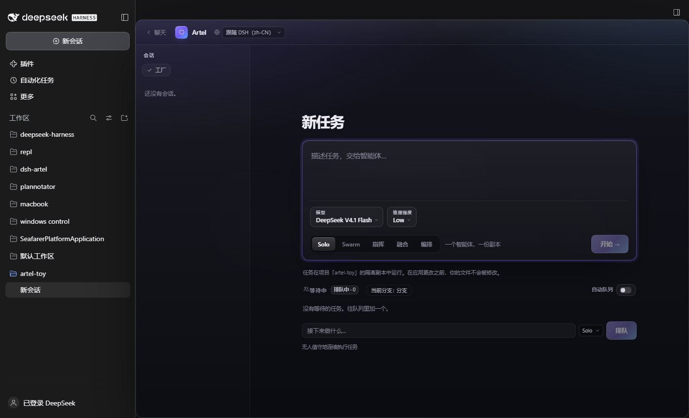
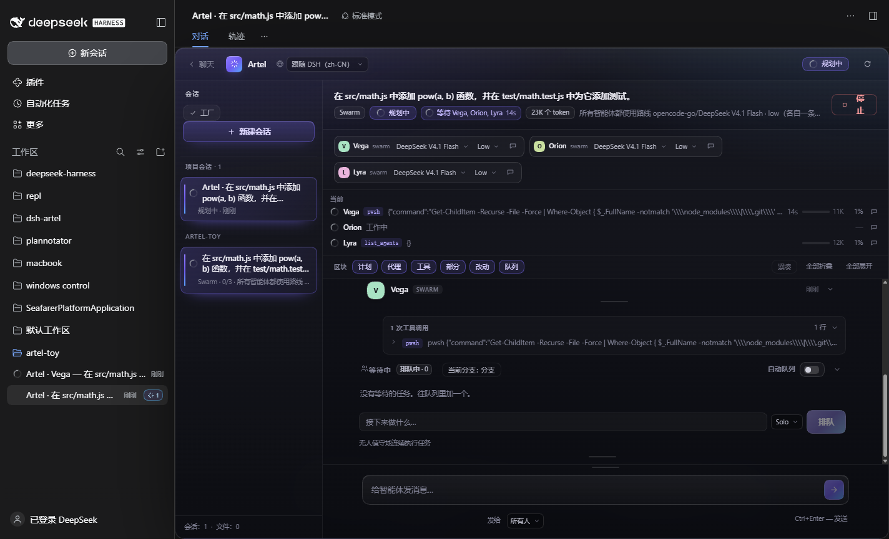
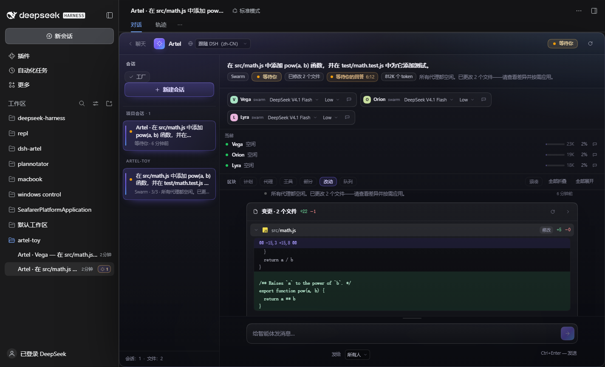

# Artel

[English](guide.md) · [Русский](guide.ru.md) · [中文](guide.zh.md)

Artel 在项目的隔离副本中执行一项开发任务，而该项目就是当前聊天会话的工作目录：它实时展示工作
过程，并且只在你要求时把结果写入你的项目。

Artel 直接从聊天中打开。**Artel** 芯片（紫色底上的标记和名称）位于输入框的工具行中，「+」的旁边；
窄行中只保留标记。它会在当前聊天区域上覆盖一层面板（浮层），聊天仍保留在下面。面板显示打开它的
那个会话的运行：在这里发起的运行会获得自己的任务聊天，运行页面就在其中（见**任务聊天与项目聊天**）。
会话的工作目录就是项目。



## 打开 Artel

1. 打开一个工作目录中包含项目的聊天。
2. 点击聊天输入框下方工具行中的 **Artel** 芯片（在 **+** 旁边）。当该会话中有运行正在进行时，
   芯片角落会显示一个琥珀色圆点。
3. 面板会覆盖聊天区域。返回聊天：点击面板标题栏中的 **聊天**，或按 Esc。关闭面板不会停止
   运行：智能体会继续工作，下次打开面板时会回到上次选择的运行。

面板标题栏包含：**聊天**（回退箭头加文字）、标题 **Artel**、所选运行的状态，以及 **刷新**（重新读取运行列表和
当前打开的运行；面板打开期间动态会自动更新）。

左侧是 **会话** 栏：当前会话的所有 Artel 运行，按项目分组。每一行显示状态点、任务和简短的
`Solo · 1/3 · 阶段` 行——模式、已结束回合的智能体数占总数的比例，以及当前阶段（最后一条状态或
计划消息）。活动运行会高亮，点击一行即可打开它的页面。**新建会话** 从运行页返回表单，栏底部
显示 `会话：N` 和 `文件：M` 计数。还没有会话时，栏中显示「还没有会话。」；表单打开时
不显示创建按钮。

## 新任务

表单占据面板右侧。标题很短——「新任务」；模型和推理强度选择器打开带提供商分组、当前值勾选标记和完整键盘操作的菜单，卡片下方
的提示会写出运行所在的项目，并说明它在隔离副本中工作。

1. 在「描述任务，交给智能体…」中描述任务：要得到什么结果、它在项目中的位置。不需要提前准备
   文件——智能体会自己查找并读取。
2. 选择模式：**Solo**（「一个智能体，一份副本」）、**Swarm**（「三个智能体划分文件」）、
   **Conductor**（「三个智能体划分文件，指挥验收成果」）、**Fusion**（「三个模型独立回答，
   评审汇总答案，一个模型执行」）或 **Orchestrator**（「规划者把大目标拆成部分，每部分有自己的
   副本和检查者」）。
3. 点击 **开始 →**（或 Ctrl+Enter）。请求发出期间，按钮显示「启动中…」。

表单下方是提示：「任务在项目「<项目>」的隔离副本中运行。在应用更改之前，你的文件不会被修改。」如果运行
没能启动，按钮下方会出现标题为「无法启动 Artel」的横幅，并附上错误文本。

## 模型与推理强度

新建表单同时选择路由。**模型** 按配置文件声明的提供方分组列出可用模型；**推理强度** 列出该模型
自报的推理强度，**适配器默认** 表示交给适配器决定。Artel 让本次运行的所有智能体都用这条路由。未选择时，
智能体使用配置文件的默认模型。

运行页面标题下方是路由栏：每个智能体都有自己的 **模型** 和 **推理强度** 选择，因此同一个成员可以
用便宜的模型规划、用更强的模型改代码。改动某一行只把该智能体切换到新路由，且从下一步生效——
已经在跑的那一步仍用原路由。运行被应用或丢弃后，路由栏只读。如果 Host 找不到智能体，该行保持
默认模型，动态里出现警告，运行不会失败。每行末尾的聊天按钮会打开该智能体的对话。

在 **Fusion** 模式下，表单把单条路由换成五个位置——**模型组 1**、**模型组 2**、**模型组 3**、
**评审** 和 **执行者**，每个都有自己的模型和推理强度选择（所选模型提供推理强度时才出现推理强度列表）。
如果配置文件声明了多个模型，模型组默认占用不同的目录行；评审和执行者使用配置文件的默认模型。
只要运行还在进行且该智能体尚未开始自己的回合，这五条路由都可以在运行页面上修改。

## 启动

接下来 Artel 会：

1. 把项目复制到项目之外的独立目录（在 Orchestrator 模式下，副本稍后创建，每个部分一份，由规划者
   拆分目标之后进行）；
2. 启动一个智能体（Solo）、三个（Swarm）、一位指挥及其成员（Conductor）、五个 Fusion 智能体
   ——三个模型组模型、评审和执行者——或，在 Orchestrator 模式下先启动规划者，然后每个部分各启动
   一个执行部分任务的智能体和一名检查者，工作目录就是各自的副本；
3. 把任务和几条规则交给它们：只在副本中修改、绝不触碰真实项目、运行适当的检查，并在结束时说明
   做了什么。

每次运行只创建一份副本，所有智能体都在其中工作。项目本身不会改变。在 Orchestrator 模式下，
每个部分有自己的副本，只有通过验收的部分才会被汇总到同一份副本中。

智能体在无人值守的情况下工作：Artel 会给它们 `never` 审批策略，并继承父聊天会话的沙箱
（sandbox）模式。该沙箱中不可用的工具会向智能体返回拒绝，而不是让运行一直等待审批。

## 任务聊天与项目聊天

点击 **开始** 不会占用你打开面板时所在的聊天。Artel 会为任务新建一个标题为 **Artel · <任务>** 的
聊天，运行页面在其中打开：这次运行在侧边栏有了自己的位置，该聊天中的会话栏列出这次运行，而你最初
的聊天保持原样——没有运行、没有面板，可以继续做别的事。任务聊天被有意设为只读：智能体只在隔离副本
中写入，聊天用于跟进运行、阅读动态和应用结果。它的标题在侧边栏中立即可见，即使还没有第一条消息。

这次运行的每个智能体也会在同一项目分组中拥有自己的聊天——Solo 的智能体、Swarm 团队、指挥及其
成员、Fusion 的智能体，以及 Orchestrator 的规划者、各个部分、检查者和汇总者——尽管它们都在运行的
副本中工作。因此侧边栏中只保留一个项目分组，包含这次运行的所有对话，而不会把副本文件夹显示成单独的
项目。分组保存在 Host 工作区中，Artel 会在 DSH 下次启动时重新归档这些聊天，所以重启后仍会保留。
旧运行不会迁移：本次更新之前的运行，其聊天仍留在原处。

可以在运行页面打开智能体的聊天：路由栏和 **当前** 条都会在每个智能体旁边放一个聊天按钮
（提示为「打开智能体会话」）。

## Solo

一个智能体从头到尾负责这项任务。它的消息、工具调用和修改会立即出现在动态中。你随时可以给它发
消息——消息会加入对话，不会打断工作。

## Swarm

三个智能体在同一份副本中工作，并能看到彼此的修改：每个智能体都会读取邻居已经改过的文件并据此
调整。它们还会互相通信：整个团队位于同一棵对话树中，因此
`send_message({ agent: "<name>", message: "..." })` 会作为真实回合送达邻居，`list_agents()`
会列出整个团队。它们的往来会以独立行出现在动态中：发送者名字、箭头和消息文本。

**第一个回合是规划。** 智能体不得修改任何内容。它们阅读项目，商定谁负责哪些文件（边界不清晰时
直接发消息给邻居），并用一行文字结束回合：

```
OWNERSHIP: src/app/settings/**
```

Artel 收集声明，把有争议的区域留给第一个声明者，并以 **计划** 卡片在动态中展示分工。如果两个
智能体声明了相同文件，动态会写出两者以及获胜者。

**然后是并行工作。** Artel 把各自的区域发给他们，并同时启动。每个智能体读取邻居已经改过的文件
并据此调整；如果需要修改区域之外的内容，智能体会发消息给负责人，而不是直接改别人的文件，并在
最终报告中说明。空闲智能体收到消息后会被唤醒进入新回合；Artel 会在宣布运行等待之前稍作停顿，
以免两个智能体之间的短促往来被误认为工作已结束。

运行进行期间，Artel 会监视修改。当第二个智能体改动另一个智能体已经改过的文件时，动态中会出现
**编辑冲突** 行，包含两个名字和路径。归属只是声明，并不强制：重叠可见，但修改不会被阻止。

没有声明任何区域的智能体会分到无人认领的文件，并在计划中标注「nobody claimed it」，以免闲置；
如果没有无人认领的文件，它就成为共享副本的检查者，并在报告中说明。

如果规划回合中没有人声明区域，Artel 会再问一次。如果第二次仍然为空，Artel 会把项目的顶层目录
分给各智能体，以免运行停滞，并在动态中说明。

## Conductor（指挥）

指挥带领团队并对结果负责。它是在 Swarm 团队之上再多一个智能体：一位指挥加上配置的成员数
（`swarmAgentCount`，默认三个）、同一份副本、同一棵对话树。一次运行分为五幕。

**1. 任务交给团队。** 成员和指挥在副本中启动并阅读项目。每位成员提出自己负责的一小块区域，
指挥在规划回合结束时给出决定。这一步没有任何修改，动态以 **计划** 卡片显示提议：由指挥决定分工。

**2. 分工已分配。** 指挥确认分工或重新分配——它的话就是最终决定，争论不会绕圈子。Artel 把各自的
区域发给成员，并在动态中显示最终分工图：**分工已分配，暂未修改**。工作从这里开始。

**3. 文件并行修改。** 成员修改各自的文件，指挥在旁监督。卡住的成员向指挥提问，无需等你就能得到
回答。如果某个成员失败或停止，指挥会把它的份额转给仍在工作的成员，动态会写出双方。**文件并行
修改，你的项目保持不变。**

**4. 份额 B 需要返工。** 当所有成员空闲后，指挥读取修改过的文件、运行项目检查，并把副本与任务
对照。它回答 **接受** 或 **返工**：返工把指定的份额连同意见退回，其余暂时接受——**份额 B 需要
返工，份额 A 和 C 已被接受**。返工最多两轮；第三次请求会变成带意见的接受，运行连同意见一起
交给你。

**5. 检查已通过——决定权在你。** 被接受的运行进入 **等待你**，与其他模式一样。**变更** 卡片显示
整份副本的合并差异，面板说明检查已运行且指挥接受了结果。但此时还没有任何内容进入你的项目：
**应用** 仍然是唯一写入项目的按钮。**检查已通过，决定权在你。**

Conductor 需要 DSH 配置中的 subagent 栈：没有它，运行会被拒绝（「Conductor mode needs the
subagent stack in this profile.」）——不存在退回独立会话的方案。当指挥正在决定分工、检查副本或
转交份额时，Artel 会拒绝消息并让你等待下一阶段；进入下一阶段后又能发消息。

## Fusion（融合）

Fusion 用于工作开始前的问题：*该采用哪种方案，以及怎样做更好*。三个模型独立回答同一个任务，
评审把答案汇总成一个决定，再由一个模型执行。运行分为三幕；前两幕不做任何修改。

**1. 三个回答，互不偷看。** 任务在同一时刻交给三个模型组模型。每个模型在自己的对话中回答——
模型之间看不到彼此的答案，也不能互相发消息——每个都被要求给出建议：方案、取舍、风险以及如何
验证。模型组在 `read-only` 沙箱中运行，因此模型组模型在物理上无法修改文件：这是关于*如何*做
工作的讨论。没有任何修改，你的项目保持原样。

**2. 评审汇总。** 三个回答都到齐后，一个单独的评审模型读取它们并构建一个共同决定：答案在哪里
一致、在哪里分歧、只有某一个注意到了什么，以及汇总后的计划。没有赢家——每个答案中的有力部分
都会被采用。汇总后的决定以 **计划** 卡片出现在动态中，状态行会显示评审发现的争议点数量。如果
某个模型组模型停止，评审只汇总已到达的答案；如果评审本身停止或回答为空，Artel 会再问一次，
然后才会让运行失败。

**3. 一个模型执行。** 执行者完整收到汇总后的决定和常规工作规则，并修改副本：先阅读项目，做
最小的连贯修改，并运行项目自己的检查。从这里开始，运行的行为与 Solo 相同——执行者的回复出现在
动态中，你可以给它发消息，当它空闲时运行停止。

**决定权在你。** 当执行者空闲时，运行与其他模式一样进入 **等待你**。**变更** 卡片显示副本的
差异，只有 **应用** 才会把它写入你的项目。执行者失败时，运行会带着已经写好的内容保持等待。

模型组和评审只在各自阶段活动时接受你的消息；在汇总期间运行仍处于 **规划中**，适用「等待下一
阶段」的规则。Fusion 不需要 subagent 栈：五个智能体都是普通会话，每个都是右侧列表中的独立聊天，
标题为 `Artel · Fusion · <角色> — <任务>`。

## Orchestrator（编排）

Orchestrator 用于一个智能体难以完成的大目标：这是一个方向，而不是十分钟的任务。规划者把目标拆成
相互独立的部分，每个部分在自己的项目副本中进行，并由检查者对照计划中的完成条件验收；只有通过
验收的部分才会被汇总到一份副本中，你用一个按钮应用结果。拆分在任何修改开始之前就已可见。

**1. 规划者拆分目标。** 运行从一位智能体——规划者开始，它以只读方式阅读真实的项目。它会给出一个
简短的计划：一段摘要和 `orchestratorParts` 个部分（默认三个，最多四个），每个部分都有标题、目标、
「完成条件」以及预计会涉及的文件。拆分以 **计划** 卡片出现在动态中，因此任何修改之前你就能看到
各个部分。如果规划者没有给出可读的计划，Artel 会再问一次，然后让运行失败——此时还没有任何修改。

**2. 每个部分一份副本、两个智能体。** 对每个部分，Artel 创建一份独立的项目副本，并在其中启动两个
智能体：执行部分任务的智能体负责工作，检查者——只读——阅读该部分的修改并对照写明的条件验收。当
执行部分任务的智能体完成后，检查者要么接受该部分，要么把它退回返工并列出问题。被退回的部分连同
这些问题一起交回给它的智能体；最多退回两次，之后该部分会带着检查者的意见被接受。各部分的智能体
并行工作、各自在独立副本中，因此不会互相覆盖；规划者和检查者不做任何修改。

**3. 汇总。** 当所有部分通过验收后，Artel 把已接受的修改写入一份汇总副本。只有一个部分修改过的
文件按原样写入；多个部分修改过的文件是冲突，交给一个合并智能体在原位置解决。随后 Artel 会检查
每个冲突文件确实与原文件不同，然后才把工作交给你。无法完成的汇总会让运行失败并记录合并状态：
汇总副本仍可查看差异，但在你丢弃运行之前 **应用** 会被拒绝。

**决定权在你。** 汇总完成后，运行进入 **等待你**：**变更** 卡片显示汇总副本的差异，只有
**应用** 才会把它写入你的项目。运行页面上的 **部分** 卡片列出各个部分及其状态（进行中、检查中、
返工、已接受）和计划中的完成条件，因此你能看到检查了什么、检查者要求了什么。各部分一旦汇总完成，
其副本会被删除。

Orchestrator 不需要 subagent 栈：每个智能体都是普通会话，并按所属部分命名——规划者为
`Artel · Orchestrator · <智能体> — <任务>`，执行部分任务的智能体为
`Artel · Part N — <标题> · <智能体> — <任务>`，其检查者为
`Artel · Review · Part N — <标题> · <智能体> — <任务>`，合并智能体为
`Artel · Merge · <智能体> — <任务>`。规划者拆分目标期间运行为 **规划中**，消息会被拒绝；之后适用
常规的发消息规则。

## 自动队列

每个聊天会话都有自己的队列，面板中的「等待中」列就是它。在「接下来做什么…」里写下一个任务并按
**排队**：任务会加入队列而不是立即开始，并且可以为它单独选择模式（Solo、Swarm、Conductor、
Orchestrator 或 Fusion）和模型。Orchestrator 也是普通的队列模式：它的计划会自动批准，因为夜里没有人来
批准。队列属于会话，另一个聊天有自己的队列；队列运行期间在聊天里发消息不会打断智能体——它会成为第一个任务。

打开 **自动队列**，任务就会一个接一个无人值守地执行。关掉开关时，任务只是留在「等待中」列。第一个
任务开始前，「启动前」会显示检查命令、任务上限以及之前未保存的版本——每个版本由你决定保存为版本
还是搁置。检查命令由 Artel 根据项目清单推测（**根据项目推测**），也可以手动替换或关闭（**不做
检查**）；没有可用命令时，版本按智能体的说法保存并标记为如此。上限（「每次运行最多 N 个任务」，
默认二十）限制一夜执行多少个任务。

自动队列任务按夜班规则执行，智能体在每个回合都会收到这些规则：每个任务都换新的执行者，没有人会
回答，因此它采用最小合理的假设并写下来，而不是提问。任务的第一个问题会替它回答——「自己决定并
写下假设」；第二个问题会让任务进入「已搁置」。智能体绝不向外发送任何东西（不 push、不创建拉取
请求、不发布、不部署、不评论跟踪器、不向机器外发消息），不启动预览、不启动长期运行的 dev server，
留在自己的副本中，运行项目检查，并以简短总结结束：改了什么、检查了什么、做了哪些假设。

任务完成后必须通过检查，才会成为当前分支上的一次提交。检查失败会作为修复回合回到同一个执行者，
最多两次；之后任务要么通过并提交，要么被搁置。队列的历史保存在它自己的 git 仓库里（`stateDir/repos/`），
因此项目的 `.git` 不会被触碰，没有 git 的项目也同样工作（但机器上仍需 git `2.30.0` 或更新，工厂也一样）；下一个任务从分支末端开始，每个任务的改动
都是自己的一个小提交，而不是整晚的结果。队列头部显示当前分支，**所有分支** 打开分支窗口——分支图、
带差异的提交列表以及应用和合并对话框。**应用分支** 一次应用整个分支；取消勾选某个提交会在当前已应用
状态上重建其余提交，项目中未提交的改动会变成显式的 drift 提交，分支像 git 一样合并（`--no-ff`，
文本冲突由修复智能体解决）。如果项目本身位于 git 工作区，**导出到 git** 会把分支导入该项目仓库的
`refs/heads/artel/<id>`：只写入引用和对象，工作树和 `HEAD` 保持不变，无法快进（non-fast-forward）的
更新会被拒绝而不是强制覆盖。**撤销应用** 用一个包含反向修改的新提交撤销最后一次应用的分支——历史只增
不减；项目有未提交改动、或最后应用已不是最近一次时不会执行。同一个窗口还会显示队列仓库大小和
**清理** 按钮（执行完整 `git gc` 并显示释放的字节），**基于此结果继续** 则从已应用状态新建分支。队列
有多个分支时，添加行可以为任务选择分支。

「已搁置」收集无法无人值守完成的任务：两次修复后检查仍失败、差异里有密钥或垃圾文件、智能体试图
向外发送，或智能体报告自己受阻。被搁置的任务带有 `vf/parked-…` 标签，保留自己的部分副本，可以
重新入队从它继续；其余任务照常继续。订阅额度只会暂停队列，重置后继续；登录失效会结束队列。

**停止** 会中断智能体并搁置部分工作，**做完当前任务后结束** 会让当前任务通过检查后停止，关闭
**自动队列** 开关则不再接新任务。队列在以下情况自行结束：队列为空、达到任务上限、连续三个任务
被搁置、登录失效，或磁盘空间不足。之后 **自动队列结果** 卡片会列出任务提交及其检查、被搁置的
任务及原因、以及没有执行的任务。卡片可以折叠到「自动队列结果」标题；一轮夜班结束时它会自动滚动到
可见位置，运行列本身也会滚动，所以面板再矮也不会把卡片藏到输入框下面。

## 工厂

**工厂** 把一个项目变成工单流水线：一个看板保存一个项目的工单，智能体把每张工单从 **收件箱**
推进到 **待 PR**，不需要你参与；只有你打开拉取请求或合并结果后才进入 **完成**。用 **打开「工厂」**
打开它，用 **创建看板** 为项目创建看板，再用 **启用** 打开——只有 **检查就绪** 显示「已就绪」后才能
启用。**暂停** 会停止接新工单，已开始的会做完，**继续** 恢复看板。

就绪有四项阻塞条件：已安装 git `2.30.0` 或更新、项目是 git 仓库、至少有一个提交（工厂以它为差异基准）、
至少有一个引擎已登录。git 程序与仓库分成两行，因此没有 git 时会显示安装链接，而不是建议执行 `git init`。
测试命令（或根据项目推测的命令）、预览命令和 Playwright 会在列表中显示，但不阻塞。如果
没有配置测试命令，会先使用看板的检查命令，再使用根据项目推测的命令；没有可用命令时测试阶段
会跳过并留下说明。

看板有七列——**收件箱**、**分诊**、**执行**、**检查**、**待 PR**、**等你处理**、**完成**——而它们
背后的流水线有九个阶段：incoming、triage、working、tests、check、review、ready、waiting 和 done。
**检查** 汇总了测试、应用检查和评审三个阶段。

**收件箱。** 用 **标题**、**描述** 和 **文件与截图**（**附加**）创建工单，按 **添加工单** 加入；
或用 **来自 GitHub issue** 导入：`#12`（看板项目所在的仓库）、`owner/repo#12` 或 issue 链接，
由已安装并登录的 `gh` 读取，且绝不重复导入。导入失败会说明原因：`gh` 未安装或未登录、仓库或
issue 不存在。看板添加了跟踪器（GitHub、GitLab、Jira、Linear）时每五分钟轮询一次，并可选地把结果
评论回去；**立即轮询跟踪器** 会马上检查。

**分诊。** 一个只读智能体阅读项目和工单，给出规格、验收标准、假设和路线。它会提出允许的路线
（Solo、Swarm、Fusion、Orchestrator）中最便宜且足够的路线；工厂只能把这条路线改便宜，不能升级。
问题会进入 **等你处理**：按 **回答** 后工单回到分诊。之后规格、标准和路线会显示在工单上。

**执行。** 工单按自己的路线启动普通 Artel 运行，并遵循与自动队列任务相同的夜班规则：第一个问题
替它回答，第二个问题把工单送进 **等你处理**。Orchestrator 路线在计划后停下，等待 **批准计划**。

**测试** 运行看板的测试命令，失败时带着输出回到执行。**应用检查** 启动预览并在只读副本中查看
结果——只对 UI 工单、只在模板要求且配置了预览命令和 Playwright 时运行。**评审** 由一到两位评审者
把工单的差异与验收标准对照。测试、应用检查或评审失败都会带着发现回到 **执行** 进行修复轮次，直到
模板上限；轮次用尽后工单会等你处理。通过评审的工单进入 **待 PR**。

模板：**常规**——测试、应用检查和评审，最多两轮修复；**快速**——不做应用检查、一轮修复，适合小
工单；**严格**——两位评审者、最多三轮修复。**等你处理** 收集分诊问题、等待批准的
计划、用尽的修复轮次、被中断的工作、没有可做内容的运行，以及被你 **搁置** 的工单；**再来一轮**
和 **按现状接受** 决定用尽轮次工单的去向，**交回工厂** 会把修改过的工单重新送进分诊。看板和每张
工单都有日志。

**待 PR** 中工单有三个操作。**Pull Request** 要求工作树干净且有远程仓库：创建分支
`factory/ticket-<number>`，把工单的运行应用到真实项目，提交、推送并调用 `gh pr create`，用规格、
标准、检查、假设和评审意见生成正文；如果看板要求，会把链接评论回跟踪器。**合并** 把工单累积的
差异应用到项目，不创建分支也不推送。**带评论交回** 把工单送回执行，你的评论成为一轮修复。
**打开会话** 接入工单会话以便人工接管。工厂自己绝不向外发送任何
东西：push、拉取请求和评论只在你按下按钮时发生。

看板设置：各角色模型（**分诊**、**执行**、**测试**、**评审**）、**允许的路线**、**开销上限**
（**同时处理工单**、**每日工单**、**每单执行者**、**允许「API」引擎**、**允许接近用尽的订阅**）、
**命令**（**测试命令**、**检查命令**、**预览命令**）、「改动未涉及测试时补写测试」以及 **工单来源**
（跟踪器及其类型、标签、项目/链接和评论开关）。

## 运行页面

所选运行的页面在右侧打开：顶部是任务、模式标签（**Solo**、**Swarm**、**Conductor**、**Fusion** 或
**Orchestrator**）、状态、已修改文件数标签（有文件后出现）以及阶段行——与栏中相同的简短阶段说明。

运行状态：**准备中**、**规划中**、**进行中**、**等待你**、**已完成**、**已停止**、**失败**、
**已应用**、**已丢弃**。

运行进行中或等待时，标题栏还会说明它在等什么——「等待你的回答」「等待计划确认」「等待 Nova」
「智能体正在工作」「正在汇总结果」——以及已经等了多久；旁边的标签汇总整个运行消耗的 token
（悬停可见输入、输出和缓存）。标题栏下方的 **当前** 条列出每个智能体：状态点、最后一步——
正在执行的工具调用（`write src/app.js`）或「正在写回复」——当前轮次的耗时，以及上下文窗口的
占用（token 数与百分比，悬停可见构成：系统、工具、消息）。行末的聊天按钮会打开该智能体的对话。这些都是宿主已经发送的运行摘要，
不需要额外请求。



运行进行期间，标题栏中有 **停止** 按钮。它会请求确认：「停止这次 Artel 运行？」并给出
**停止运行** 和 **继续**（请求发出期间显示「停止中…」）。停止后的运行变为 **已停止**；副本和
差异仍然可用，给智能体发消息可以让它重新工作。

### 动态

- 完整的智能体回复：带首字母的头像、名字、角色和时间；文本按 markdown 渲染。
- 工具调用被归入紧凑的行：工具名和文件路径或命令。有内容可展示的行——智能体传入的参数和工具
  返回的输出（或错误）——是一个按钮：展开后同时显示两者，箭头随之向下旋转；**全部收起** 会关闭
  所有已展开的行。只重复名称的行（如 `read README.md`）保持普通样式。
- 带时间戳的状态行，以及展示分工的 **计划** 卡片。在 Conductor 模式下，**计划** 卡片还会显示指挥
  的决定：已分配的份额、返工轮次和验收结果。在 Fusion 模式下，它显示评审的汇总决定和争议点
  数量。在 Orchestrator 模式下，它显示规划者的拆分和完成条件、检查者对每个部分的结论以及汇总
  卡片；差异上方的 **部分** 卡片列出各个部分及其状态。
- 你的消息：标有「你 → 所有人」或「你 → <智能体>」的气泡。
- 智能体之间的往来：发送者名字、箭头和消息文本。
- 两个智能体碰到同一路径时出现 **编辑冲突**；智能体回合失败时出现 **错误**。两者在已知时都会
  在下方给出路径。

动态为空时显示「智能体正在准备——消息会出现在这里。」；加载期间显示「正在加载动态…」。

### 块：收起、隐藏与调整大小

运行页面由一列块组成：**计划** 卡片、智能体回复、分组的工具调用、**部分** 卡片、**变更** 卡片和
**队列** 条。每个块的标题栏都是按钮：点击可把块收成一行并显示简短计数——「计划 · 24 行」、
「Vega · 6 行」、「工具：4」——再次点击即可展开。动态上方的 **块** 工具栏让整页都在掌控之中：

- 标签可隐藏或恢复某一类块——**计划**、**智能体**、**工具**、**部分**、**变更**、**队列**；
- **紧凑** 一次性收起所有块，**全部收起** / **全部展开** 一次点击即可收起或展开整页；
- 收起状态、隐藏的类别和紧凑模式按聊天会话保存在浏览器中（`localStorage`，键
  `dsh-artel:blocks:<会话 id>`），刷新页面后仍保持你离开时的样子。

长块会被限制在舒适的高度（默认：计划和回复 40vh，变更卡片 36vh，队列条 32vh），在框内滚动，并
提供 **显示全部** / **收起**；拖动块底边的把手可调整其高度，输入框上方的把手也可调整输入框的高度。
动态、部分卡片、变更卡片和队列条共用同一个滚动区域，因此输入框永远不会遮住它们，也不会有任何
东西盖在动态上（issue #8）。

### 给智能体发消息

底部的输入框是「给智能体发消息…」，按钮为 **发送**。页脚有 **发给**：默认 **所有人**，也可以
选择具体智能体。旁边提示「Ctrl+Enter — 发送」。消息会以「你 → …」出现在动态中，并在副本尚未
应用或丢弃之前，让等待或已停止的运行重新工作。在 Conductor 模式下，当指挥正在决定分工、检查副本
或转交份额时，消息会被拒绝；进入下一阶段后又能发消息。在 Fusion 模式下，只能给当前活动阶段的
智能体发消息：模型组回答时发给模型组，评审汇总时发给评审，工作开始后发给执行者。在 Orchestrator
模式下，规划者拆分目标期间消息会被拒绝（「Wait until the planner splits the goal into parts」），
已停止的汇总尚未完成时也会被拒绝（「The merge was stopped. Discard the run and plan it again.」）；
其余时间按常规规则发消息。

## 更改：应用或丢弃

当智能体空闲下来，Artel 会停止、计算与你的项目之间的差异，并把运行转为 **等待你**。页面底部的
**变更** 卡片列出与你的项目不同的文件：标题「变更 · N 个文件」和总计 `+N/−M`。每行有状态——
**新增**、**修改**、**删除** 或 **二进制**——以及自己的 `+N/−M`。点击文件可展开差异
（**显示差异**），再次点击则收起（**隐藏差异**）。二进制文件无法展开。卡片标题栏中有
**刷新更改** 和折叠开关（**显示更改** / **隐藏更改**）；折叠状态与其他块一样按会话记住，卡片底边也
可以拖动，给文件列表更多空间（见 **块：收起、隐藏与调整大小**）。



- **应用** 会先请求确认：「应用这些更改？」和「更改将写入 <项目>。隔离副本将被删除。」，按钮为
  **应用** 和 **取消**。它会写入卡片中的所有文件；没有逐文件选择。
- **丢弃** 会询问「丢弃这些更改？」和「隔离副本将被删除，<项目> 保持不变。」，按钮为
  **丢弃** 和 **取消**。

做出决定后，按钮处会出现标记：**已应用** 并附「更改已写入 <项目>。」，或 **已丢弃** 并附
「副本已删除；项目未更改。」。如果部分文件未能写入，卡片会加上「已跳过：N」。

写入之前，Artel 会重新读取你的项目。对每个文件，它会检查该文件是否仍与运行开始时一致：

- 如果一致，文件被应用。
- 如果你在运行期间改过它，Artel 会拒绝：「Nothing was applied. <文件>: changed in your project
  during the run」——并且不写入任何内容，让你重新决定。
- 运行期间在项目中新出现的文件同样会被拒绝。

在 Orchestrator 模式下，**应用** 还有一个条件：各部分必须先汇总完成。如果你在汇总中途停止了运行，
或合并智能体无法解决多个部分都修改过的文件，**应用** 会被拒绝，卡片会说明合并尚未完成——汇总
副本仍可查看，但唯一的出路是 **丢弃** 后重新运行。

应用是最终操作：运行变为 **已应用**，它的更改进入项目，隔离副本会立即删除。差异仍保留在运行的
动态中，之后仍可查看改了什么。

### 安装到 DSH

已应用的项目可能是 DSH 本身需要接入的内容。此时卡片会在 **已应用** 下保留 **安装** 区块，其中不会
自动发生任何事：

- **安装到 DSH** — 项目是 DSH 插件包（`package.json` 声明了 `dsh.bundle.patch`，或根目录有
  `cordis.patch.yml`）。按钮会把项目文件夹以本地 `link:` 依赖加入当前 DSH 配置。卡片随后显示
  「已安装 — 重启 DSH 以加载插件包。」没有插件管理器的配置会显示手动方式：把文件夹添加为插件
  （DSH → 插件 → 添加插件），见项目 README。
- **安装步骤** — 项目在 `artel.install.json` 中声明的命令
  （`{"steps": [{"title": "安装运行时", "command": "python install/install.py"}]}`，最多八条），
  或项目自带的常规安装脚本（`install/install.py`、`scripts/install.mjs` 等）。每一步显示完整命令；
  点 **运行** 会先确认，然后只运行这一条命令，工作目录是项目文件夹，限时五分钟。卡片显示退出码、
  超时说明和捕获的输出（**显示输出**）。

刷新卡片后步骤结果会保留：命令未变的步骤保留结果，命令改变的步骤重新变为「未运行」。没有你的点击，
不会安装任何东西、也不会运行任何命令；既没有插件包也没有安装步骤的项目不会显示安装区块。

## 界面语言

面板提供英语、俄语和中文。面板标题栏里的地球按钮——**聊天** 和 **Artel** 标签旁——列出 **English**、
**Русский** 和 **中文**，以及 **跟随 DSH** 模式：该模式跟随 DSH 的界面语言，并在按钮上写明所跟随的
语言（例如「跟随 DSH（中文）」）。选择立即作用于打开的面板，并按 DSH 配置保存在 `stateDir` 下的
`settings.json` 中，因此该配置的所有聊天使用同一种语言。模式名（Solo、Swarm、Conductor、Fusion、
Orchestrator）、状态、文件路径以及智能体写出的内容保持不变。字符串位于 `locale/*.json` 并被编译进
客户端，因此新增语言只需要一个目录文件而不是代码（见 [translating.md](translating.md)）。本指南也
提供同样三种语言：页面顶部的切换可以打开另一种语言的指南。

## 数据位置

- 副本：`<DSH home>/artel/<profile>/copies/<run id>`——在 **应用** 或 **丢弃** 时删除；崩溃后遗留的
  副本会在下次启动时清理。在 Orchestrator 模式下，汇总之前每个部分各有一份副本
  （`<run id>-p1`、`<run id>-p2`、…），汇总完成后只保留汇总副本 `<run id>`。
- 运行索引和动态：`<DSH home>/artel/<profile>/state/runs`——一个 JSON 索引和每次运行一个 JSONL
  文件，大小有上限。
- 自动队列与工厂：`<DSH home>/artel/<profile>/state/queue/<session>.json`（每个聊天一个队列）、
  `.../state/tickets/boards.json`（工单看板）和 `.../state/attachments/<board>/<ticket>/`（工单附件）。
- 智能体对话：你会话存储中的普通 DSH 会话——任务聊天以项目为工作目录（只读），每个智能体一个
  聊天，以其副本为工作目录。它们在侧边栏项目分组中的位置保存在
  `<DSH home>/storages/workspace.json`（Host 工作区）中，Artel 会在每次启动时重新归档。
- 配置的界面语言：`<DSH home>/artel/<profile>/state/settings.json` —— `null` 跟随 DSH 语言；面板标题栏中的地球按钮会写入它。

`<profile>` 是 Host 运行 Artel 的 DSH 配置：服务端会从启动器的 `profileContext` 读取它，因此即使
启动器没有导出 `DSH_PROFILE`，桌面应用和 `dsh web` 也会使用同一个按配置隔离的目录。较早的版本可能写入
`<DSH home>/artel/default`；下次启动时，如果目标目录尚不存在，该目录会移动到真实的配置名之下——
已有目录永远不会被合并或覆盖。

Artel 每个会话最多保留 `maxRunsPerSession` 次运行：最旧的已结束运行（已应用、已丢弃、已停止、
失败）会连同副本一起从列表中移除。仍在等待你决定的运行不会被移除。

## 常见问题

**「Artel 服务端不可用。请检查插件是否已启用。」**——客户端部分已加载，但服务端不响应：插件被
禁用，或服务端部分加载失败。请启用插件并重新加载页面。

**「Artel 服务端正在重启——请稍后重试」**——服务端正在更新或重启。请稍候，并在横幅中点击
**重试**。

**「This chat session has no project directory yet, so there is nothing to copy」**——会话没有工作
目录，没有可复制的内容。请打开工作空间，或在目录中启动会话。如果项目目录存在但已被删除或移动，
服务端会返回「The project directory does not exist」。

**「Could not copy the project: project is larger than 536870912 bytes; excluded folders or a
smaller project are required」**——项目超过 512 MB 的副本上限。Artel 不会做部分副本：运行会被
拒绝。请用 `excludeGlobs` 排除庞大的目录，或改用更小的项目。单个文件超过 32 MB 不会进入副本。

**「Another run is already in progress in this session」**——每个会话只允许一个活动运行。请完成
或停止它。

**没有更改**——智能体可能没有做任何修改就结束了；卡片会显示「本次运行没有文件更改。」。请查看
动态；如果任务需要推动，就给智能体发消息。

**应用被拒绝**——卡片横幅会列出运行期间在你的项目中发生变化的文件。请丢弃这次运行，等文件空闲
后重新启动：只应用其余文件是不可能的，因为卡片没有逐文件选择。

**运行因重启而中断**——如果插件或服务端重启，活动运行会变为 **已停止**。副本和差异仍然保留：
你可以应用或丢弃它们。
